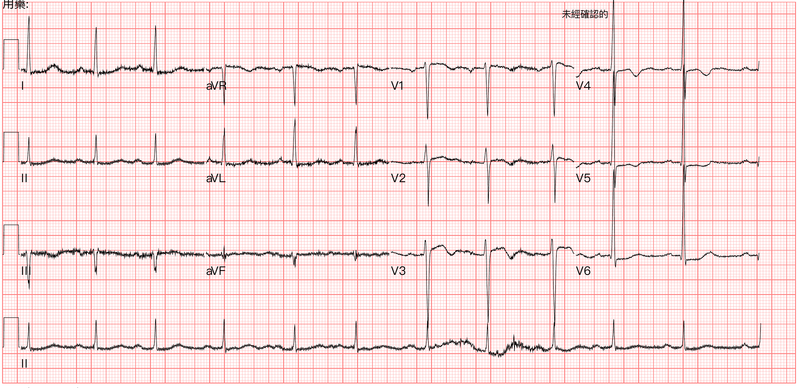
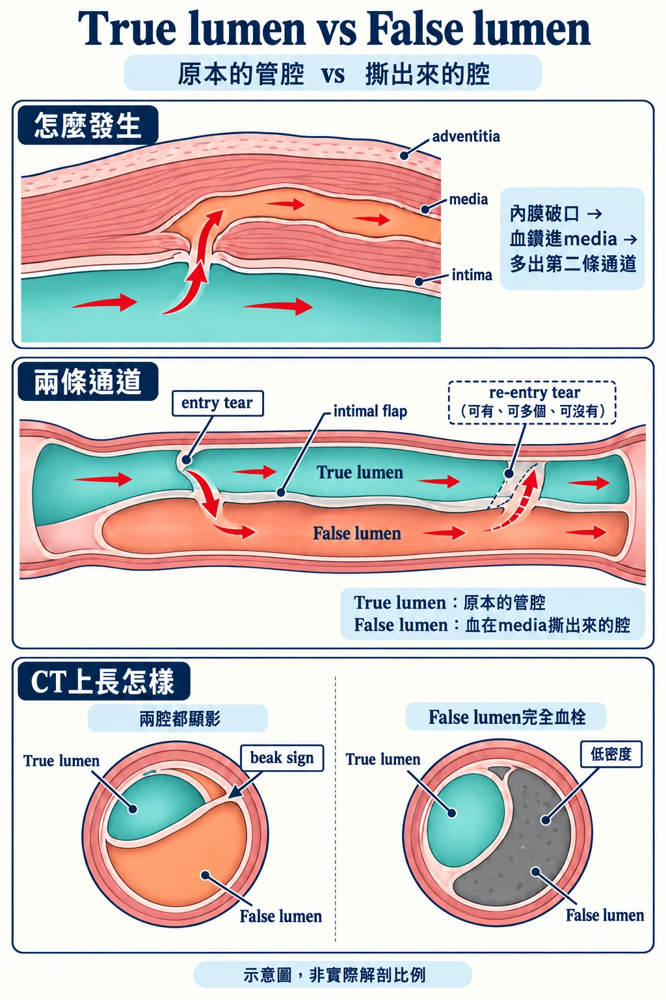
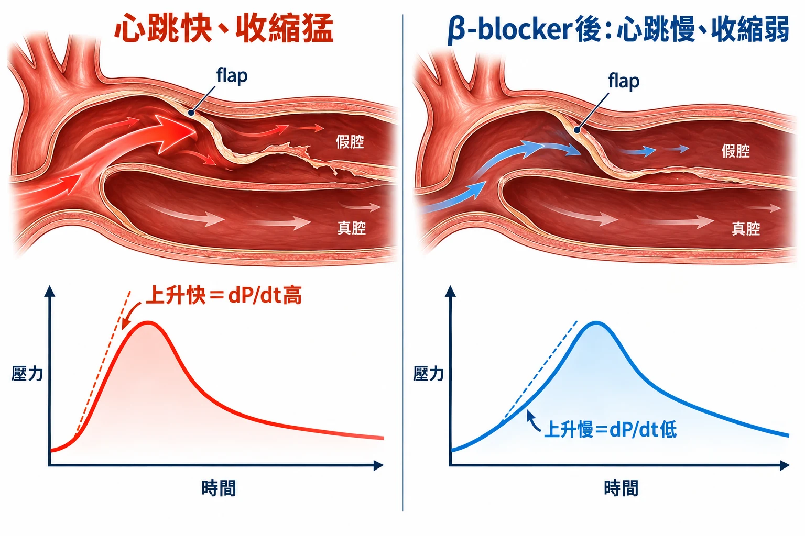
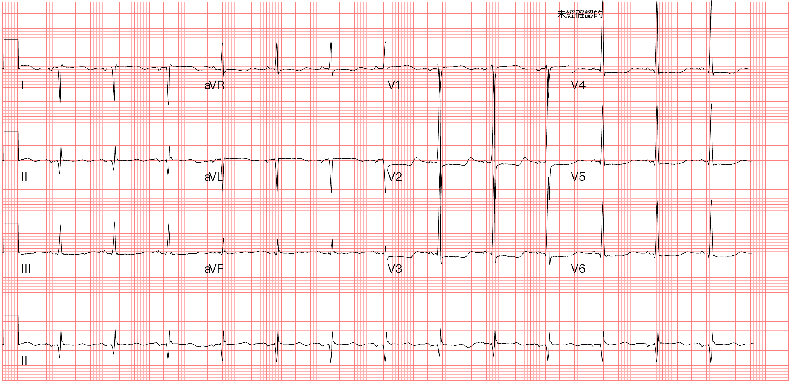



騎車騎到一半，突然腰痛。痛到在床上扭來扭去，連我問的問題都聽不進去。腎臟沒有水腫，床邊echo卻看到pericardial effusion。

上一篇[明明在救ACS，怎麼會是主動脈剝離？](https://agoodbear.com/post/ecg-post-17/)講的是：echo沒有pericardial effusion（PEF），也不能排除Type A aortic dissection。

這篇剛好是另一面：**echo有PEF。**

診斷抓到了，接下來的降心跳、降血壓，遇到PEF要怎麼調整？

這篇想討論這幾個問題：


- **Q1**：痛和找到的東西對不上，要往哪裡想？
- **Q2**：床邊echo看到PEF，代表什麼？
- **Q3**：一定要先把心跳壓到50–60，才能開始降血壓嗎？沒做到會怎樣？
- **Q4**：急診常用的藥有哪些？
- **Q5**：合併PEF的時候，藥還一樣嗎？


## ❤️Case：騎車騎到一半，突然腰痛

48歲男性，有高血壓病史。

騎車騎到一半，突然腰痛，EMT送來急診。

到院的時候，痛到在床上扭動身體。

到院生命徵象：體溫35.9°C，血壓：病患在EMT的擔架床上扭來扭去，不好測，E4V5M6，心跳72，呼吸20，SpO2 99%。

到院ECG：

**心電圖顯示是sinus arrhythmia、1st AVB、LVH by voltage。**

病人實在太不舒服，我問的問題似乎聽不進去。

慢慢問下來，順序是：**先胸悶，接著epigastric pain，再來flank pain，最後雙腳麻。**

<mark>**痛，一路往下走。**</mark>

床邊超音波看腎臟，沒有hydronephrosis。

腎結石可以解釋腰痛和扭來扭去，解釋不了胸悶，也解釋不了雙腳麻。

問完診，我馬上走進診間，交代這位病人要先上IV line。我們家的護理師對於這種醫師主動要求要先上line的都會特別警覺，立刻就圍了一堆護理師。再次感謝大家的團隊合作。

我說：「我要先看echo有沒有pericardial effusion。」

### ❤️Q1：痛和找到的東西對不上，要往哪裡想？

教科書寫的「撕裂痛」，其實沒那麼常見。

<mark style="background-color: pink">病人比較常講的是**突然發作、一開始就最痛的刺痛或銳痛**</mark>，在胸口、背部，有時候在肚子，有時會往外放射[^acc-pain]。大約九成的病人形容痛得很厲害[^braunwald-pain]。

這個病人的痛，從胸口一路走到肚子、腰側，最後雙腳麻。痛的放射和移動，往往反映剝離延伸的路徑[^rosen-migrate]；剝離往遠端走，痛就可能一路往下移到腰側或骨盆[^hurst]。

<mark>**痛會移動，往往代表剝離在延伸。**</mark>

「pain out of proportion」這句話，我們最熟的是mesenteric ischemia：肚子軟軟的，壓下去不怎麼痛，病人卻痛得要命。

Rosen's在主動脈剝離那章寫到，急性Type A或Type B的剝離，也可能出現一樣的表現：肚子軟，痛卻遠超過壓痛的程度[^rosen-mesenteric]。

床邊可以用<mark><strong>ADD-RS（Aortic Dissection Detection Risk Score）</strong></mark>把這種感覺變成分數，看三類：

- **高風險狀況**
  - Marfan等結締組織疾病
  - 主動脈疾病家族史
  - 已知主動脈瓣疾病
  - 最近做過主動脈相關處置
  - 已知胸主動脈瘤
- **高風險疼痛**
  - 胸、背或腹痛，而且是突然發作、劇烈、或撕裂樣（這三種各算一項）
- **高風險理學檢查**
  - pulse deficit或兩手血壓差
  - 合併疼痛的focal neurologic deficit
  - 新出現的AR murmur
  - 低血壓或休克

<mark style="background-color: lightgreen">三類各有一項就算1分，總分0–3分：0分低風險、1分中風險、2–3分高風險</mark>[^acc-addrs]。

這套分數不是一開始就設計好的。<strong><u>2010年ACC/AHA胸主動脈疾病指引</u></strong>先列出12項高風險特徵，分成上面三類；<strong><u>2011年Rogers等人才拿IRAD（國際急性主動脈剝離登錄）</u></strong>裡已經確診的病人，回頭看他們到院時有沒有這些特徵，每一類有就算1分，變成0–3分。2,538位確診急性主動脈剝離的病人，95.7%至少有一項，0分的只有4.3%，作者的結論是：<mark>這是一個敏感度很高的工具</mark>[^rogers]。

它強調的是「不要漏掉」：寧願多抓一些人去做檢查，也不要漏掉任何一個aortic dissection。代價就是specificity低。Rogers收的全是確診病人，沒有沒病的人可以比，只算得出敏感度；後來的統合分析把疑似病人一起算，<mark>ADD-RS≥1的敏感度94.6%，specificity只有34.7%</mark>[^ren]。

確診的人裡，0分的還有這4.3%。這是敏感度漏掉的部分：Rogers算出來敏感度95.7%，漏掉4.3%，跟specificity無關；所以0分還不能排除，要接D-dimer或影像，才走到後面的排除。

這個病人：疼痛那一類拿1分；雙腳麻算focal neurologic deficit，再加1分，**ADD-RS 2分，高風險。**

高風險的病人，不要靠D-dimer排除，直接安排影像；<mark>風險分數2–3分，不建議驗D-dimer</mark>[^braunwald-ddimer]。<mark>和PE的病人一樣，D-dimer只適用在風險不高的病人，用來排除</mark>[^tintinalli-dd][^rosen-dd]。

<mark>D-dimer是給ADD-RS 0–1分、風險不高的人用的</mark>。<strong><u>ADvISED研究</u></strong>收了1,850位疑似急性主動脈症候群的病人，其中924位ADD-RS≤1、D-dimer<500 ng/mL，這924位裡面最後只有3位是急性主動脈症候群（failure rate 0.3%）[^advised]。

整理成一張流程：



<mark>**所以在急診：痛和找到的東西對不上，加上會移動的痛或神經學症狀，ADD-RS算一算，≥2就直接CTA。**</mark>

## ❤️Case個案繼續

探頭先從xiphoid area放上去，立刻看到有液體：pericardial effusion。**有問題了。**

<figure class="ec-video-wide"><video autoplay muted loop playsinline preload="metadata" poster="/videos/ecg-post-22/echo-xiphoid-poster.jpg" aria-label="Video 1｜從xiphoid area往心臟方向掃，看到pericardial effusion"><source src="/videos/ecg-post-22/echo-xiphoid.mp4" type="video/mp4"></video><figcaption>Video 1｜從xiphoid area往心臟方向掃，看到pericardial effusion</figcaption></figure>
<figure><video autoplay muted loop playsinline preload="metadata" poster="/videos/ecg-post-22/echo-a-poster.jpg" aria-label="Video 2｜Parasternal short axis view"><source src="/videos/ecg-post-22/echo-a.mp4" type="video/mp4"></video><figcaption>Video 2｜Parasternal short axis view</figcaption></figure>
<figure><video autoplay muted loop playsinline preload="metadata" poster="/videos/ecg-post-22/echo-b-poster.jpg" aria-label="Video 3｜Parasternal long axis view，這個切面水就沒那麼明顯"><source src="/videos/ecg-post-22/echo-b.mp4" type="video/mp4"></video><figcaption>Video 3｜Parasternal long axis view，這個切面水就沒那麼明顯</figcaption></figure>

沒有cardiac tamponade。

我再往右邊的common carotid artery掃：**很明顯的dissection，flap在震動。**

<figure class="ec-video-wide"><video autoplay muted loop playsinline preload="metadata" poster="/videos/ecg-post-22/cca-short-poster.jpg" aria-label="Video 4｜右側common carotid artery短軸，紅色箭頭指的就是flap"><source src="/videos/ecg-post-22/cca-short.mp4" type="video/mp4"></video><figcaption>Video 4｜右側common carotid artery短軸，紅色箭頭指的就是flap</figcaption></figure>
<figure><video autoplay muted loop playsinline preload="metadata" poster="/videos/ecg-post-22/cca-short-color-poster.jpg" aria-label="Video 5｜短軸加彩色都卜勒"><source src="/videos/ecg-post-22/cca-short-color.mp4" type="video/mp4"></video><figcaption>Video 5｜短軸加彩色都卜勒</figcaption></figure>
<figure><video autoplay muted loop playsinline preload="metadata" poster="/videos/ecg-post-22/cca-long-color-poster.jpg" aria-label="Video 6｜長軸加彩色都卜勒"><source src="/videos/ecg-post-22/cca-long-color.mp4" type="video/mp4"></video><figcaption>Video 6｜長軸加彩色都卜勒</figcaption></figure>

我拿探頭往下用力壓。

vein本來就會被壓扁，artery本來就不容易被壓扁[^ma-compress]，所以internal jugular vein一壓就扁了，這很正常。

可是這條common carotid artery，我用力往下壓，<strong>連一點點扁的跡象都沒有。</strong>裡面有很明顯的血栓，代表false lumen裡面充滿了血栓。

<figure class="ec-video-wide"><video autoplay muted loop playsinline preload="metadata" poster="/videos/ecg-post-22/cca-compression-poster.jpg" aria-label="Video 7｜探頭往下壓：internal jugular vein壓扁，common carotid artery壓不下去"><source src="/videos/ecg-post-22/cca-compression.mp4" type="video/mp4"></video><figcaption>Video 7｜探頭往下壓：internal jugular vein壓扁，common carotid artery壓不下去</figcaption></figure>

CT：Type A aortic dissection合併PEF（另有左側renal infarction）。

<figure class="ec-video-wide"><video autoplay muted loop playsinline preload="metadata" poster="/videos/ecg-post-22/ct-axial-poster.jpg" aria-label="Video 8｜CTA，軸切面，由上往下"><source src="/videos/ecg-post-22/ct-axial.mp4" type="video/mp4"></video><figcaption>Video 8｜CTA，軸切面，由上往下</figcaption></figure>
<figure><video autoplay muted loop playsinline preload="metadata" poster="/videos/ecg-post-22/ct-sagittal-poster.jpg" aria-label="Video 9｜CTA，矢狀切面"><source src="/videos/ecg-post-22/ct-sagittal.mp4" type="video/mp4"></video><figcaption>Video 9｜CTA，矢狀切面</figcaption></figure>
<figure><video autoplay muted loop playsinline preload="metadata" poster="/videos/ecg-post-22/ct-coronal-poster.jpg" aria-label="Video 10｜CTA，冠狀切面"><source src="/videos/ecg-post-22/ct-coronal.mp4" type="video/mp4"></video><figcaption>Video 10｜CTA，冠狀切面</figcaption></figure>
<figure class="ec-video-wide"><video autoplay muted loop playsinline preload="metadata" poster="/videos/ecg-post-22/ct-noncontrast-poster.jpg" aria-label="Video 11｜未顯影CT，軸切面"><source src="/videos/ecg-post-22/ct-noncontrast.mp4" type="video/mp4"></video><figcaption>Video 11｜未顯影CT，軸切面</figcaption></figure>

這裡停一下，講一下這兩個lumen。

true lumen就是原本的管腔。內膜破一個口，血鑽進media，撕出第二條通道，這條就是false lumen，兩條中間隔著的那片就是flap。遠端可能再破一個口讓血流回true lumen，也可能有好幾個，或是沒有。[^hurst-reentry]

CT上最好用的線索是<mark>beak sign</mark>和截面積比較大，這兩個都指向false lumen。[^lepage]大小只是傾向，要多項一起看：

- <strong>指向false lumen：</strong>beak sign、截面積通常較大、血流通常較慢[^braunwald-lumen]；完全血栓時呈低密度
- <strong>指向true lumen：</strong>在主動脈弓，一個腔繞著另一個腔走的時候，被包在裡面的那個是true lumen；哪一腔的外壁有鈣化，或flap上的鈣化靠在哪一腔那一側，那一腔多半是true lumen[^hurst-lumen][^lepage]

false lumen撐大之後會把true lumen壓扁，器官就可能灌流不足。[^braunwald-malperfusion]分支也不一定都接在true lumen上。[^hurst-branch]

那天在急診的用藥和生命徵象如下，時間從到院起算：

<b>Table 1</b>｜急診時間軸

| 時間 | 心跳 | 血壓 | 處置 |
|---|---|---|---|
| 到院 | 72 | 不好測 | 上三條IV，NS 1,000 mL全速；床邊echo看到心臟周圍很多水；抽血、備血、排CTA |
| 14分 | | | ketorolac 30 mg IV |
| 15分 | 76 | 156/63 | morphine 5 mg IV |
| 29分 | | | NTG（0.2 mg/mL）5 mL/hr起，4分鐘後調到6 mL/hr，目標收縮壓100–120；會診CVS |
| 34分 | 69 | 142/65 | CT回來，確診主動脈剝離，安排開刀、住加護病房 |
| 48分 | 82 | 133/62 | CVS：NTG維持10 mL/hr（約33 mcg/min）；NS改100 mL/hr |
| 65分 | | | 還在痛，再看一次echo，心臟周圍仍很多水；tramadol 100 mg IV |
| 70分 | 84 | 116/64 | |
| 95分 | 88 | 143/64 | 送進開刀房 |

整段沒有給β-blocker，心跳一直在69到88之間。

會診CVS，送開刀，術後轉SICU。

那天跟著我的subintern問了兩個問題：


- **問題一**：用IV NTG降血壓（擴張靜脈降preload、擴張動脈降afterload），這樣會不會讓aorta也一起擴張？擔心的是主動脈一撐大，剝離會更惡化。
- **問題二**：為什麼要先把心跳降到50–60，再開始降血壓？


在說這位病人後來怎麼了之前，先把這幾題一題一題拆開。

### ❤️Q2：床邊echo看到PEF，代表什麼？

2024 ESC Guidelines for the management of peripheral arterial and aortic diseases建議：疑似急性主動脈症候群的病人，**<mark style="background-color: pink">急診有條件的話就先做focused TTE，看PEF、wall motion、AR、主動脈直徑</mark>**[^esc-tte]。

Type A剝離可能破進心包膜，血就流進心包膜腔[^rosen-pericardial]。

<mark>急性Type A有8%到31%會發生cardiac tamponade</mark>，是最常見的致死機轉之一；一旦填塞，**住院死亡率是沒有填塞的兩倍（54% vs 25%）。**[^braunwald-tamponade]

看到PEF之後，還要接著看：

- **RA、RV有沒有舒張期塌陷**、IVC是不是脹滿不隨呼吸變化：決定是「有積液」還是「已經填塞」
  - 心包膜壓力一旦短暫高過心腔內壓，右心就會被壓扁：RV在舒張早期塌陷[^braunwald-collapse][^mateer-tamponade]，RA在舒張晚期往內凹[^braunwald-collapse]。看到這個，比較favor cardiac tamponade，代表積液已經壓到影響血行動力學[^braunwald-collapse]。
  - <mark>**IVC脹滿、吸氣也不變小，是重要的佐證**</mark>[^braunwald-collapse]。正常人IVC在吸氣或sniff時會縮小一半以上[^mateer-ivc]；IVC超過2.1 cm、縮不到50%，代表右心房壓高，大約15 mmHg[^ase-ivc]。心包膜裡升高的壓力傳到右心，IVC就一直脹著[^ase-plethora]。<mark>它敏感但不特異</mark>，IVC脹大的原因很多；有中到大量積液時看到它，才比較能說積液已經影響血行動力學[^ase-plethora]。
- **aortic root**：有沒有擴大（**超過4 cm**）[^rosen-us]
- **AR**：Type A合併急性AR，β-blocker要小心（Q4會講）

RV有沒有在舒張期塌陷，即時的2D畫面不一定看得出來，把影像停下來慢慢倒轉會比較清楚[^mateer-frozen]。M-mode可以把塌陷的時間點看清楚[^ase-mmode]：在parasternal long axis，把M-mode的線拉過RV free wall和mitral valve，<mark>舒張期mitral valve一打開，RV free wall就往mitral valve的方向塌進去</mark>[^mateer-mmode]。



看M-mode，那天我沒做到XD

<mark>**反過來，echo沒看到，不能排除。**</mark>經胸超音波對胸主動脈剝離的敏感度不夠（2024 ESC：Type A 78–100%、Type B 31–55%）[^esc]，看到flap、PEF、aortic root擴大（超過4 cm）或AR這些異常很有用[^rosen-us]，看不到不能拿來rule out[^mateer]（這就是[上一篇](https://agoodbear.com/post/ecg-post-17/)Case 1的教訓）。

確診還是靠CTA；病人不穩、推不去CT，就用TEE（ESC列I-B）[^esc-toe]。

### ❤️Q3：一定要先把心跳壓到50–60，才能開始降血壓嗎？

**不用。**

<mark>**兩份指引的順序都是：β-blocker先上；開始給了之後，血壓還壓不下來，就加血管擴張劑。**</mark>

2022 ACC/AHA主動脈疾病指引的原句是這樣：

> "In patients with AAS, initial management should include intravenous vasodilators if the BP is not well controlled after initiation of intravenous beta-blocker therapy."[^acc]

關鍵字是after initiation，**開始給了就可以，沒有要求心跳先達標**。2024 ESC周邊動脈與主動脈疾病指引也是同一個順序：開始β-blocker後血壓還沒到目標，才併用nitrates或nicardipine這類血管擴張劑，而且<mark>控制心跳的藥要先上，避免反射性心搏過速</mark>[^esc-order]。血管擴張劑讓血壓一掉，身體會反射性把心跳加快、收縮更用力[^tcc]；<mark style="background-color: pink">**β-blocker先上，就是先把這條反射擋住**</mark>[^esc-order]。

這些處置也不用等確診，檢查做到一半就要開始[^braunwald-commence]。

**<mark style="background-color: lightblue">心跳、收縮壓的目標數字</mark>**，<u>**美國（2022 ACC/AHA主動脈疾病指引）**</u>和<u>**歐洲（2024 ESC周邊動脈與主動脈疾病指引）**</u>寫得不一樣：

<b>Table 2</b>｜心跳與收縮壓目標

| 來源 | 心跳 | 收縮壓 |
|---|---|---|
| 2022 ACC/AHA[^acc-target] | 60–80 bpm | <120 mmHg，或維持器官灌流的最低血壓 |
| 2024 ESC[^esc-target] | ≤60 bpm | <120 mmHg |
| Tintinalli 9th[^tintinalli] | ≤60 bpm | 100–120 mmHg，理想上到院1小時內達到 |

兩份指引的心跳目標，下限都沒有寫到50。

**為什麼要先降心跳？**

剝離會不會繼續撕，除了看血壓多高，更看每一下心跳把血打出去有多猛，也就是主動脈壓力上升的速度（dP/dt）。所以要減弱心臟收縮力、把心跳壓到每分鐘60以下，血壓維持在正常偏低，讓dP/dt降到最低[^rosen-dpdt]。

單用血管擴張劑又會怎樣？血壓一掉，身體反射性心跳加快、收縮更用力，dP/dt可能反而上升，所以純血管擴張劑不該當第一線[^tcc]。<mark>會不會因此讓剝離惡化，作者也只說至少理論上會</mark>。

這就回答了subintern的第一題：問題不在NTG把主動脈撐大，在血壓掉了之後的反射性心跳變快、dP/dt上升。

NTG的麻煩是：它擴張靜脈為主，不是降動脈壓的理想藥物[^mattu]；再加上反射性心搏過速。那麼nicardipine適合嗎？適合，但一樣要排在β-blocker後面：它以血管作用為主，降血壓有效，可是血壓一掉心跳也會往上。

「NTG讓主動脈擴張、剝離惡化」這個說法，我翻的教科書都沒有寫。

### 那沒先降心跳，會有嚴重併發症嗎？

<mark>**要老實講：這是生理機轉加上專家共識，沒有隨機試驗證明「先給血管擴張劑」會增加死亡。**</mark>

前面那句「至少理論上」，是教科書作者自己的保留。指引也承認這一點：

> "There are no randomized studies that have evaluated different medical treatments in the treatment of AAS, although extensive clinical experience has established the current standard of anti-impulse therapy."[^acc-norct]

意思是：沒有隨機試驗比較過哪一種藥比較好；**<mark style="background-color: pink">現在先降心跳、降收縮力（anti-impulse therapy）這套做法，是靠多年臨床經驗建立起來的</mark>**。

可是剝離繼續延伸，會出事的地方都很要命：破裂、心包膜填塞、急性AR、腦、脊髓、腸、腎、下肢缺血。

Type A發病後，早期死亡率每小時約1–2%[^acc-mortality]，這是1950年代、手術普及前的舊數字：505例裡，24小時死21%、48小時死37%[^harris]。

近年的IRAD用的是48小時累積死亡率[^harris-irad]：

<b>Table 3</b>｜IRAD 2022，Type A早期死亡率

| 病人 | 人數 | 48小時 | 換算每小時 |
|---|---|---|---|
| 全部 | 5,611 | 5.8% | 0.12% |
| 手術組 | 5,131 | 4.4% | 0.09% |
| 內科組 | 480 | 23.7% | 0.5% |

全部、手術組的「換算每小時」是本文拿48小時死亡率除以48算的；內科組0.5%是論文原本的數字。這是在比死亡速度，不是現在每一小時的風險。

內科組不等於沒處理，而且多半是高齡或共病多（平均70.9歲），不能直接說成開刀救回這麼多。

有一個例外要記得，就是灌流不足：這時候可以容忍高一點的血壓，把灌流留給受威脅的器官[^esc-malperfusion]。

<mark>**這個病人雙腳麻，要想到脊髓或下肢灌流，不要硬壓到120以下。**</mark>

ESC也建議放動脈導管、進ICU監測[^esc-monitor]。

### ❤️Q4：急診常用的藥有哪些？

- **Esmolol**停藥後效果很快消退，PEF病人最好用[^rosen][^tintinalli-esmolol][^braunwald][^dailymed-esmolol]
  - 手邊沒有esmolol：Rosen's建議改用metoprolol或labetalol[^rosen]
  - 500&nbsp;mcg/kg 1分鐘推完，接50&nbsp;mcg/kg/min
  - 要快：1&nbsp;mg/kg 30秒推完，接150&nbsp;mcg/kg/min
  - 有PEF、還沒填塞：用上面500&nbsp;mcg/kg接50&nbsp;mcg/kg/min那組小量滴定，不用「要快」那組（見Q5）
  - 高血壓可調到250–300&nbsp;mcg/kg/min
- **Labetalol**α＋β，ESC列為首選[^esc-labetalol][^braunwald-labetalol][^dailymed-labetalol]
  - 20&nbsp;mg 2分鐘慢推，之後每10分鐘40或80&nbsp;mg，總量300&nbsp;mg
  - 或持續滴注2&nbsp;mg/min
- **Nicardipine**β-blocker之後才加[^tintinalli-nicardipine][^braunwald-nicardipine][^dailymed-nicardipine]
  - 5&nbsp;mg/hr起，每5–15分鐘加2.5&nbsp;mg/hr，最多15&nbsp;mg/hr

**有急性AR、heart block、心搏過緩時，β-blocker要小心；不耐受的病人，通常改用diltiazem或verapamil**[^acc-bb]。

急性AR時，心臟是靠心跳變快來維持心輸出量；β-blocker把這個代償擋掉，舒張期拉長，逆流反而更多[^tintinalli-ar][^hurst-ar]。

Tintinalli在外傷性主動脈損傷的段落寫，建議用nicardipine或clevidipine，而不是nitroprusside[^tintinallitrauma]。那句沒有寫原因；比較說得通的理由是安全性：nitroprusside有cyanide和thiocyanate毒性[^tintinalli-cyanide]，FDA仿單還有血壓驟降的黑框警語[^snp]。療效上沒有證明比較差，14位病人的回溯研究裡，clevidipine和nitroprusside控壓差不多[^ulici]。

<strong><mark>止痛也是治療的一部分</mark>。</strong>痛會讓交感神經衝高，血壓心跳更難壓。**<mark>指引建議用IV opioid</mark>**，說它在這個情境特別有效。

同一段接著點名ketorolac這類IV NSAID：可能不適合，因為可能讓血壓上升、傷腎[^acc-analgesia]。

**<mark style="background-color: lightgreen">fentanyl的好處是半衰期短、好調，比較不會把血壓拉下來</mark>**[^rosen-fentanyl]。

### ❤️Q5：合併PEF的時候，藥還一樣嗎？

<mark>**決定藥怎麼用的，是有沒有填塞造成的血行動力學問題，不只是有沒有積液。**</mark>

- **沒有積液**血壓高。標準做法：先β-blocker，不夠再加血管擴張劑[^acc]。
- **有積液、沒填塞**血壓高、RA/RV沒塌陷。仍先β-blocker，但用短效esmolol、小量滴定（Q4的500&nbsp;mcg/kg接50&nbsp;mcg/kg/min那組），盯POCUS和血壓（最好有動脈導管[^esc-monitor]），一掉就停；NTG放後面甚至不用；收縮壓停在能維持灌流的最低值就好[^braunwald-adrenergic][^acc-target]。
- **填塞＋低血壓**血壓低、RA/RV塌陷。不降壓、不降心跳；輸液加升壓劑撐住，直接送開刀[^rosen-hypotension][^esc-puncture]。

**為什麼有PEF要特別小心？**

心包膜裡有血，心臟要靠夠高的回心靜脈壓才裝得進血。

**<mark>填塞邊緣的病人，靠三招撐住：靜脈壓升高、心跳變快、血管收縮</mark>**[^tcc-tamponade][^tintinalli-comp][^braunwald-adrenergic]。心輸出量下降靠心跳加快和血管阻力上升來代償，常常唯一的臨床表現就是sinus tachycardia[^tintinalli-comp]。

剝離的標準治療，剛好一招一招拿掉這些代償，有點像生理性困難氣道，我們一樣一樣把病人的代償拿掉，病人就collapse：

- NTG、morphine擴張靜脈，降前負荷[^braunwald-rv]
- β-blocker壓掉心跳
- morphine降交感[^tintinalli-opioid][^tcc-morphine]



<mark>**三招都被拿掉，心臟裝不進血，血壓可能突然掉，甚至PEA。**</mark>

這和右心室梗塞是同一個道理：靠前負荷撐住的病人，NTG和morphine可能讓血壓崩掉；右心室梗塞那章就寫nitrates、morphine、diuretics都應避免[^braunwald-rv]。

一旦低血壓，整個方向反過來：先找可逆的原因，心包膜填塞或內出血；停掉降壓降心跳的藥，改用輸液加升壓劑撐住灌流，MAP抓65 mmHg。升壓劑選norepinephrine或phenylephrine，收縮末梢血管、少刺激心肌，盡量不再增加主動脈的剪力[^rosen-hypotension]。

**上面這套低血壓的處理是Rosen's寫的**。2024 ESC沒有寫輸液、升壓劑或MAP 65，低血壓這塊只把原因列出來，**對策是立刻手術，快要因填塞心跳停止時才考慮緊急心包膜穿刺**。

### 那要不要抽心包膜？

抽太多，血壓一回升，可能更快往心包膜出血，反而崩潰。

Braunwald很保守：相對穩定的病人，抽的風險大概超過好處；真的撐不到開刀，才考慮抽，而且只抽到病人穩得住的量[^braunwald-pc]。

2024 ESC：快要因為填塞心跳停止時，可考慮緊急心包膜穿刺，當作送開刀房前的過渡[^esc-puncture]。

Rosen's的作者給了具體做法：超音波導引放pigtail，每次抽5–10 mL，看血行動力學，反覆抽到收縮壓80–90[^rosen-pigtail]。

三個來源的共同點：穩得住就不抽；真的要抽，只抽到血壓撐得住，不要抽到正常。

<strong>不抽，改做pericardial window呢？</strong>

pericardial window是心臟外科從劍突下切一個小口，直接打開心包膜把血放出來（subxiphoid pericardiotomy）[^lin-sxp-how]。

林口長庚2020年發表過一篇回溯研究：586位接受急性Type A手術的病人，術前CT有血心包膜的191位；150位靠藥物穩住，41位血行動力學撐不住、需要緊急救援。這41位裡，26位先做劍突下心包膜切開，15位先接上體外循環，兩組住院死亡率差不多（30.8% vs 33.3%）[^lin-sxp]。

- **什麼時候考慮**：這篇研究裡，是病人血壓撐不住（兩組平均收縮壓約62、67 mmHg）時，由心臟外科做，做完立刻接著修補主動脈[^lin-sxp][^lin-sxp-how]。它是開刀前的過渡，不是取代開刀。
- **好處**：快，通常3分鐘做完，切開就能減壓、把血放出來[^lin-sxp-how]。作者認為，不熟練的超音波導引穿刺，可能沒有外科切開有效可靠[^lin-sxp-risk]。
- **壞處**：跟穿刺一樣，血壓可能大幅波動，剝離的主動脈可能破裂。即使只放一部分、傷口用紗布塞住，26位裡還是有6位因為主動脈持續出血，得馬上接體外循環，其中3位死亡[^lin-sxp-risk]。作者建議做的時候血壓心跳要壓得住（減壓後血壓可能大幅波動）；影像上有contained rupture的不要做；最好體外循環機在旁待命[^lin-sxp-risk]。

這篇病人少、不是隨機分組，選哪一種是醫師當場決定的[^lin-sxp-limit]。pericardial window不一定只在開刀房做，有些急診也會做；不管在哪裡做，上面這些風險都在。

<strong>血壓很低，可以先放ECMO撐嗎？</strong>

一般不建議。Tintinalli把「懷疑主動脈剝離或嚴重AR」列為ECPR的禁忌[^tintinalli-ecpr]，Emergency Echocardiography也把主動脈剝離列為不能用ECMO的情況[^echo-ecmo]。日本全國資料庫2010–2018年有398位急性主動脈剝離的病人做了ECPR，住院死亡率98%，只有7位活著出院[^ohbe]。少數人靠它活下來或撐到開刀，但整體結果很差[^ohbe]。

## ❤️Case個案繼續

術後隔天凌晨，SICU的ECG：

<mark>病人後來住加護病房轉一般病房，合併起來快兩週。終於順利出院~~~</mark>

## 事後回顧感想

1. 一開始還是盡量把心跳降到60以下，畢竟這是多數臨床經驗累積下來的做法。
2. 也了解，β-blocker開始給了之後，心跳還沒達標，就可以先加血管擴張劑。
3. 血管擴張劑選nicardipine比NTG好；esmolol則是更前面、先上的那一步。

## 學習重點

1. **痛會移動，卻找不到能解釋的東西**Type A aortic dissection要放進鑑別診斷；ADD-RS≥2直接CTA，不靠D-dimer。
2. **床邊echo看到PEF**接著看RA/RV有沒有塌陷、aortic root、AR；沒看到PEF不能排除。
3. **不用等心跳達標才降壓**β-blocker先上，開始後血壓還壓不下來就加nicardipine這類血管擴張劑；ACC/AHA心跳目標60–80、ESC≤60，收縮壓都<120，但以器官灌流為前提，灌流不足就容忍高一點。
4. **有PEF但還沒填塞、血壓還高：方向不變，下手要輕**這些藥都是等心臟外科、等開刀時用的。用短效esmolol（手邊沒有，才改labetalol或metoprolol）、小量滴定，NTG放後面甚至不用；一低血壓或已經填塞，就不降壓、不降心跳，改輸液加升壓劑、直接送開刀。
5. **止痛用IV opioid**有PEF時偏好fentanyl（短效、比較不會把血壓拉下來）；ketorolac可能不適合。

## 參考資料

內文每個上標數字，滑過去（手機點一下）就看得到出處和原文。整理起來是這20份：

- **指引**
  - 2022 ACC/AHA Guideline for the Diagnosis and Management of Aortic Disease（Isselbacher EM, et al. *Circulation* 2022）
  - 2024 ESC Guidelines for the management of peripheral arterial and aortic diseases（Mazzolai L, et al. *Eur Heart J* 2024）
- **研究**
  - Rogers AM, et al. *Circulation* 2011（ADD-RS）
  - Nazerian P, et al. *Circulation* 2018（ADvISED）
  - Ren S, et al. *PLoS One* 2024（ADD-RS統合分析）
  - Harris KM, et al. *JAMA Cardiol* 2022（IRAD早期死亡率）
  - LePage MA, et al. *AJR* 2001（CT分辨true／false lumen）
  - Ulici A, et al. *Am J Emerg Med* 2017（clevidipine vs nitroprusside）
  - Lin CY, et al. *PLoS One* 2020（劍突下心包膜切開vs先接體外循環）
  - Ohbe H, et al. *Resuscitation* 2020（主動脈剝離做ECPR）
- **教科書**
  - Braunwald's Heart Disease
  - Rosen's Emergency Medicine 10th ed.
  - Tintinalli's Emergency Medicine 9th ed.
  - Hurst's the Heart 14th、15th ed.
  - Ma and Mateer's Emergency Ultrasound 3rd ed.
  - Textbook of Critical Care
  - Mattu A, et al. Cardiovascular Emergencies（ACEP）
  - Emergency Echocardiography
  - ASE's Comprehensive Echocardiography
- **藥品仿單**
  - DailyMed：esmolol、labetalol、nicardipine、nitroprusside

[^advised]: Nazerian P, et al. Diagnostic Accuracy of the Aortic Dissection Detection Risk Score Plus D-Dimer for Acute Aortic Syndromes: The ADvISED Prospective Multicenter Study. *Circulation*. 2018;137(3):250-258. PMID: 29030346. DOI: 10.1161/CIRCULATIONAHA.117.029457 原文："In 924 patients with ADD-RS ≤1/DD-, 3 cases of AAS were observed. This yielded a failure rate of 0.3% (95% CI, 0.1-1) and an efficiency of 49.9% (95% CI, 47.7-52.2)" 另見摘要："A total of 1850 patients were analyzed." 以及 "DD was considered negative (DD-) if <500 ng/mL."
[^tintinallitrauma]: Tintinalli's Emergency Medicine: A Comprehensive Study Guide. 9th ed.，外傷性主動脈損傷（traumatic aortic injuries）段落。 原文："A vasodilating calcium channel blocker such as nicardipine or clevidipine is recommended over sodium nitroprusside."
[^tcc]: Textbook of Critical Care. 6th ed. Aortic dissection. 原文："Pure vasodilator drugs should be avoided as an initial treatment, because reflex tachycardia and increased cardiac contractility may actually increase the rate of change in aortic pressure and, at least theoretically, exacerbate the dissection process."
[^mattu]: Mattu A, et al. Cardiovascular Emergencies. ACEP. 原文："Like nitroprusside, nitroglycerin is a nitric oxide generator that induces both arterial and venous dilation. However, unlike nitroprusside, venodilation predominates. This means that nitroglycerin is not an ideal drug for the purpose of lowering arterial blood pressure."
[^hurst]: Hurst's the Heart. 15th ed. 原文："Pain may migrate inferiorly to the flank or pelvis as the dissection propagates distally."
[^mateer]: Ma and Mateer's Emergency Ultrasound. 3rd ed. 原文："Transthoracic ultrasound is very useful if an abnormality is seen, but not sensitive for detecting thoracic aortic dissection, so it should not be used to rule out this diagnosis."
[^esc-order]: 2024 ESC Guidelines for the management of peripheral arterial and aortic diseases. 原文："If the BP target is not reached after initiating beta-blockers, i.v. vasodilators such as nitrates or dihydropyridine CCBs (e.g. nicardipine) can be administered concomitantly with rate-controlling agents first to avoid reflex tachycardia."
[^esc-malperfusion]: 2024 ESC Guidelines for the management of peripheral arterial and aortic diseases. 原文："In cases of malperfusion, higher BP could be tolerated to optimize perfusion to the threatened region."
[^rosen-hypotension]: Rosen's Emergency Medicine. 10th ed. 原文："Hypotension should elicit an immediate search for potentially reversible causes such as pericardial tamponade or internal hemorrhage. In addition to any temporizing interventions such as pericardiocentesis, blood pressure may be supported with crystalloid infusion and vasopressors to provide adequate perfusion of vital organs, targeting a mean arterial pressure of 65 mm Hg. Norepinephrine or phenylephrine infusions are preferred to maximize peripheral vasoconstriction and minimize myocardial stimulation with resulting sheer stress. Antiadrenergic infusions should be stopped."
[^ma-compress]: Ma and Mateer's Emergency Ultrasound. 3rd ed. 原文："Normally, veins will compress easily while arteries can be difficult to compress."
[^acc-pain]: 2022 ACC/AHA Guideline for the Diagnosis and Management of Aortic Disease. 原文："Although the classic textbook description of AAS is of acute 'tearing' or 'ripping' pain, patients more commonly report the abrupt onset of severe 'sharp' or 'stabbing' pain in the chest or back (and sometimes abdomen), maximal at the start, that sometimes radiates."
[^braunwald-pain]: Braunwald's Heart Disease. Diseases of the Aorta. 原文："the pain is described as severe in approximately 90% of patients and usually of sudden onset, with maximum intensity occurring at its inception."
[^rosen-migrate]: Rosen's Emergency Medicine. 10th ed. 原文："The radiation and migration of pain often reflect the anatomic extension of the dissection."
[^rosen-mesenteric]: Rosen's Emergency Medicine. 10th ed. 原文："Patients with mesenteric ischemia classically present with a soft abdomen and abdominal pain out of proportion to tenderness. This can also be observed with acute type A or B dissection."
[^acc-addrs]: 2022 ACC/AHA Guideline for the Diagnosis and Management of Aortic Disease. 原文："For each risk category, 1 point is assigned if ≥1 risk factors are present... An ADD-RS of 0 points is low risk; 1 point is moderate risk; and 2 to 3 points is high risk."
[^braunwald-ddimer]: Braunwald's Heart Disease. Diseases of the Aorta. 原文："In patients with high probability (risk score 2 or 3) of aortic dissection, testing of D-dimers is not recommended."
[^esc-tte]: 2024 ESC Guidelines for the management of peripheral arterial and aortic diseases. 原文："A focused TTE at the emergency department, if available, is recommended to assess pericardial effusion, wall motion abnormalities, aortic regurgitation, and aortic diameters."
[^braunwald-tamponade]: Braunwald's Heart Disease. Diseases of the Aorta. 原文："Cardiac tamponade, which occurs in 8% to 31% of acute type A dissections, is one of the most common mechanisms of death in patients with dissection ... Patients with tamponade ... have double the inhospital mortality rate as those without tamponade (54% versus 25%)."
[^rosen-us]: Rosen's Emergency Medicine. 10th ed. 原文："US examination may demonstrate an unexplained pericardial effusion, a dilated aortic root (>4 cm), aortic insufficiency, and/or a linear echogenic flap in the descending aorta."
[^esc-toe]: 2024 ESC Guidelines for the management of peripheral arterial and aortic diseases. 原文："In unstable patients who cannot be transferred to CCT, TOE is recommended for diagnosis"（I-B）
[^braunwald-commence]: Braunwald's Heart Disease. Diseases of the Aorta. 原文："These measures should commence immediately while the patient is undergoing diagnostic evaluation."
[^rosen-dpdt]: Rosen's Emergency Medicine. 10th ed. 原文："This is accomplished by decreasing the force of cardiac contraction and resulting aortic sheer forces, and driving the heart rate down to 60 beats per minute or less. Acceleration of aortic blood flow, dP/dt, is minimized while maintaining blood pressure in the low normal range."
[^acc-mortality]: 2022 ACC/AHA Guideline for the Diagnosis and Management of Aortic Disease. 原文："...early mortality of 1% to 2% per hour after symptom onset."
[^esc-monitor]: 2024 ESC Guidelines for the management of peripheral arterial and aortic diseases. 原文："Invasive monitoring with an arterial line and continuous three-lead ECG recording, as well as admission to an intensive care unit, is recommended."（I-B）
[^acc-bb]: 2022 ACC/AHA Guideline for the Diagnosis and Management of Aortic Disease. 原文："Caution should be used in patients with contraindications to beta blockers (eg, acute AR, heart block, or bradycardia). In patients who are intolerant to beta blockers, intravenous non-dihydropyridine calcium channel blockers (ie, verapamil or diltiazem) are typically used for initial treatment."
[^acc-analgesia]: 2022 ACC/AHA Guideline for the Diagnosis and Management of Aortic Disease. 原文："Intravenous opiates are particularly efficacious in this situation. Intravenous nonsteroidal anti-inflammatory drugs, such as ketorolac, may not be suitable because of the risk of inducing hypertension as well as adverse renal effects."
[^rosen-fentanyl]: Rosen's Emergency Medicine. 10th ed. 原文："Fentanyl benefits from a short half-life allowing titratability and relatively minimal secondary decrease in blood pressure."
[^tintinalli-comp]: Tintinalli's Emergency Medicine. 9th ed. 原文："The reduced cardiac output is offset by the increase in heart rate and increase in systemic vascular resistance. Often, the only clinical finding of pericardial tamponade is sinus tachycardia."
[^braunwald-rv]: Braunwald's Heart Disease，右心室梗塞段落。 原文："Because of their ability to reduce preload, medications routinely prescribed for LV infarction may produce profound hypotension in patients with RV infarction. Specifically, nitrates, morphine, and diuretics should be avoided."
[^braunwald-pc]: Braunwald's Heart Disease. Diseases of the Aorta. 原文："Pericardiocentesis for acute hemopericardium in patients with dissection can result in recurrent bleeding and acute hemodynamic collapse, especially if a larger volume of fluid is removed and increased BP leads to further brisk bleeding into the pericardial space. Therefore, in a relatively stable patient with acute type A dissection and cardiac tamponade, the risks associated with pericardiocentesis probably outweigh its benefits." "However, for patients who will not survive until surgery, pericardiocentesis with aspiration of only enough pericardial fluid to stabilize the patient before surgery may be lifesaving and should be considered a treatment option in this setting."
[^esc-puncture]: 2024 ESC Guidelines for the management of peripheral arterial and aortic diseases. 原文："For potential cardiac arrest from pericardial tamponade, consider an emergency pericardial puncture as a temporary life-saving measure before transferring to the operating room."
[^rosen-pigtail]: Rosen's Emergency Medicine. 10th ed. 原文："Once the catheter is inserted, 5 to 10 mL of hemopericardium can be aspirated with close observation of the resulting hemodynamics. Aspiration can be repeated as needed to attain a systolic blood pressure of 80 to 90 mm Hg." 同段前文："Controlled catheter drainage with a pigtail catheter can be performed with ED ultrasound guidance to temporize and allow time to prepare for definitive operative care."

---

*本文為醫學教育用途，個案細節已去識別化（隱去病歷號、日期、院所與經手醫療人員姓名），旨在討論疾病判讀與學習點，不針對任何特定病人或醫療處置作評價。臨床決策請依當下情境與最新指引，並諮詢專責醫師。*
[^acc]: Isselbacher EM, et al. 2022 ACC/AHA Guideline for the Diagnosis and Management of Aortic Disease. *Circulation*. 2022;146(24):e334-e482. PMID: 36322642. DOI: 10.1161/CIR.0000000000001106 原文："In patients with AAS, initial management should include intravenous vasodilators if the BP is not well controlled after initiation of intravenous beta-blocker therapy."
[^acc-target]: 2022 ACC/AHA Guideline for the Diagnosis and Management of Aortic Disease. 原文："Patients with AAS should be treated to an SBP <120 mm Hg or to lowest BP that maintains adequate end-organ perfusion, as well as to a target heart rate of 60 to 80 bpm."（1 C-LD）
[^acc-norct]: 2022 ACC/AHA Guideline for the Diagnosis and Management of Aortic Disease. 原文："There are no randomized studies that have evaluated different medical treatments in the treatment of AAS, although extensive clinical experience has established the current standard of anti-impulse therapy."
[^esc]: Mazzolai L, et al. 2024 ESC Guidelines for the management of peripheral arterial and aortic diseases. *Eur Heart J*. 2024;45(36):3538-3700. PMID: 39210722. DOI: 10.1093/eurheartj/ehae179 原文："its diagnostic accuracy for AAS is limited (sensitivity: 78%–100% for type A, 31%–55% for type B)"
[^esc-target]: 2024 ESC Guidelines for the management of peripheral arterial and aortic diseases. 原文："In patients with AAS, immediate anti-impulse treatment targeting SBP <120 mmHg and heart rate ≤60 b.p.m. is recommended."（I-B）
[^esc-labetalol]: 2024 ESC Guidelines for the management of peripheral arterial and aortic diseases. 原文："Intravenous beta blockade (labetalol as a first choice due to its alpha- and beta-blocking properties) is generally accepted as the best option."
[^tintinalli]: Tintinalli's Emergency Medicine: A Comprehensive Study Guide. 9th ed. 原文："The therapeutic goal in acute aortic dissection is a systolic blood pressure between 100 and 120 mm Hg and a heart rate ≤60 beats/min, ideally within the first hour of presentation."
[^harris]: Harris KM, et al. Early Mortality in Type A Acute Aortic Dissection: Insights From the International Registry of Acute Aortic Dissection. *JAMA Cardiol*. 2022;7(10):1009-1015. PMID: 36001309. Hirst的505例為本文轉引（原始文獻：Hirst AE Jr, et al. Dissecting aneurysm of the aorta: a review of 505 cases. *Medicine* 1958;37(3):217-279）。 原文："In the series by Hirst et al from the 1950s, mortality was estimated at 21% in the first 24 hours and 37% in the first 48 hours."
[^harris-irad]: Harris KM, et al. Early Mortality in Type A Acute Aortic Dissection: Insights From the International Registry of Acute Aortic Dissection. *JAMA Cardiol*. 2022;7(10):1009-1015. PMID: 36001309. 從到院起算；內科組非隨機分組。全部與手術組的「換算每小時」是本文自行換算。 原文："A total of 5611 patients with TAAAD were identified based on intended treatment: 5131 (91.4%) in the surgical group ... and 480 (8.6%) in the medical group ... mean [SD] age, 70.9 [14.7] years ... Over the first 48 hours, the mortality for all patients in the study was 5.8%. Among patients who were medically managed, mortality was 0.5% per hour (23.7% at 48 hours). For those whose intended treatment was surgical, 48-hour mortality was 4.4%." 另見："Early data revealed a mortality rate of 1% to 2% per hour for type A acute aortic dissection (TAAAD) during the initial 48 hours." 以及 "Reasons for medical management included advanced age (n = 141), comorbidities (n = 281), and patient preference (n = 81)."
[^rosen]: Rosen's Emergency Medicine: Concepts and Clinical Practice. 10th ed. 來源只講半衰期短、好調整，沒有針對PEF；「PEF病人最好用」是本文的推論。 原文："Favored agents include esmolol infusion due to its short 9-minute half-life and titratability, or metoprolol or labetalol if esmolol is not readily available."
[^tintinalli-esmolol]: Tintinalli's Emergency Medicine. 9th ed. 原文："β-Blockade is ideal, and short-acting β-blockers such as esmolol or labetalol are preferred over long-acting β-blockers."
[^braunwald]: Braunwald's Heart Disease，談β-blocker相對禁忌症的段落，不是針對主動脈剝離。 原文："Because the hemodynamic effects of this drug (half-life of 9 minutes) disappear in less than 30 minutes, it offers an advantage over longer-acting agents when the risk for complications with a beta blocker is relatively high."
[^dailymed-esmolol]: DailyMed: Brevibloc (esmolol hydrochloride) injection. U.S. National Library of Medicine. 仿單的適應症是圍手術期心搏過速與高血壓，不是主動脈剝離。 原文："Loading dose: 500 mcg per kg over 1 minute for gradual control (1 mg per kg over 30 seconds for immediate control) ... Then 50 mcg per kg per min for gradual control (150 mcg per kg per minute for immediate control) ... For the treatment of hypertension, higher maintenance infusion dosages (250-300 mcg per kg per min) may be required. ... Decrease of dose or termination of infusion reverses hypotension, usually within 30 minutes."
[^braunwald-labetalol]: Braunwald's Heart Disease. Diseases of the Aorta. 原文："Labetalol is given at an initial IV dose of 20 mg over 2 minutes and then at 40 to 80 mg every 10 minutes (maximum dose, 300 mg) until the desired response is achieved."
[^dailymed-labetalol]: DailyMed: Labetalol hydrochloride injection (Hospira). U.S. National Library of Medicine. 原文："Additional injections of 40 mg or 80 mg can be given at 10 minute intervals until a desired supine blood pressure is achieved or a total of 300 mg labetalol HCl has been injected. ... The diluted solution should be administered at a rate of 2 mL/min to deliver 2 mg/min."
[^tintinalli-nicardipine]: Tintinalli's Emergency Medicine. 9th ed.，高血壓急症用藥表。 原文："Always use β-blocker prior to vasodilators"
[^braunwald-nicardipine]: Braunwald's Heart Disease. Diseases of the Aorta. 原文："Other IV medications for severe hypertension include nicardipine (5 mg/hr, can be increased to a maximum of 15 mg/hr)."
[^dailymed-nicardipine]: DailyMed: Cardene IV (nicardipine hydrochloride) injection. U.S. National Library of Medicine. 原文："In a patient not receiving oral nicardipine, initiate therapy at 5 mg/hr. Increase the infusion rate by 2.5 mg/hr every 5 minutes (for rapid titration) to 15 minutes (for gradual titration) up to a maximum of 15 mg/hr until desired blood pressure reduction is achieved."
[^tintinalli-cyanide]: Tintinalli's Emergency Medicine. 9th ed.，高血壓急症用藥表。 原文："cyanide and thiocyanate toxicity in patients with reduced renal function or therapy >24–48 h"
[^snp]: DailyMed: Sodium nitroprusside injection (Xiromed) 美國仿單，boxed warning。 原文："Sodium Nitroprusside Injection can cause precipitous decreases in blood pressure ... In patients not properly monitored, these decreases can lead to irreversible ischemic injuries or death. ... sodium nitroprusside gives rise to important quantities of cyanide ion, which can reach toxic, potentially lethal levels"
[^ulici]: Ulici A, et al. Clevidipine versus sodium nitroprusside in acute aortic dissection: a retrospective chart review. *Am J Emerg Med*. 2017;35(10):1514-1518. PMID: 28669696。單中心回溯、n=14，比較對象是clevidipine，不是nicardipine。 原文："Clevidipine administration during initial medical management of aortic dissection showed similar efficacy compared to SNP when used as adjunct therapy to esmolol."
[^rogers]: Rogers AM, et al. Sensitivity of the aortic dissection detection risk score, a novel guideline-based tool for identification of acute aortic dissection at initial presentation: results from the international registry of acute aortic dissection. *Circulation*. 2011;123(20):2213-2218. PMID: 21555704. DOI: 10.1161/CIRCULATIONAHA.110.988568 原文："Of 2538 patients with acute aortic dissection, 2430 (95.7%) were identified by 1 or more of 12 proposed clinical risk markers. With the use of the ADD risk score, 108 patients (4.3%) were identified as low risk (ADD score 0) ... The clinical risk markers proposed in the 2010 thoracic aortic disease guidelines and their application as part of the ADD risk score comprise a highly sensitive clinical tool for the detection of acute aortic dissection."
[^tintinalli-dd]: Tintinalli's Emergency Medicine. 9th ed. 原文："A normal d-dimer test can exclude pulmonary embolism in patients with low and moderate pretest probability"
[^rosen-dd]: Rosen's Emergency Medicine. 10th ed. 原文："Patients with high pretest probability or a positive D-dimer require imaging."
[^lepage]: LePage MA, et al. Aortic dissection: CT features that distinguish true lumen from false lumen. AJR Am J Roentgenol. 2001;177(1):207-211. 原文："The beak sign and a larger cross-sectional area were the most useful indicators of the false lumen for both acute and chronic dissections. Features generally indicative of the true lumen included outer wall calcification and eccentric flap calcification. In cases showing one lumen wrapping around the other lumen in the aortic arch, the inner lumen was invariably the true lumen."
[^braunwald-lumen]: Braunwald's Heart Disease. Diseases of the Aorta. 原文："If the false lumen is completely thrombosed, it demonstrates low attenuation. The false lumen usually has slower flow and a larger diameter than the true lumen."
[^braunwald-malperfusion]: Braunwald's Heart Disease. Diseases of the Aorta. 原文："Distention of the false lumen with blood causes the intimal flap to compress the true lumen and narrow its caliber and may lead to malperfusion syndromes."
[^hurst-reentry]: Hurst's the Heart. 15th ed. 原文："The false lumen may terminate at any point along the length of the aorta or in the iliac or femoral arteries, and there are sometimes multiple flaps and several sites of reentry."
[^ren]: Ren S, et al. Diagnostic accuracy of the aortic dissection detection risk score alone or with D-dimer for acute aortic syndromes: Systematic review and meta-analysis. *PLoS One*. 2024;19(6):e0304401. PMID: 38905181. DOI: 10.1371/journal.pone.0304401 原文中的ADD-RS>0即≥1分。 原文："Summary sensitivities and specificities (95% credible interval) were: ADD-RS>0 94.6% (90%, 97.5%) and 34.7% (20.7%, 51.2%), ADD-RS>1 43.4% (31.2%, 57.1%) and 89.3% (80.4%, 94.8%)"
[^braunwald-collapse]: Braunwald's Heart Disease，心包膜疾病章，cardiac tamponade段落。 原文："Several echocardiographic findings indicate that tamponade is severe enough to cause hemodynamic compromise. ... These include early diastolic collapse of the right ventricle, late diastolic indentation or collapse of the right atrium ... Early diastolic RV collapse ... and late diastolic RA collapse ... are signs that usually first appear relatively early during tamponade, when pericardial pressure transiently exceeds intracavitary pressure. ... Distention of the inferior vena cava that does not diminish with inspiration is an important confirmatory finding."
[^mateer-tamponade]: Ma and Mateer's Emergency Ultrasound. 3rd ed. 原文："Right ventricular diastolic collapse (Figure 22-106), right atrial collapse during systole (Figure 22-107), and dilated inferior vena cava with lack of inspiratory collapse (Figure 22-108) are seen with cardiac tamponade." Ma and Mateer對RA寫的是during systole，Braunwald寫late diastolic；本文正文採Braunwald。
[^hurst-branch]: Hurst's the Heart. 15th ed. 原文："the dissection usually has spiral morphology, leaving some aortic branches supplied by the true lumen and others in continuity with the false lumen."
[^hurst-lumen]: Hurst's the Heart. 14th ed. Fig. 22-4圖說（引自LePage 2001）。 原文："The outer false lumen (F) wraps around the true lumen (T). ... Eccentric flap calcification is present along the true lumen side of the flap."
[^tintinalli-ar]: Tintinalli's Emergency Medicine. 9th ed. 原文："Although β-blockers are commonly used in aortic dissection, avoid these in acute aortic regurgitation because they block the compensatory tachycardia that is critical in maintaining cardiac output."
[^hurst-ar]: Hurst's the Heart. 14th ed. 原文："Beta-blockers should be avoided in acute AR because they prolong diastole and may worsen AR."
[^braunwald-adrenergic]: Braunwald's Heart Disease. Pericardial Diseases. 原文："The compensatory response to a hemodynamically significant effusion includes increased adrenergic tone and parasympathetic withdrawal. The resultant tachycardia and increased contractility maintain the cardiac output and blood pressure for a period of time. ... Patients who cannot mount a normal adrenergic response (e.g., those receiving beta blockers) are more susceptible to the effects of an effusion."
[^tcc-tamponade]: Textbook of Critical Care. 6th ed. 心包膜填塞的處置段落。 原文："Intravenous fluid administration is the best treatment option before and during drainage. • Intravenous administration of diuretics is contraindicated and could be fatal in patients on the edge of their compensatory mechanism in tamponade."
[^mateer-ivc]: Ma and Mateer's Emergency Ultrasound. 3rd ed. Figure 6-35圖說。 原文："The IVC normally collapses >50% with inspiration or sniffing (A, B), but has no inspiratory collapse when central venous pressure is elevated (C)."
[^ase-ivc]: ASE's Comprehensive Echocardiography. 原文："An IVC diameter less than 2.1 cm that collapses more than 50% with a sniff suggests a normal RA pressure of 3 mm Hg (range is 0 to 5 mm Hg), whereas an IVC diameter greater than 2.1 cm that collapses less than 50% with a sniff suggests a high RA pressure of 15 mm Hg (range is 10 to 20 mm Hg)."
[^ase-plethora]: ASE's Comprehensive Echocardiography. Inferior Vena Cava Plethora段落。 原文："with associated minimal (<50%) respiratory change in size is considered a sensitive sign of cardiac tamponade physiology, reflecting the elevated intrapericardial pressure transmitted to the right heart chambers. ... Because a dilated IVC is seen in many other conditions, IVC plethora is considered a nonspecific sign of cardiac tamponade. However, its presence in the setting of a patient with a moderate to large pericardial effusion is helpful in implying that the pericardial fluid has hemodynamic import."
[^mateer-frozen]: Ma and Mateer's Emergency Ultrasound. 3rd ed. 原文："These changes may be difficult to appreciate in real-time B-mode (2D) imaging but will be more apparent if the video is frozen and rolled backward slowly."
[^ase-mmode]: ASE's Comprehensive Echocardiography. Cardiac tamponade段落。 原文："The exact timing of diastolic right ventricular collapse can also be demonstrated by M-mode echocardiography"
[^mateer-mmode]: Ma and Mateer's Emergency Ultrasound. 3rd ed. Figure 6-42圖說。 原文："M-mode image demonstrating right ventricular diastolic collapse. In a parasternal long-axis view, the M-mode cursor is directed through the right ventricular free wall and the mitral valve. ... The free wall of the right ventricle collapses toward the mitral valve as the valve opens during diastole."
[^lin-sxp]: Lin CY, et al. Surgical rescues for critical hemopericardium complicated by acute type A aortic dissection: Emergent subxiphoid pericardiotomy or cardiopulmonary bypass first? *PLoS One*. 2020;15(3):e0229648. PMID: 32119707. DOI: 10.1371/journal.pone.0229648 原文："According to preoperative computed tomography, hemopericardium was found in 191 patients (32.6%), 150 were stabilized with medical treatment, and 41 underwent surgical rescues for critical hemodynamics. ... The average systolic blood pressure was 62.4 ± 13.3 mmHg and 67.1 ± 13.1 mmHg in the E-SXP and E-CPB groups, respectively. ... The in-hospital mortality was similar (30.8% versus 33.3%, P = 0.865) in the two groups." 另見摘要："Between January 2007 and March 2019, 586 consecutive patients underwent ATAAD repair at our institution." 以及 "emergent subxiphoid pericardiotomy (E-SXP group, n = 26, 63.4%) or emergent cardiopulmonary bypass (E-CPB group, n = 15, 36.6%)"
[^lin-sxp-how]: 同上（Lin CY, et al. *PLoS One* 2020），方法段。 原文："By spreading the tips of the hemostatic forceps, a 2–4 cm 2 pericardiotomy was created. After evacuation of the hemopericardium and stabilization of hemodynamics, the xiphoid region was packed with gauze to prevent persistent bleeding from the pericardial cavity, and further aortic repair procedures were implemented immediately. The E-SXP procedure was usually completed in 3 min."
[^lin-sxp-risk]: 同上（Lin CY, et al. *PLoS One* 2020），討論段。 原文："an inexperienced echocardiography-guided pericardiocentesis may be less efficient and reliable compared to surgical rescue procedures. As a simplified technique, the E-SXP can decompress the pericardial cavity immediately and evacuate the hemopericardium. However, this procedure revealed similar potential risks of inducing large fluctuations in blood pressure and rupture of the dissected aorta. Even with a limited drainage with gauze packing at the subxiphoid wound, which mimics a controlled pericardiocentesis, there were still six patients who underwent concomitant E-CPB due to continuous bleeding from the aorta. Three of these patients died ... we suggest that strict control of blood pressure/heart rate is mandatory when performing E-SXP in patients with ATAAD-complicated hemopericardium. Furthermore, E-SXP should be avoided for patients with signs of contained aortic rupture according to preoperative image studies, and a prepared CPB machine with blood recyclers should be on standby if possible."
[^lin-sxp-limit]: 同上（Lin CY, et al. *PLoS One* 2020），研究限制。 原文："First, with a retrospective and non-randomized control design with small sample size, bias might exist that influenced the homogeneity and power of statistical analyses of the study groups. Second, the rescue procedure was chosen by individual physicians based on a clinical judgment"
[^tintinalli-ecpr]: Tintinalli's Emergency Medicine. 9th ed. Table: General Indications and Contraindications for Extracorporeal CPR。 原文（禁忌欄）："Suspect aortic dissection or severe aortic regurgitation; traumatic cardiac arrest"
[^echo-ecmo]: Emergency Echocardiography. Echocardiography before extracorporeal membrane oxygenation commencement段落。 原文："Conditions that preclude the use of ECMO can also be revealed by echocardiography, such as aortic dissection, atherosclerotic disease in the aorta, tricuspid valve stenosis or tricuspid valve (TV) replacement"
[^ohbe]: Ohbe H, et al. Extracorporeal cardiopulmonary resuscitation for acute aortic dissection during cardiac arrest: A nationwide retrospective observational study. *Resuscitation*. 2020;156:237-243. PMID: 32800864. DOI: 10.1016/j.resuscitation.2020.08.001 原文："Acute aortic dissection (AAD) has been considered a contraindication for extracorporeal cardiopulmonary resuscitation (ECPR). ... We identified 398 AAD patients with ECPR ... In-hospital mortality was 98% in AAD patients with ECPR ... Seven AAD patients survived to discharge after ECPR; of these, six patients had good neurological outcomes at discharge." 另見："Using the Japanese Diagnosis Procedure Combination inpatient database from July 2010 to March 2018" 以及結論 "ECPR successfully improved outcomes and/or facilitated surgery for a small number of AAD patients with refractory cardiac arrest"
[^tintinalli-opioid]: Tintinalli's Emergency Medicine. 9th ed. 主動脈剝離段落。 原文："Pain control with opioids helps decrease sympathetic tone."
[^tcc-morphine]: Textbook of Critical Care. 6th ed. 鎮痛鎮靜章。 原文："Morphine can cause hypotension by triggering the release of histamine and by the ablation of pain-mediated sympathetic stimulation."
[^rosen-pericardial]: Rosen's Emergency Medicine. 10th ed. 主動脈剝離章。 原文："dissection generally requires expeditious surgical repair due to progressive increasing risk of multiple complications, including rupture into the pericardial space"
