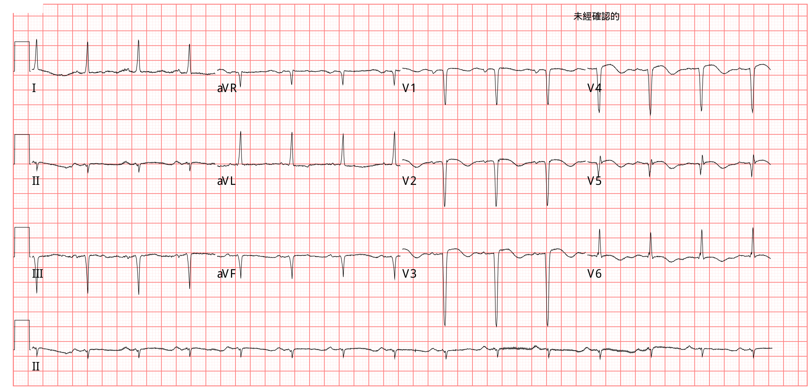
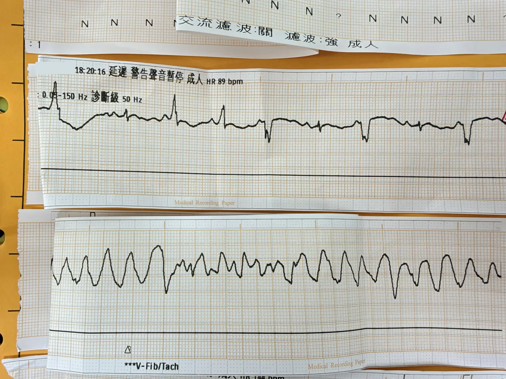
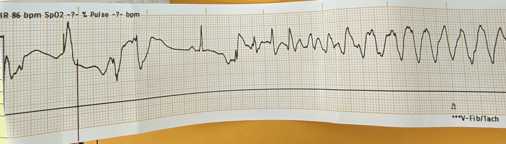
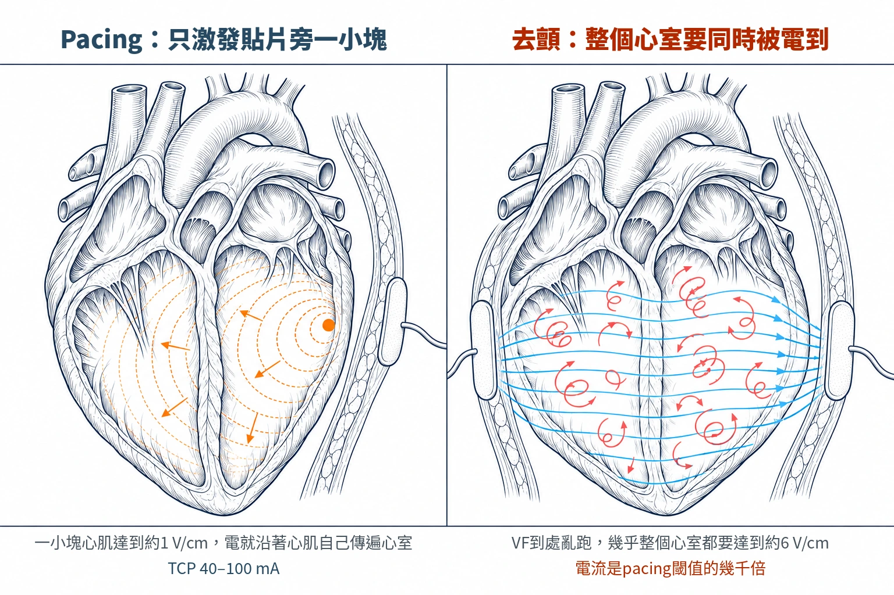



這兩個月，急診遇到兩個身上裝ICD的病人。讓我想到：**<mark style="background-color: pink">ICD會讓人恐懼，還是會讓人安心？怎麼說？</mark>**

接下來，我們先看看這兩位的病史。

## Case 1：心肌炎後的ICD，被電了好幾年

一位年輕女性。

<b>Table 1</b>｜Case 1時間軸


ICD前約2年半 | arrest | 打完疫苗當天猝死，被電了3次救回來
隔年 |  | 診斷dilated cardiomyopathy，懷疑是心肌炎
ICD前1週 | arrest | 在外面OHCA（initial shockable rhythm），ECPR 62分鐘、裝上VA-ECMO 6天
放ICD | proc | 放了一顆ICD，當時LVEF 25%
ICD後3個月 | shock | 利尿劑造成低血鉀（K 2.5），VT兩次，ICD放電；停掉amiodarone後QT縮短
ICD後1年7個月 | shock | VT合併cardiogenic shock，DC shock一次
2週後 | proc | 升級成dual chamber ICD（MRI compatible DDD）
1個月後 | proc | radiofrequency ablation
ICD後2年1個月 | shock | Torsades de pointes，ICD放電一次
2個月後 | shock | electrical storm，ICD頻繁放電，用lidocaine 4天，住院約3週【我們醫院的紀錄寫AFL→焦慮→VT，連電6次】
ICD後2年7個月 | check | LVEF 32%
同月 | med | ICD記錄到non-sustained VT，門診新開amiodarone 200 mg BID；當天頭暈，原本會自己停下來的short run VT，變成停不下來的VT，ICD做了好幾次ATP
隔天 | shock | ICD電一次→急診（amiodarone infusion＋補Mg），住院約1週
住院第3天 | med | amiodarone pump 48小時後改口服；ICD rate從50調到75 ppm；住院期間QTc 500–530 ms
出院 |  | 出院，amiodarone 200 mg/day


ATP（anti-tachycardia pacing）：ICD用比VT稍快的速度連續pacing一小串，把VT打斷，不用電擊。

**<mark style="background-color: pink">那ICD什麼時候用ATP、什麼時候電擊？</mark>**

ICD主要看心跳有多快。醫師會依心跳快慢設幾個區間（zone）：<mark style="background-color: lightblue">比較慢的VT區</mark>，**<u>先試ATP</u>**，打不斷才電擊；<mark style="background-color: lightblue">最快的VF區</mark>，**<u>直接電擊</u>**，而且第一下就用最大能量，避免一電再電[^1]。有些機型在VF區會趁充電的空檔先打一次ATP，打斷了就不用電；沒打斷，充好電照樣電，不會耽誤時間[^1]。

<mark style="background-color: pink">不是每一種ICD都有這些功能</mark>。經靜脈ICD有導線放在心臟裡，可以分區、做ATP；皮下的S-ICD沒有心內導線，不能做ATP，也不能長期pacing，只能電擊[^2]。本篇兩個case放的都是經靜脈的雙腔ICD。

ATP不痛，電擊會痛；研究也發現，被電擊跟比較高的死亡率有關[^1]。所以現在的設定，能用ATP打斷的就盡量不電。



Case 1在ICD後2年7個月那次就是這樣：ICD先做了好幾次ATP，打不斷，隔天才電一次。

出院約2個月後的某天清晨，睡覺時突然喘、心跳很快，接著ICD放電一次，來到急診。07:56做了到院第一張ECG（Fig.2）。

 464/518 ms")

Atrial-paced rhythm，QTc 518 ms。

**<mark style="background-color: pink">問個問題：這種PPM打出來的心律，QTc可信嗎？</mark>**

她是atrial pacing：PPM打的是心房，電再從房室結照常傳到心室，所以QRS和QT都是她自己的，不像ventricular pacing整個QRS都是pacing出來的。從這點看，這張的QT比ventricular pacing可信。

所以QTc 518 ms，已經超過500 ms，要當成TdP的高風險來看[^3][^4]。要確認的話，手量QT，或跟她自己以前同樣心律的ECG比。

## Case 2：放ICD才5週，騎車昏倒

60多歲男性。

<b>Table 2</b>｜Case 2時間軸（第一次住院）


住院第1天 |  | NSTEMI住院；CAD with DVD，culprit lesion在LAD近端
第5天 | arrest | 第一次IHCA，CPR 18分鐘、插管3天
第6天 | proc | LAD近端到中段放了一支BMS
第12天 | check | 心臟超音波LVEF 22.1%
第18天 | arrest | 第二次IHCA，這次是VF/VT；做了cardioversion、上Xylocaine pump，又插管5天
第21天 | proc | 放了一顆dual chamber ICD
第27天 |  | 出院


住院期間還合併ADHF、肺水腫，以及ILD急性惡化合併黴漿菌感染。

出院一個月後<mark>（距離放ICD 5週）</mark>，騎機車時突然頭暈、自摔，頭部撞到、ILOC，到急診時意識清楚、沒有胸痛。

Sinus rhythm、poor R wave progression（PRWP）、QT prolongation。

<b>Table 3</b>｜Case 2急診經過


15:49 | check | 到院ECG：QT prolongation（Fig.3）
17:01 | check | 抽血K 2.7
— |  | 縫完傷口、上了石膏，準備回家時開始胸痛
18:16 |  | 心跳168–189，接上monitor轉急救區
18:21 | va | 開始跳TdP，之後反覆short run VT，給了amiodarone
18:39 | shock | 再發作時，<strong>NP正在摸pulse，ICD放電，NP的手也麻了一下</strong>
18:46 | med | 才開始補鉀；急診期間沒有給magnesium


18:20先出現VPC，接著跳TdP（Fig.4上段是VPC開始出現，下段是TdP）：

18:39再發作的那一次，可以看到從正常的心跳開始，直接接上TdP（Fig.5）：

為什麼QT延長的時候，一個PVC就可能變成TdP？repolarization拖得太長，T波還沒結束，這時候打下來的PVC剛好落在T波上（R on T）；而且TdP常常是「short-long-short」：先一個PVC、接著一個停頓，停頓後那一跳的QT拉得更長，下一個PVC就打在它的T波峰附近，點燃TdP[^3]。

那QT正常的人呢？<mark>只要有frequent PVC，short-long-short其實很常出現</mark>：每一個PVC後面幾乎都跟著一個代償性停頓，等於自動做出一組「short（PVC提早）→ long（停頓）」，下一跳如果又是PVC（例如bigeminy），就是short-long-short。不過沒有QTc超過500 ms這類危險因子，藥物引起的TdP很少見[^4]。

<mark>short-long-short拆開講</mark>：第一個short是PVC提早出現（短的RR）；long是PVC後面的代償性停頓（長的RR）；停頓之後那一跳的repolarization被拉得更長，T波更大、更怪，停頓也會讓早期後去極化（EAD）變大[^3]；最後一個short，是下一個PVC又提早打下來，剛好落在這個被拉長的T波上。

Ashman phenomenon是同一個道理，發生在傳導系統：His-Purkinje系統的refractory period跟前一個RR成正比，前面停得越久，下一跳的refractory period越長；這時候一個提早的上心室心跳傳下來，右束支還在refractory，就變成RBBB形狀的aberrant conduction[^5]。

兩個都是「前面停得越久，下一跳恢復得越慢」。發生在傳導系統，是Ashman，通常只是QRS變形；發生在心室肌、而且QT本來就長，停頓後的repolarization更不穩定，就可能變成TdP。所以<mark>Ashman典型是long-short（前面再多一個short、變成short-long-short時更容易發生）[^6]；TdP的典型開頭則是short-long-short</mark>。**<u><mark style="background-color: pink">兩者差在變形的那一跳：Ashman是上心室心跳傳導變形，TdP是PVC打在T波上。</mark></u>**





<b>Table 4</b>｜Ashman和TdP怎麼分

|  | Ashman | TdP |
| --- | --- | --- |
| 底下的心律 | 上心室心律（最常見是AF，其他SVT也可能） | 心室心律不整 |
| 寬QRS是什麼 | 右束支還在refractory，傳導變形 | 心室自己亂跳，QRS軸一直轉 |
| 危險嗎 | 通常benign，但容易被當成VT | 會變VF，要立刻處理 |
| 怎麼認 | 變形那跳前面緊接長的cycle；RBBB形；跟前一跳的間隔不固定；後面沒有完整代償性停頓（Fisch criteria）[^6] | 長QT＋short-long-short；QRS軸一直轉 |
| 怎麼處理 | rate control，不是電擊 | 持續就電擊；Mg、補K、pacing |

這兩個分清楚很重要。AF裡連續幾個Ashman beat，寬QRS排在一起，很容易被當成VT。我遇過一位病人，就是AF合併一串Ashman beat，被當成VT電了三次都沒有效，後來給了MgSO4和CCB才控制下來。<mark>**Ashman是上心室的心律只是傳導變形，處理的是AF本身（rate control），不是去電一個不存在的VT；TdP才是真正的心室心律不整**</mark>。

這個case住進CVICU約10天：隔天因肺炎併急性呼吸衰竭、肺水腫插管3天，VT用Cordarone infusion；肝指數大幅上升，研判是shock造成的缺血性肝炎。

## 兩個case放在一起看

<b>Table 5</b>｜兩個case放在一起看

|  | Case 1 | Case 2 |
| --- | --- | --- |
| 心臟底子 | 心肌炎後DCM，LVEF 32% | CAD／NSTEMI，LVEF 22% |
| 為什麼放ICD | OHCA（VF）後，二級預防 | 住院中VF/VT，二級預防 |
| ICD放了多久 | 將近3年 | 5週 |
| ICD種類 | 經靜脈；放ICD後1年8個月升級為dual chamber（MRI compatible DDD） | 經靜脈，dual chamber |
| 這次的誘因 | 背景：到院前約2個月因NSVT加回amiodarone，住院中QTc 500–530 ms；VT本身反覆發作（storm史） | 低血鉀K 2.7＋QT延長（急性、可矯正） |
| 心律 | Ventricular arrhythmia，不確定哪一種 | TdP（polymorphic VT） |
| 放電在哪裡 | 家裡、睡夢中 | 急診急救區，旁邊有人摸著 |
| ICD扮演的角色 | 除了電，還被拿來「調pacing rate壓QT」 | 只能在TdP發生後電 |
| 以前被電過 | 很多次，包括一次electrical storm（更早一次另一家醫學中心寫TdP、我們醫院寫AFib） | 第一次 |

**共通點**：**都是心臟停過、為了二級預防放ICD**；LV功能都很差；都卡在QT延長；都有低血鉀的病史；都用到amiodarone；也都在身上有ICD的情況下，照樣跑出致命心律不整

**不同點**：<mark style="background-color: lightblue">一個是慢性病人、被電了好幾年，誘因是「治療本身」（服用amiodarone）</mark>；<mark style="background-color: lightblue">一個是剛放ICD、誘因是可以早點矯正的低鉀</mark>。**<mark style="background-color: pink">一個在家被電，一個在急診被電、連旁邊的人都被電到</mark>**

## 由此提出的問題


- **Q1**：ICD到底在做什麼？為什麼它擋不住這兩個人發作？（ATP vs shock、終止≠預防）
- **Q2**：有ICD，為什麼還是一直出事？QT延長、低鉀、amiodarone各自扮演什麼角色？
- **Q3**：Case 1為什麼要把ICD的lower rate調快？用pacing來「預防」TdP的道理
- **Q4**：ICD會不會傷人？Case 1的AFib被電、AFL連電6次：inappropriate shock、electrical storm、被電之後的焦慮
- **Q5**：ICD放電時，摸著病人的人會被電到嗎？
- **Q6**：放ICD多久可以騎車、開車？
- **Q7**：需要外部電擊時，貼片放哪？
- **Q8**：回頭看：兩個case，急診可以早一步做什麼？


### ❤️Q1：ICD到底在做什麼？為什麼它擋不住這兩個人發作？

ICD做兩件事：一直看心跳，心跳快到設定的區間就出手。**出手的方式就是ATP或電擊**（請見Fig.1）。

**<mark style="background-color: pink">它做不到的，是讓VT、VF不要發生</mark>**。QT多長、鉀多低、心肌的疤痕在不在，ICD都管不到；它只能在心律不整已經發生之後，把它打斷。

所以Case 2身上有ICD，K 2.7、QT延長，照樣跳TdP；ICD做的，是18:39那一下把它電掉。Case 1也是一樣：VT一次一次地來，ICD一次一次地電。

ICD唯一算得上「預防」的，是它也是一台節律器。Case 1把lower rate調高，用pacing把心跳撐快、把QT壓短，這是Q3要講的。

### ❤️Q2：有ICD，為什麼還是一直出事？QT延長、低鉀、amiodarone各自扮演什麼角色？

**QT延長**是TdP的根本條件。心肌repolarization拖得太長，repolarization還沒結束就冒出一個早期後去極化（early afterdepolarization），變成一個PVC，就可能點燃TdP[^3]。<mark>AHA／ACC的聲明引用先天性long QT的資料：QTc超過500 ms，TdP的風險高了2到3倍</mark>[^3][^7]。

**低鉀**會讓QT更長，AHA／ACC把它列為要先處理的誘發因素[^3]。Case 2的K 2.7，Case 1在放ICD後3個月那次VT，K也只有2.5。

<mark>**amiodarone**比較特別。它會把QT拉得很長，卻很少引起TdP</mark>[^3]。一個說法是它把各層心肌的repolarization一起拉長，不會造成某一層特別慢[^3]。所以Case 1明明QTc 500多，心臟科還是選擇繼續用amiodarone壓VT，再用pacing把QT壓短。

### ❤️Q3：Case 1為什麼要把ICD的lower rate調快？

TdP很常是在「停頓」之後發作：心跳一慢、一停，停頓後那一跳的QT拉得更長，這時候一個PVC打上去，就點燃TdP（Fig.6的short-long-short）[^3]。

所以AHA／ACC的聲明寫，**<u>可以用暫時性經靜脈的心房或心室pacing，把心跳拉到每分鐘70下以上，避免出現會誘發TdP的停頓</u>**[^3]。

Case 1身上本來就有ICD，ICD也是一台節律器。把lower rate調到75 ppm，等於把這件事一直開著：心跳不會掉到75以下，停頓少了，QT也跟著縮短，她才能繼續吃amiodarone。

### ❤️Q4：ICD會不會傷人？

會，大致有三種。

**<mark style="background-color: lightblue">電錯（inappropriate shock）</mark>**：ICD主要看心跳快慢，心跳快不一定是VT。**<u>AF合併快速心室反應、其他SVT，或是T波被重複計數、導線斷裂造成的雜訊，都可能讓ICD以為是VT而放電</u>**[^8]。

**<mark style="background-color: lightblue">electrical storm時一再被電</mark>**：electrical storm是心臟自己一再跳出心室心律不整，24小時內發作3次以上[^8]，不是ICD造成的。ICD每一次都電對了，可是病人一天之內要被電好幾次，每一下都會痛[^8]。

**<mark style="background-color: lightblue">被電之後的心理</mark>**：電擊會痛，還會引起焦慮、憂鬱、幻覺電擊（phantom shocks：病人說自己被電了，但ICD紀錄裡沒有放電[^9]）、PTSD；這些又讓交感神經更興奮，更容易再跳VT，變成惡性循環[^8]。

Case 1在electrical storm那次，另一家醫學中心寫的是electrical storm；我們醫院的紀錄寫「AFL→焦慮→VT，連電6次」，正好是這個惡性循環的樣子。再往前兩個月那次，另一家醫學中心寫TdP、我們醫院寫AFib；如果真的是AFib，那一次就是電錯。

### ❤️Q5：ICD放電時，摸著病人的人會被電到嗎？

會，但大多只是麻一下。電大部分在病人身體裡面走，只有一小部分會漏到摸著病人的人身上。Petley在2019年量了25位病人，換算施救者會碰到的電流：<mark>經靜脈的ICD中位數31 mA（9–75 mA），放在皮下的S-ICD中位數135 mA（91–164 mA）</mark>[^10]。所以<mark>壓胸的時候，站在ICD的對側比較安全</mark>[^10]。

為什麼S-ICD比較高？因為<strong><u>S-ICD電擊的能量比較高，電極又放在皮下、離體表比較近</u></strong>[^10]。為什麼要站對側？ICD多半放在左胸，**<u>Petley量到，從病人左側壓胸時，施救者會碰到的表面電壓比右側高</u>**（中位數127 V vs 67 V）[^10]。

Case 2的NP就是這樣，手麻了一下。他身上是經靜脈的雙腔ICD。

那TCP呢？TCP是用電流來設定，成人通常要40–100 mA才抓得到capture[^11][^12]。**<u>pacing時不要去碰貼片的凝膠區，會有輕微電擊感</u>**[^11]。

那AED呢？AED或去顫器電擊的那一下，旁邊的人不能碰病人；ERC 2025寫，手動壓胸的同時電擊不安全，戴醫療手套也一樣[^13]。

三者的電量差很多（Fig.8）：ICD一下約40 J，S-ICD約80 J[^13]；AED／去顫器雙相波第一下至少150 J[^13]。

TCP是用電流設定，不是焦耳；換成能量估算，每一下大約只有0.005–0.03 J。這是本文估算的：能量（J）＝電流²（A）×阻抗（Ω）×時間（s），用成人平均胸壁阻抗約77 Ω[^14]、每下40 ms[^11]去算。mA講的是電流有多大，J講的是一下總共給了多少能量，兩個不能直接比，要乘上阻抗和時間。



為什麼這麼小的能量也能pacing？因為<strong><u>pacing只要把貼片附近一小塊心肌推過閾值，這一小塊一動，電就沿著心肌自己傳下去</u></strong>；**<u>去顫不一樣，要讓幾乎整個心室的心肌同時被電到，才能把所有亂跑的電流一起打斷</u>**[^15]（Fig.9）。Ideker的研究講得很清楚：pacing只需要電極旁邊一小塊組織達到約1 V/cm的電場；去顫要讓幾乎全部心室都達到約6 V/cm，而有些心肌離電極超過10 cm，需要的電流是pacing閾值的幾千倍[^15]。

### ❤️Q6：放ICD多久可以騎車、開車？

先分是哪一種ICD：

<b>Table 6</b>｜primary與secondary prevention ICD，禁駕多久

|  | Primary prevention | Secondary prevention |
| --- | --- | --- |
| 什麼時候放 | **還沒發生過致命心律不整，因為風險高先放** | **心跳停止被救回來之後，或自發的心律不整合併血行動力學不穩（包括昏倒）之後**[^16] |
| 例子 | LVEF很差、還沒發作過 | 本篇兩個case |
| 歐盟：私人駕駛 | 停2週[^16] | 停3個月[^16] |
| 美國：私人駕駛 | 至少停1週[^17] | 停6個月[^18] |
| ICD適當放電之後 | 歐盟：再停3個月[^16]；美國：比照secondary[^18] | 歐盟：再停3個月[^16] |
| 職業駕駛 | 歐盟：永久禁止[^16] | 歐盟：永久禁止[^16] |

Case 2是secondary prevention，放ICD才5週就騎機車，照歐規還在禁駕期；這次ICD又放了電，要從這次再算3個月[^16]。

為什麼要禁駕？ICD只在心律不整發生之後才出手，發作的當下，人可能已經頭暈、昏倒，ICD電擊本身也可能讓人失去意識；而且**放ICD後的頭幾個月、ICD放電後的頭幾個月，再發作的機會最高**。歐盟報告引用的波蘭登錄研究：**<u>secondary prevention放ICD之後，第一個月心律不整發作的機率1.9%、第二個月3.3%、第三個月3.7%，接下來三個月每個月都低於2%</u>**[^16]。美國一個7萬多人的遠端監測研究：第一次被ICD電之後，1個月內再被電的累積發生率是14.5%，6個月是28.7%[^18]。

### ❤️Q7：需要外部電擊時，貼片放哪？

貼片直接蓋在裝置上電擊，可能把裝置電壞。<mark>ERC 2025寫：貼片要離裝置至少8 cm</mark>，或改用其他位置（前側、前後）[^13]。如果ICD打不掉shockable rhythm，就照一般方式外部電擊，貼片一樣離機殼8 cm以上[^13]。

外部電擊之後，ICD的去顫和pacing功能都要重新檢查[^13]。

### ❤️Q8：回頭看：兩個case，急診可以早一步做什麼？

Case 2在17:01就看到K 2.7，ECG也已經QT延長，這時候他還沒跳TdP。AHA／ACC的聲明把「嚴重低血鉀」列在要做QT監測的情況裡[^3]；照這個標準，那個時間點就符合接monitor的條件。

<mark><u>**AHA／ACC列出要做QT監測的四種情況**</u></mark>[^3]：

1. 開始用已知會引起TdP的藥
2. 可能致心律不整的藥物過量
3. 新發生的心搏過緩
4. 嚴重低血鉀或低血鎂

<u>**<mark>TdP一旦跳出來，magnesium sulfate 2 g IV不論血中鎂濃度都可以當第一線藥物</mark>**</u>[^3]<u>**<mark>；鉀可以考慮補到4.5–5 mmol/L，不過這個做法的證據不多</mark>**</u>[^3]。Case 2在急診期間沒有給magnesium，補鉀是在TdP之後才開始。

Case 2跳TdP時給的是amiodarone。教科書寫，TdP發作時，會拉長QT的Class IA、Class III抗心律不整藥（amiodarone屬於Class III）不但沒效，還可能致命[^19]；AHA 2025對TdP提的是magnesium，停頓誘發的找專家考慮overdrive pacing或isoproterenol[^7]。

Mg怎麼給：

- **劑量**
  magnesium sulfate 2 g IV，不論血中鎂濃度[^3]。AHA 2025把它列為「可以考慮」（Class 2b），對象是合併long QT、反覆發作的polymorphic VT，也就是TdP[^7]
- **給幾次**
  TdP還是一直發作，可以再給2 g[^3]；要隔幾分鐘再給，AHA／ACC 2010沒有寫
- **還是壓不住，又合併心搏過緩或停頓**
  提高心跳，用overdrive pacing或isoproterenol，AHA 2025建議找專家討論[^3][^7]
- **要小心**
  鎂幾乎完全靠腎臟排，腎功能不好要小心，可能鎂中毒；注意膝反射還在、呼吸沒有被抑制，旁邊備好靜脈鈣[^20]
- **不要給的情況**
  <u>**QT正常的polymorphic VT，不要常規給Mg（AHA 2025：No Benefit）**</u>[^7]

## 學習重點

1. **ICD只能在VT、VF發生之後把它打斷**，擋不住它發生；QT多長、鉀多低，ICD都管不到。Case 2身上有ICD，K 2.7加上QT延長，照樣跳TdP。
2. **QTc超過500 ms，TdP風險高2到3倍**（先天性long QT的資料），低鉀會讓QT更長，要先補。amiodarone例外：QT拉得很長，卻很少引起TdP。
3. **TdP常在停頓之後發作（short-long-short）**，用pacing把心跳撐到每分鐘70下以上可以減少停頓；Case 1把ICD的lower rate調到75 ppm，就是這個道理。
4. **ICD傷人有三種**：電錯（AF、SVT、T波重複計數、導線雜訊）、electrical storm時一天被電好幾次、被電之後的焦慮與惡性循環。
5. **ICD放電時摸著病人，大多只是麻一下**，壓胸站ICD對側比較安全；TCP時別碰貼片凝膠區；AED、去顫器電擊那一下不能碰病人，戴手套也一樣。
6. **外部電擊，貼片離ICD機殼至少8 cm**，電完要重新檢查ICD的去顫和pacing功能。
7. **secondary prevention ICD放完要禁駕**：歐盟3個月、美國6個月；ICD適當放電之後，歐盟要從那次再算3個月。
8. **低鉀加上QT延長，還沒跳TdP就該接monitor**；TdP一跳出來，magnesium sulfate 2 g IV不論血鎂濃度都可以給。QT正常的polymorphic VT不要常規給Mg。

## 參考資料

內文每個上標數字，滑過去（手機點一下）就看得到出處和原文。

- **指引與聲明**
  - Drew BJ, et al. *Circulation* 2010（AHA／ACC：住院中預防TdP）
  - Tisdale JE, et al. *Circulation* 2020（AHA：藥物引起的心律不整）
  - Al-Khatib SM, et al. *J Am Coll Cardiol* 2018（2017 AHA/ACC/HRS心室心律不整指引）
  - Wigginton JG, et al. *Circulation* 2025（AHA 2025 Part 9：Adult Advanced Life Support）
  - Epstein AE, et al. *Circulation* 2007（AHA／HRS：ICD病人駕駛）
  - Soar J, et al. *Resuscitation* 2025（ERC 2025 Adult Advanced Life Support）
  - European Commission 2013：New Standards for Driving and Cardiovascular Diseases
- **研究與回顧**
  - Merchant FM, et al. *JAMA Cardiol* 2016（ICD放電後的駕駛限制）
  - De Maria E, et al. *World J Cardiol* 2017（ICD的ATP設定系統性回顧）
  - Jentzer JC, et al. *J Am Coll Cardiol* 2023（electrical storm回顧）
  - Petley GW, et al. *Resuscitation* 2019（ICD放電時施救者的漏電流）
  - Bilanovic A, et al. *PACE* 2013（phantom shocks）
  - Heyer Y, et al. *Sensors* 2022（胸壁阻抗系統性回顧）
  - Ideker RE, et al. *PACE* 1995（pacing、fibrillation、defibrillation閾值的關係）
- **操作手冊與教材**
  - ZOLL PD 1200 Operation Manual
  - UK Defence Medical Services：Clinical Guidelines for Operations（Transcutaneous pacing）
  - ECG Weekly（Amal Mattu）：Ashman phenomenon vs. nonsustained VT（2023-09-18）
  - LITFL：Ashman Phenomenon
  - Baltazar RF. Basic and Bedside Electrocardiography（2009）
  - Magnesium Sulfate in Water仿單（Hospira，openFDA）

[^1]: De Maria E, et al. Antitachycardia pacing programming in implantable cardioverter defibrillator: A systematic review. *World J Cardiol* 2017;9(5):429-436. PMID 28603590。 原文："Beyond ATP use, excellent clinical results were obtained with programming standardization following these principles: extended detection time in ventricular fibrillation (VF) zone; supraventricular discrimination criteria up to 200 bpm; first shock in VF zone at the maximum energy in order to reduce the risk of multiple shocks." "In order to avoid significant delays in the delivery of shock therapy (in case of ATP failure) algorithms of ATP sequences during or before capacitor charging were soon implemented in the VF zone for most manufacturers; this strategy has been subsequently clinically validated as safe and effective." "Even more important, it has also been demonstrated that shock therapy is associated with a higher risk of mortality compared to ATP sequences only."
[^2]: Al-Khatib SM, et al. 2017 AHA/ACC/HRS Guideline for Management of Patients With Ventricular Arrhythmias and the Prevention of Sudden Cardiac Death. *J Am Coll Cardiol* 2018;72(14):e91-e220. PMID 29097296。 原文："The subcutaneous implantable cardioverter-defibrillator is incapable of bradycardia pacing, biventricular pacing, or antitachycardia pacing. Therefore, patients who need any of these types of pacing from an ICD should not be offered a subcutaneous implantable cardioverter-defibrillator."
[^3]: Drew BJ, et al. Prevention of torsade de pointes in hospital settings: a scientific statement from the American Heart Association and the American College of Cardiology Foundation. *Circulation* 2010;121(8):1047-60. PMID 20142454。 原文："Second, episodes of drug-induced TdP usually start with a short-long-short pattern of R-R cycles consisting of a short-coupled premature ventricular complex (PVC) followed by a compensatory pause and then another PVC that typically falls close to the peak of the T wave." "Data from congenital LQTS studies indicate that a QTc >500 ms is associated with a 2- to 3-fold higher risk for TdP." "A long preceding pause increases the amplitude of early afterdepolarizations, which makes them more likely to reach the threshold necessary to produce a PVC or ventricular couplet." "If episodes of TdP persist, it may be necessary to repeat infusions of magnesium sulfate 2 g." "Magnesium sulfate 2 g can be infused intravenously as a first-line agent to terminate TdP irrespective of the serum magnesium level." "In contrast, isoproterenol infusion or overdrive pacing can suppress TdP in these circumstances." "An increase in heart rate to prevent pauses that may trigger TdP may be attempted with temporary transvenous atrial or ventricular pacing at rates >70 beats per minute." "Repletion of potassium to supratherapeutic levels of 4.5 to 5 mmol/L may also be considered, although there is little evidence to support this practice (Class IIb, Level of Evidence: C)." "indications for QT-interval monitoring include the following: (1) Initiation of a drug known to cause TdP; (2) overdose from potentially proarrhythmic agents; (3) new-onset bradyarrhythmias; and (4) severe hypokalemia or hypomagnesemia." "The trigger for TdP is thought to be a PVC that results from an early afterdepolarization generated during the abnormally prolonged repolarization phase of the affected myocardium." "If these ECG harbingers of TdP are recognized, it then becomes possible to discontinue the culprit drug and manage concomitant provocative conditions (eg, hypokalemia, bradyarrhythmias) to reduce the occurrence of cardiac arrest." "Chronic administration of amiodarone markedly prolongs the QT interval, yet it is very rarely associated with TdP." "It has been postulated (although as yet unproven) that unlike high-risk drugs that selectively prolong repolarization in myocytes located in the mid myocardium (M cells), amiodarone uniformly delays repolarization in all layers of the myocardial wall."
[^4]: Tisdale JE, et al. Drug-Induced Arrhythmias: A Scientific Statement From the American Heart Association. *Circulation* 2020;142(15):e214-e233。 原文："Drug-induced TdP is rare in patients without risk factors, which include heart rate–corrected QT interval (QTc) >500 milliseconds or QTc lengthening ≥60 milliseconds from pretreatment value"
[^5]: LITFL — Ashman Phenomenon（Cadogan M, Buttner R）。 原文："Ashman phenomenon describes an aberrant ventricular conduction, usually of RBBB morphology, which follows a short R-R interval and preceding relatively prolonged R-R interval" "The refractory period of the His-Purkinje system is proportional to the RR interval of the preceding beat." "So, when two beats are separated by a long RR interval, the subsequent refractory period will be relatively long."
[^6]: ECG Weekly（Amal Mattu）— Rhythm Interpretation: Ashman phenomenon vs. nonsustained ventricular tachycardia（2023-09-18）。 原文："Typically follows a long-short cycle, and is especially likely to occur with a short-long-short cycle" "Fisch Criteria for diagnosing Ashman phenomenon: A relatively long cycle immediately ahead of the cycle terminated by the aberrant QRS complex RBBB from aberrancy with a normal orientation of the initial QRS vector: concealed propagation of aberration is possible, such that it is possible to have a series of wide QRS supraventricular beats Irregular coupling of aberrant QRS complexes Absence of a full compensatory pause, as full compensatory pauses favor a ventricular origin." "This is NOT ventricular tachycardia and antidysrhythmic medications and hospitalization is unnecessary"
[^7]: Wigginton JG, et al. Part 9: Adult Advanced Life Support: 2025 American Heart Association Guidelines for Cardiopulmonary Resuscitation and Emergency Cardiovascular Care. *Circulation* 2025;152(suppl 2):S538–S577. PMID 41122884。 原文："The risk for developing torsades increases when the corrected QT interval is greater than 500 milliseconds and accompanied by bradycardia." "Magnesium may be considered for treatment of adults with recurrences of polymorphic ventricular tachycardia associated with a long QT interval (torsades de pointes)." "In patients with bradycardia or pause-precipitated torsades, expert consultation is best sought for additional measures such as overdrive pacing or isoproterenol." "Routine use of magnesium is not recommended for the treatment of polymorphic VT in adults with a normal QT interval."
[^8]: Jentzer JC, et al. Multidisciplinary Critical Care Management of Electrical Storm: JACC State-of-the-Art Review. *J Am Coll Cardiol* 2023;81(22):2189-2206. PMID 37257955。 原文："Electrical storm (ES) reflects life-threatening cardiac electrical instability with 3 or more ventricular arrhythmia episodes within 24 hours." "Inappropriate ICD therapies can be for arrhythmias such as nonsustained VT or supraventricular tachycardia (e.g., atrial fibrillation with rapid ventricular rate), or due to artifactual signals such as T wave oversensing or lead noise (e.g., lead fracture)." "ICD shocks can further exacerbate ES by provoking pain and emotional distress (including anxiety, depression, phantom shocks, and post-traumatic stress disorder), which further stimulate sympathetic drive and increase the risk of subsequent VA episodes potentially leading to a vicious cycle of VA and recurrent ICD therapies."
[^9]: Bilanovic A, et al. Uncovering phantom shocks in cardiac patients with an implantable cardioverter defibrillator. *Pacing Clin Electrophysiol* 2013;36(6):673-83. PMID 23437816。 原文："Implantable cardioverter defibrillator recipients sometimes report "phantom shocks" (PSs), defined as a reported shock lacking objective evidence."
[^10]: Petley GW, et al. Leakage current from transvenous and subcutaneous implantable cardioverter defibrillators (ICDs): A risk to the rescuer? *Resuscitation* 2019;137:148-153. PMID 30794831。 原文："More recently, subcutaneous ICDs (S-ICD) have been developed, which utilise a higher energy and more superficial electrodes compared with transvenous ICDs (T-ICD), raising safety concerns further." "Surface voltages (median RMS) to which the rescuer is likely to be exposed are higher when performing chest compressions from the patient's left side compared with the right (127 V vs 67 V respectively, 95% CI of difference -34 V to -67 V, P < 0.0001)." "Twenty-five patients were recruited. Rescuer current from S-ICDs was significantly higher than those from T-ICDs (S-ICD: Median RMS 135 mA range 91 mA-164 mA, T-ICD: Median RMS 31 mA, range 9 mA-75 mA, P < 0.0001)." "Chest compressions should be performed from the opposite side to the ICD to reduce rescuer risk."
[^11]: ZOLL PD 1200 Operation Manual。 原文："Pulse Duration: 40 milliseconds" "Typical threshold currents are usually between 40 and 80 mA." "Avoid touching the gelled area of the electrode while pacing. A minor electrical shock hazard exists."
[^12]: UK Defence Medical Services, Clinical Guidelines for Operations — Transcutaneous pacing。 原文："This will typically be between 50-100mA in adults."
[^13]: Soar J, et al. European Resuscitation Council Guidelines 2025: Adult Advanced Life Support. *Resuscitation* 2025;215:110769。 原文："On sensing a shockable rhythm, an ICD will discharge approximately 40 J (approximately 80 J for subcutaneous devices)" "For biphasic waveforms (rectilinear biphasic or truncated exponential biphasic, but not pulsed biphasic), defibrillation shock energy levels for the first shock is at least 150 J." "Do not defibrillate during manual chest compressions (even when wearing clinical gloves), as that practice is not safe to the rescuer." "Implantable medical devices may be damaged during defibrillation if current is discharged through defibrillation pads placed directly over the device. Place the pad away from the device (at least 8 cm) or use an alternative pad position (antero-lateral, anteroposterior)." "If an ICD fails to terminate a shockable rhythm, conventional external shocks should be delivered, placing any defibrillation pad/paddle more than 8 cm from the defibrillator box" "Cardioverter and pacing function should always be re-evaluated following external defibrillation, both to check the device itself and to check pacing/defibrillation thresholds of the device leads."
[^14]: Heyer Y, et al. A Systematic Review of the Transthoracic Impedance during Cardiac Defibrillation. *Sensors (Basel)* 2022;22(7):2808. PMID 35408422。 原文："Excluding outliers and pediatric measurements, the mean TTI recordings ranged from 51 to 112 Ω with an average TTI of 76.7 Ω under normal distribution."
[^15]: Ideker RE, Zhou X, Knisley SB. Correlation among fibrillation, defibrillation, and cardiac pacing. *Pacing Clin Electrophysiol* 1995;18(3 Pt 2):512-25. PMID 7777416。 原文："An electrical stimulus must create an electric field of approximately 1 V/cm in the extracellular space to stimulate myocardium during diastole." "The defibrillation threshold in terms of current is typically thousands of times greater than the diastolic pacing threshold." "Pacing requires a potential gradient of approximately 1 V/cm only in a small liminal volume of tissue immediately adjacent to the electrode." "Defibrillation requires an electric field of approximately 6 V/cm throughout all or almost all of the ventricular myocardium. Since some portions of the ventricles can be more than 10 cm away from the defibrillation electrodes, a shock of several amps is required to create this field, a current thousands of times greater than the pacing threshold."
[^16]: Expert Group on Driving and Cardiovascular Disease. New Standards for Driving and Cardiovascular Diseases. European Commission, Brussels, 2013。 原文："Lubinski et al (75) reported data from the Polish registry of 2162 patients implanted for secondary prevention of sudden cardiac death." "The probability of arrhythmic episodes was 1.9% in the first month, 3.3% in the second month and 3.7% in the third month. In the three months thereafter the added probability remained below 2% per month." "Secondary prophylaxis is defined as implantation after resuscitated cardiac arrest, or after spontaneous arrhythmias with hemodynamic compromise, including, but not limited to syncope. Primary prophylaxis is implantation for all other reasons." "ICD implantation for secondary prevention｜driving must cease for 3 months｜permanent driving ban" "ICD implantation for primary prevention｜driving must cease for 2 weeks｜permanent driving ban" "the expert group advises a restriction from driving of three months after appropriate ICD therapy, for patients implanted for primary and for secondary prevention, especially if the patient experienced symptoms of impaired consciousness."
[^17]: Epstein AE, et al. Addendum to "Personal and public safety issues related to arrhythmias that may affect consciousness": public safety issues in patients with implantable defibrillators. A scientific statement from the AHA and the Heart Rhythm Society. *Circulation* 2007;115(9):1170-6. PMID 17287391。 原文："Patients receiving ICDs for primary prevention should be restricted from driving a private automobile for at least 1 week to allow for recovery from implantation of the defibrillator."
[^18]: Merchant FM, et al. Time Course of Subsequent Shocks After Initial Implantable Cardioverter-Defibrillator Discharge and Implications for Driving Restrictions. *JAMA Cardiol* 2016;1(2):181-8. PMID 27437889。 原文："Of 73 503 ICD recipients who underwent remote monitoring, 14 230 (19.4%) experienced at least 1 ICD shock and were included in this analysis" "The cumulative incidence of receiving a second shock was 14.5% (IQR, 13.9%-15.1%) at 1 month and 28.7% (IQR, 27.9%-29.5%) at 6 months." "For noncommercial drivers (ie, drivers of private automobiles), the 2007 guidelines from the American Heart Association–Heart Rhythm Society recommend driving restrictions for 6 months among recipients of secondary-prevention ICDs or among recipients of primary-prevention ICDs who subsequently receive an appropriate ICD shock."
[^19]: Baltazar RF. *Basic and Bedside Electrocardiography*. Lippincott Williams & Wilkins, 2009。 原文："Antiarrhythmic agents: In torsades de pointes, antiarrhythmic agents that prolong the QT interval such as Class IA and Class III agents are not only ineffective but may be fatal."
[^20]: Magnesium Sulfate in Water for Injection仿單（Hospira, Inc.；openFDA set id 22ca78b4-f5a3-4144-cf89-5f633acf1e6d）。 原文："Parenteral use in the presence of renal insufficiency may lead to magnesium intoxication." "Because magnesium is removed from the body solely by the kidneys, the drug should be used with caution in patients with renal impairment." "Clinical indications of a safe dosage regimen include the presence of the patellar reflex (knee jerk) and absence of respiratory depression (approximately 16 breaths or more/minute)." "An injectable calcium salt should be immediately available"
