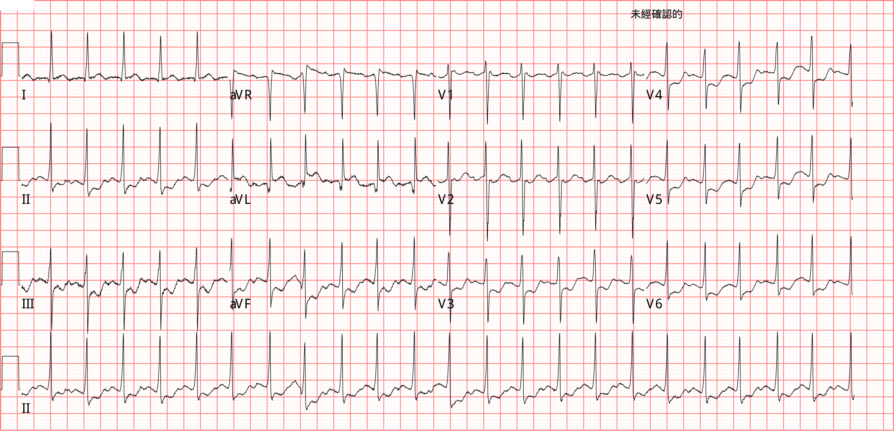
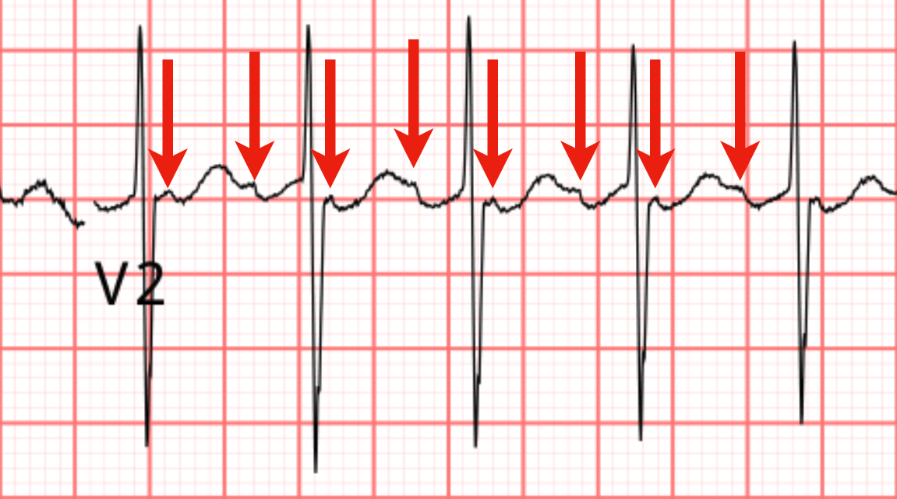
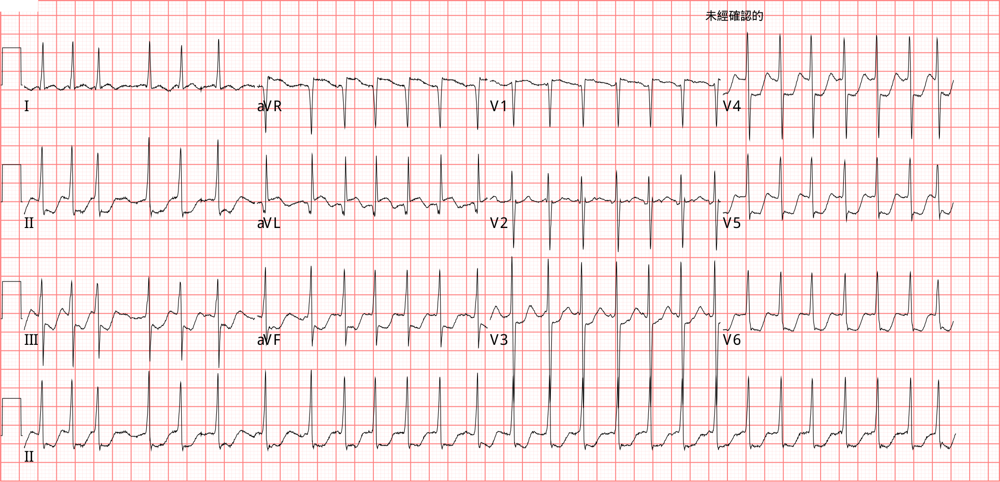
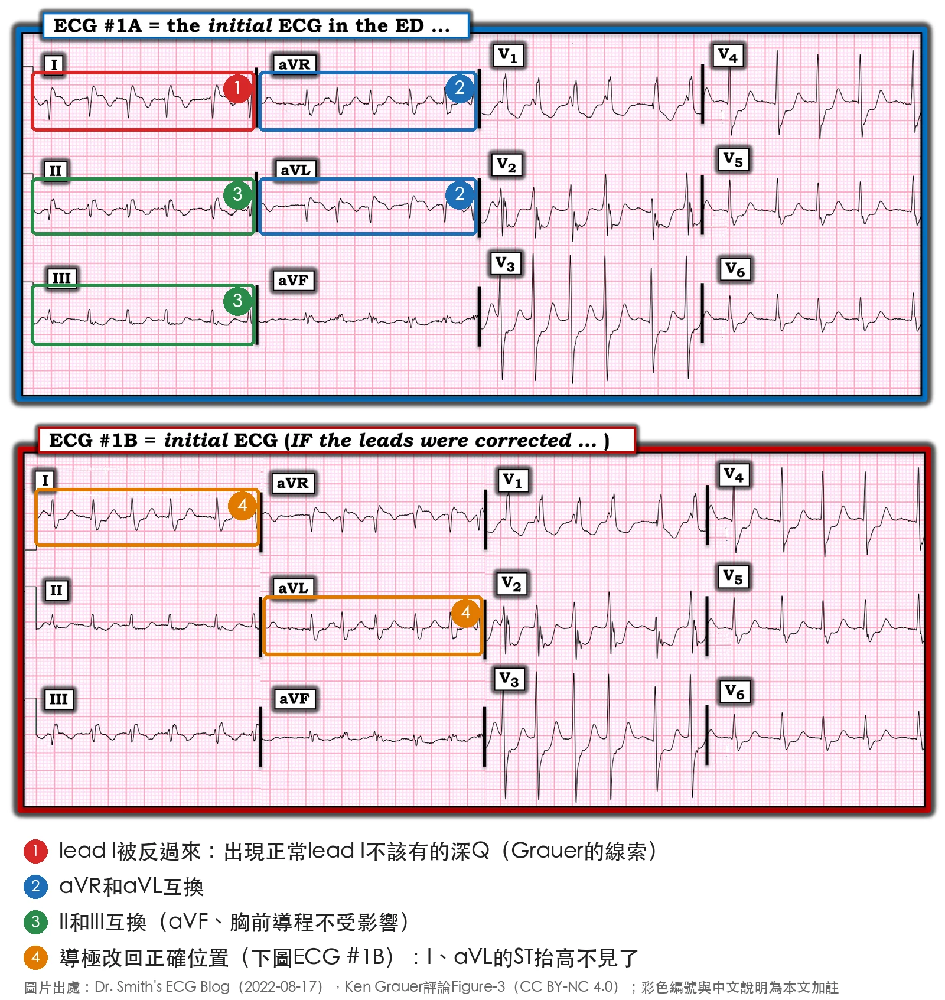
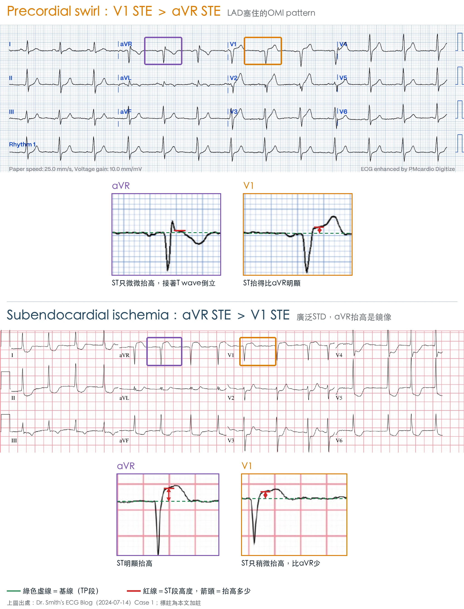
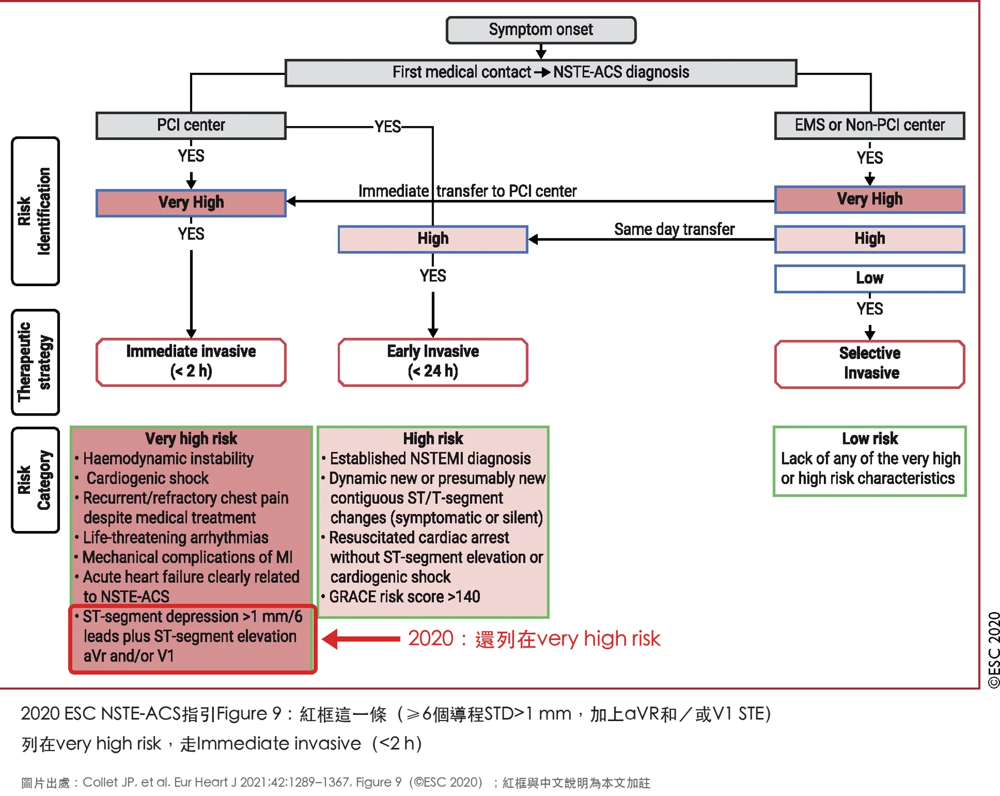
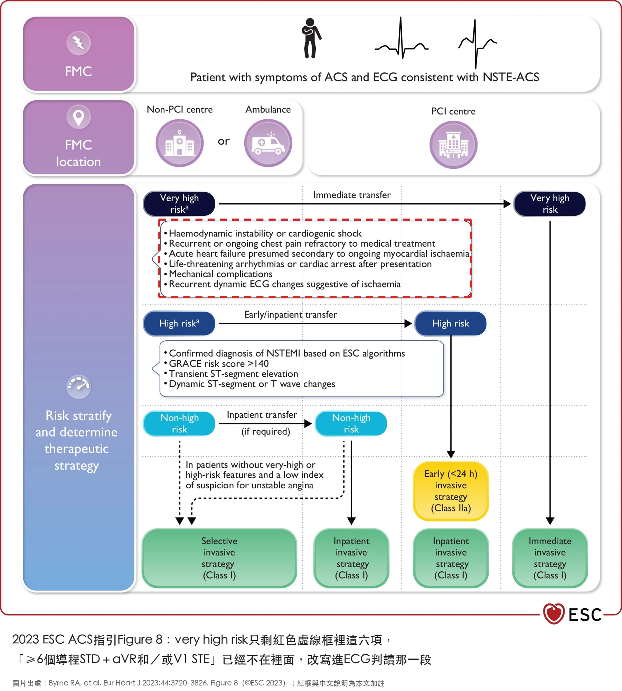
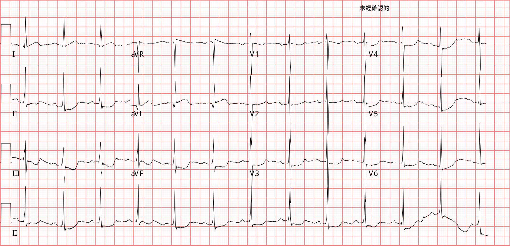



心跳快的病人，ECG上出現STD，我們心裡第一句話常常是「應該是心跳快造成的吧」。這次遇到一個心跳160、I/aVL抬高的病人，導管做完血管全通，可是心跳降下來以後ECG還在。這篇想問的是：這張ECG，到底該不該相信？

可是翻教科書，心跳快常見的是rate-related STD，不是STE[^ecgem-tachy][^eeac-tachy]；會跟著抬高的，多半只有aVR，那是diffuse STD的鏡像[^litfl-stdloc]。**<mark>Dr. Smith也說，心跳很快會把STE放大（Extreme tachycardia can greatly exaggerate ST Elevation），但STEMI本身除非已經cardiogenic shock，很少讓心跳快到這種程度</mark>**[^smith-fever]。那心跳快的時候，冒出來的STE到底可不可信？

## 讓我們來看看這個Case

一個有甲狀腺癌、右側甲狀腺切除後甲狀腺低下的50多歲女性，平常每天吃levothyroxine。

下午突然胸悶、冒冷汗，下巴和後背很痠。

沒有昏厥，血壓穩定，沒有低血壓。

到院後馬上做了一張ECG。


Rate: 138 bpm
Rhythm: sinus tachycardia
Axis: normal axis
Interval: PR、QRS正常，No QT prolong
Ischemia: <mark><strong>aVR STE＋multiple lead STD，STD最低大概在V5、V6；I、aVL STE</strong></mark>。另外有LVH for voltage。


不過回頭再看這張，我覺得它其實是AFL with 2:1 AV conduction，不是sinus tachycardia。

仔細看V2的紅箭頭位置，其實都有一個小小的往上upright突起，這個其實就是P wave。

所以這一張其實是一個flutter with 2:1 AV conduction的圖形。它的atrial rate大概是落在250到350 bpm的atrial flutter區間。

aVR STE加上multiple lead STD，我第一個想到的是subendocardial ischemia的pattern。

只是，<strong>為什麼lead I跟aVL會這樣高起來？</strong>

心跳138，加上一個看起來像subendocardial ischemia的pattern，很容易讓人說「先rate control，再做一張ECG看看」。可是I/aVL的抬高，沒那麼容易用心跳快來解釋。

這張ECG，我想帶大家回答幾個問題：

- Q1.aVR STE＋multiple lead STD，是心跳快造成的，還是心肌缺血引起？
- Q2.lead I、aVL的抬高，除了OMI還可能是什麼導致的？
- Q3.STEMI會不會心跳快？
- Q4.aVR STE＋multiple lead STD，算不算STEMI equivalent？
- Q5.心跳降下來ECG還在缺血pattern，要相信導管，還是相信ECG？
- Q6.下次遇到同樣的ECG，我還會call CV嗎？

## ❤️Q1.aVR STE＋multiple lead STD，是心跳快造成的，還是心肌缺血引起？

<mark><strong>aVR STE＋diffuse STD代表的是整圈的subendocardial ischemia，它本身不會告訴你哪一條血管塞住。</strong></mark>

**<mark style="background-color: pink">subendocardial ischemia的STD出現在哪幾個導程，不代表缺血就在那裡</mark>**，ST壓低的向量通常指向心尖（II、V5、V6），所以多數導程是ST壓低，只有對面的aVR會抬高[^smith-late40s][^litfl-stdloc]。

<strong><u>那posterior OMI跟subendocardial ischemia怎麼分？</u></strong>Dr. Smith的看法是看STD最深落在哪裡：**<mark>最深在V1–V4，先當posterior OMI；最深在V5、V6（II通常也會跟著壓低），比較像subendocardial ischemia</mark>**[^shah1997][^smith-early40s]。

Meyers和Smith 2021年回頭看了808個高風險ACS病人，懷疑是缺血、STD最深在V1–V4的，對OMI的specificity是97%；而且抓到的OMI裡，有34%的STD還不到1 mm[^meyers2021]。不過Smith也提醒，**<mark>AF RVR的時候，STD最深在V1–V4也可能只是心跳快造成的subendocardial ischemia</mark>**[^smith-subendo-af]。這個病人Fig.1的STD最低在V5、V6，站在subendocardial ischemia那一邊。

也就是說，靠「STD最深在V1–V4」抓到的OMI裡，有接近三分之一的病人STD不到1 mm[^meyers2021]。我們看到很明顯的ST depression通常會很緊張，可是這個數字告訴我們，**<u>STD不深不代表沒事。只要STD最深落在V1–V4，就算不深，也要考慮posterior OMI</u>**。

Smith這句提醒，跟這篇的主題剛好是同一件事反過來看。**<mark style="background-color: pink">STEMI的病人不常心跳快，可是心跳快如果合併STE，還是要小心；反過來，心跳快造成的subendocardial ischemia會產生STD，就算STD最深在V1–V4，如果是AF RVR，也不要一開始就認定是posterior OMI</mark>**，先把心跳處理掉再看。後面這個病人10分鐘後的ECG（Fig.2），就可以拿來對照。

造成subendocardial ischemia的原因很多，心跳快只是其中一個。Dr. Smith的部落格把這個pattern的DDx列成一串[^elbaba2022]。

**<mark>我自己之前也整理過一張aVR≧1~1.5 mm的DDx表，分三類：</mark>**

<b>Table 1</b>｜aVR≧1~1.5 mm的DDx

- **ACS sick P't**
  - LMCA stenosis（not occlusion）
  - TVD
  - Proximal LAD
- **Non-ACS sick P't**（會產生global ischemia的原因）
  - Severe anemia
  - Type A aortic dissection
  - VHD
  - Hypotension（尤其diastolic hypotension）
  - Massive PE
  - Na channel pathology（TCA overdose、Hyper-K、Brugada）
  - Hyper-K／Hypo-K
  - Early post-arrest（給Bosmin或電擊後15分鐘內）
  - ICH
- **Normal variant**
  - SVT（尤其AVRT）
  - AfRVR
  - LBBB
  - Paced rhythm
  - LVH with strain或HOCM
  - Severe HTN

心跳快的SVT除了STD，還有一個可能會看到的現象：**<u><mark style="background-color: lightgreen">electrical alternans</mark></u>**。Amal Mattu講過，SVT可能出現electrical alternans，轉回sinus rhythm就會消失[^mattu-svt]；Dr. Smith也說，SVT常有electrical alternans。那sinus tachycardia呢？electrical alternans不是心跳快本身造成的。跟pericardial effusion、tamponade有關的electrical alternans，是出現在sinus rhythm的時候，而且通常是sinus tachycardia：心臟泡在大量積液裡，一下擺近、一下擺遠，QRS的電壓就跟著一高一低[^goldberger-alt][^roberts-alt]。所以sinus tachycardia看到electrical alternans，要想到tamponade；SVT的electrical alternans卻跟積液沒有關係，看到了不必往tamponade想[^smith-svt-alt][^atlas-alt]。

這個病人同時有心跳快、LVH for voltage，又有典型的ACS症狀。也就是說，Table 1的三類裡，她一次站了兩類：ACS sick P't，加上Normal variant那一格的心跳快和LVH。

2026年的UDMI第五版，也把<strong><u>這個pattern歸成不特異的global ischemic changes</u></strong>[^udmi5-ecg]。

大家還記得我之前寫的5th UDMI嗎？那篇在[這裡](https://agoodbear.com/post/ecg-post-18/)。

所以在急診你要做的是：<strong>先找誘因、處理心跳，再做一張新的心電圖。</strong>Smith在AF RVR的情境講得很直接：先電擊，再重新評估[^smith-subendo-af]。

但這只解釋了aVR和diffuse STD。I/aVL的抬高，不在subendocardial ischemia會抬高的方向上。

## ❤️Case個案繼續

第一張ECG做完大約10分鐘，監視器上的節律變了，再做一張ECG。


Rate: 162 bpm
Rhythm: atrial fibrillation
Axis: normal axis
Interval: QRS沒有變寬
Ischemia: <mark><strong>aVL的ST elevation更明顯，lead I的ST segment變得比較直；II、III、aVF都是ST depression；aVR elevation更明顯</strong></mark>


跟Fig.1比：

- Rhythm從AFL變成AF，心跳從138到162
- aVL的STE更明顯，lead I的ST segment變直
- II、III、aVF的STD，加上aVR的抬高，都更明顯
- STD最大值落在V4-V6之間

STD最深落在V4，剛好卡在中間，posterior OMI和subendocardial ischemia都說得通。Dr. Smith的部落格有一個Case就卡在這裡：STD「客觀上可能最深在V4，可是V4到V6都一樣深」。他們給的分法是看V4往V6走的變化：posterior OMI的STD從V4到V6會明顯變淺、甚至消失；subendocardial ischemia的STD到V6還是一樣深，甚至更深[^nannet2022]。那個病人最後不是OMI，是type A aortic dissection[^nannet2022]。放回Fig.2，V4到V6的STD看起來一樣深，照這個分法比較像subendocardial ischemia。

心跳更快了，aVR和下壁的變化跟著加重，這可以用心跳解釋。可是aVL也跟著更高，而且下壁的壓低剛好就是aVL的reciprocal change。

## ❤️Q2.lead I、aVL的抬高，除了OMI還可能是什麼導致的？

第一個要想的是<strong>atrial repolarization wave（Ta wave）</strong>。這是Aslanger、Meyers、Smith 2021年那篇〈Ten steps to or away from cath lab〉的Step 2：心房的電活動，像倒立P wave的repolarization wave或flutter波，會疊在ST段上，假裝STE[^aslanger2021]。

我之前也[寫過這篇的10個步驟](https://agoodbear.com/post/ecg-post-2/)。



Ta wave的方向永遠跟P wave相反：P wave正立時Ta是負的，會把J point往下拉，假裝STD；P wave倒立時Ta是正的，會假裝STE。Ta wave很長，是P wave的2–3倍，最晚可以拖到J point之後180 ms才結束，所以整段ST都可能被它影響[^smith-ta]。

要讓Ta假裝STE，P wave倒立還不夠，PR interval也要夠短：P wave離QRS越近，正向的Ta越容易剛好落在J point和ST段上，把它們往上抬。Grauer就說過，PR不夠短，就比較難把Ta推到會影響ST的位置；而且Ta的大小跟P wave成正比，P越大，影響越大[^grauer-ta2022]。**<mark style="background-color: lightgreen">low atrial或junctional rhythm常常是下壁又大又倒立的P wave，加上很短的PR，看起來就像下壁STE，這叫Emery phenomenon</mark>**[^grauer-emery]。

認法：<strong>PR segment往下斜</strong>。P wave正立時Ta是往下的，P wave一結束，基線就開始往下掉，所以PR segment看起來斜斜往下；Ta還沒回到基線QRS就來了，J point和ST段也會跟著被拉低，看起來像STD[^smith-ta]。

放回這個Case：Fig.2已經是AF，沒有規則的P wave，也就沒有Ta wave疊上去，可是aVL反而更高。所以Ta wave解釋不了這個aVL。

其他會讓I/aVL抬高的原因：

- <strong>Atrial flutter的F波</strong>：同樣是Step 2。F波疊在ST段上，也會假裝STE[^aslanger2021]。
- <strong>Early repolarization</strong>：aVL有J wave、reciprocal STD只在lead III、其他導程都正常，比較像early repolarization（Smith的偽陽性例子，見下面的清單）[^smith-avl2014]。
- <strong>LA-RA導極接反</strong>：Smith和Grauer 2022年有一個AF RVR的Case，I/aVL抬高加上下壁reciprocal STD，最後發現是導極接反。Grauer的線索是lead I出現了不該有的深Q[^smith-v3-2022]。
- <strong>LVH</strong>：limb leads高電壓會造成nonischemic的下壁STE、aVL reciprocal STD，方向剛好跟這個Case相反[^aslanger2021]。

**<mark style="background-color: lightblue">LA-RA接反的時候</mark>**，lead I會整個翻過來（P wave、QRS、T wave都倒），II和III互換，aVR和aVL互換，aVF不變[^litfl-lara]。Smith和Grauer那個Case是AF，看不到P wave，Grauer抓到的線索，是lead I出現了不該有的深Q；把導極改回正確位置以後，I、aVL的ST抬高就不見了[^smith-v3-2022]。

回頭看這個病人的圖，LA-RA導極接反和flutter波都不像。

Smith拿真陽性和偽陽性的aVL STE並排比，給了一張檢查清單[^smith-avl2014]。aVL STE合併lead III reciprocal STD時：

1. 找J wave、其他導程的STD、大T wave、對稱的T wave、Down-Up T wave
2. 跟舊ECG比
3. 有床邊echo就做
4. 做正式echo
5. troponin陽性有幫助（陰性沒有）



這個Case照這張圖走：reciprocal STD落在II、III、aVF三個導程，不是只有lead III，而且還有其他導程的ST壓低，走的是右邊那條，站在真陽性那一邊。

最後一條值得畫線：<mark><strong>troponin陽性有幫助，陰性沒有幫助。</strong></mark>

## ↩️Back to case

典型的ACS症狀，加上I/aVL STE和下壁的reciprocal change，我看到這個看起來，我也會想要call CV。

導管室啟動了。

<strong>CAG報告➜冠狀動脈全通，沒有看到阻塞。</strong>

血管既然是通的，下一個要確認的就是：這些ECG變化，能不能全部用心跳快解釋。

## ❤️Q3.STEMI會不會心跳快？

我們印象中，STEMI不太會心跳快。<mark><strong>Dr. Smith常講的一條經驗法則是這樣：STEMI除非已經cardiogenic shock，通常不會心跳快</strong></mark>[^meyers2017]。

翻成白話文：STEMI的病人心跳快，代表心臟打不出足夠的stroke volume，只能靠心跳代償，那已經是cardiogenic shock了。這個病人血壓穩定，照這條法則，心跳138就不像STEMI本身造成的。

<strong>可是這條法則碰到AF和atrial flutter就不適用。</strong>Pendell Meyers寫得很清楚[^meyers2018]。

AF和flutter繞過了正常調控心跳的機制，所以心跳快不能拿來排除OMI。Meyers那篇的病人就是AF RVR約150、血壓正常，**<mark style="background-color: lightgreen">最後CAG是LCx開口100%阻塞</mark>**[^meyers2018]。

解剖上也說得通。Tintinalli講AMI合併AF時，最後一句提到left circumflex ischemia[^tintinalli]。

白話：**AMI合併的AF，多半發生在頭24小時內，而且通常是暫時的**。AMI的病人裡，AF比較容易出現在這幾種人身上：**<u><mark>catecholamine大量釋放、低血鉀、低血鎂、缺氧、有慢性肺病，以及sinus node或left circumflex缺血的病人</mark></u>**。

I/aVL的抬高常常是<strong><u>LCx或diagonal的問題</u></strong>，跟AF剛好可以是同一個病灶造成的[^smith-avl2014]。

所以面對AF RVR合併ST變化，Smith的做法是先把心跳處理掉，再判讀[^smith-60s]。

這裡順便把兩個名詞講清楚：

| | Rate control | Rhythm control |
| --- | --- | --- |
| 目標 | 只放慢心室速率，不轉回sinus rhythm | 轉回sinus rhythm |
| 怎麼做 | β-blocker、CCB；前兩者無效或禁忌時，可以用digoxin[^ecm-rate][^af-digoxin] | 用藥物叫chemical（pharmacologic）cardioversion，例如amiodarone 用電擊叫electrical cardioversion，也就是synchronized cardioversion[^ecm-rate][^ebem] |

血行動力不穩的AF RVR，處置是直接做synchronized cardioversion[^montreid][^geri]。這個病人沒有昏厥、shock或低血壓，屬於穩定的AF RVR。

## ❤️Q4.aVR STE＋multiple lead STD，算不算STEMI equivalent？

先講aVR STE要多高才算。其實指引沒有給aVR一個數字：ESC 2020和2023寫的都是「≥6個導程STD，加上aVR和／或V1的ST elevation」，**STD有寫1 mm，aVR沒有寫**[^esc2020][^esc2023]。**<u>研究用的門檻有≥0.5 mm，也有≥1 mm</u>**[^ecm-avr]；**<mark>臨床上最常拿來用的是≥1 mm</mark>**[^litfl-shock][^ecgweekly-avr]。真的是嚴重LM或三條血管病變的，aVR通常抬高超過1 mm，而且aVR比V1高[^clinecg][^litfl-shock]。Ken Grauer在Dr. Smith的部落格也講過aVR跟V1怎麼比：diffuse subendocardial ischemia的時候，aVR的STE通常比V1多；precordial swirl（LAD塞住的OMI pattern）剛好相反，V1抬得比aVR多[^grauer-swirl2024]。我自己的DDx表抓的是aVR≧1~1.5 mm。

<mark><strong>它代表LM或多條血管的大範圍缺血，風險很高，可是真的是急性冠狀動脈阻塞的只有約一成。</strong></mark>

數字來自亞利桑那大學：他們回頭看了847次STEMI activation，其中99人是aVR STE＋multilead STD，再看這些人做緊急導管的結果[^harhash]：



真的找到阻塞culprit的只有8人，而且沒有一個是LM或LAD；可是這群人的住院死亡率是31%，沒有aVR抬高的STEMI只有6.2%[^harhash]。**<u><mark style="background-color: pink">這群人導管常常是「false positive」，可是人並沒有比較安全</mark></u>。**

指引的寫法這幾年一直在變：

- 2020年ESC NSTE-ACS指引：放進very high-risk criteria，建議2小時內做導管（Class I、Level C）[^esc2020]
- 2023年ESC ACS指引：不再列在NSTE-ACS的very high-risk清單裡，改寫進講ECG判讀的段落：那一段列的是「提示冠狀動脈可能還塞著或嚴重缺血、要馬上安排再灌流」的ECG表現，跟posterior OMI、RV infarction放在一起，寫成「提示多條血管缺血或LM阻塞，特別是血行動力不穩時」[^esc2023]

我的讀法是：病人不穩定或胸痛一直沒緩解，就比照STEMI處理；病人穩定、又有明顯的誘因（像心跳快），先處理誘因再拍一張。

<strong>可是這個Case還多了一樣東西：I/aVL STE加上下壁的reciprocal change。</strong>光是aVR STE＋diffuse STD，我會先rate control再看；多了這組抬高，就不能只用心跳帶過。

## ❤️Case個案繼續

導管做完，病人回到sinus rhythm，心跳降到75，再拍一張ECG。


Rate: 75 bpm
Rhythm: sinus rhythm、1st degree AV block
Axis: normal axis
Interval:  
Ischemia: <mark><strong>aVL的ST segment是straight，是ischemia pattern，而且還是有明顯的reciprocal changes</strong></mark>


跟Fig.2比：

- Rhythm從AF回到sinus rhythm，心跳從162降到75
- 心跳已經慢下來，aVL的ST segment還是直的，reciprocal change也還在

急診只抽了一次troponin，沒有上升。Echo沒有做。

心跳已經慢下來了，ECG還在。看到這張，我還是會想到occlusion的可能性。

## ❤️Q5.心跳降下來ECG還在缺血pattern，要相信導管，還是相信ECG？

如果ST變化全是心跳快造成的，心跳降下來就應該退。UDMI第五版把這個判斷直接寫進ECG章[^udmi5-ecg]。

也就是說，<mark><strong>電擊或rate control以後ST變化沒有很快消退，就要回頭考慮primary MI。</strong></mark>Fig.3剛好就是這個情況。

UDMI第五版也把舊的type 2 MI改叫secondary MI，而且點名最常見的誘因就是tachyarrhythmia[^udmi5-secondary]。

可是要確診secondary MI，要過兩關（UDMI第五版Box 4）[^udmi5-box4]：

1. <strong>前提</strong>：troponin證實有急性心肌損傷
2. <strong>再加上至少一項</strong>：
   - 冠狀動脈≥70%狹窄，但沒有急性病灶
   - 新的局部LV wall motion異常

這個病人的troponin後來真的升起來了：急診只抽了一次，17:01是<0.100；住院做完導管以後再追，22:12升到3.070，隔天05:53是4.340，第一關算是過了。急診那一套陰性，剛好就是Smith說的：陰性沒有幫助。可是CAG血管全通、沒有≥70%狹窄，echo也沒做，後面那一項還是湊不到。

把這個Case的證據排在一起：

- CAG：血管全通，沒有急性病灶，也沒有≥70%狹窄
- Troponin：急診只抽一次，沒有上升；住院做完導管以後才升到3.070、4.340
- Echo：沒有做
- ECG：心跳降到75，aVL還是straight，reciprocal change還在

⚠️ 這裡我必須誠實標一下：<strong>這個Case的最後診斷，我下不了。</strong>

Troponin有升、有症狀、ECG也有缺血變化，照UDMI第五版，primary MI算是「likely」；可是要「confirmed」，還要影像看到急性冠狀動脈病灶，或新的局部LV wall motion異常[^udmi5-box3]。CAG血管全通，echo沒做，這一關過不了。secondary MI的兩關前面講過，第二關也湊不到。

剩下能下的，是UDMI第五版的MINOCA（myocardial injury with non-obstructive coronary arteries）：看起來像MI、CAG卻沒有≥50%狹窄的病人，先掛這個working diagnosis，再往下找原因，像myocarditis、Takotsubo、cardiomyopathy，甚至PE[^udmi5-minoca]。這個病人沒做echo，也沒做其他影像，往下找的路就斷在這裡。

- 沒有echo，就沒有LV wall motion可以看。
- CAG說血管是通的，ECG說心跳慢下來了還在缺血，兩邊對不起來，我手上沒有第三個證據可以裁判。

我能說的只有：這張ECG從頭到尾都站在occlusion那一邊，心跳降下來也沒有退。

## 🔖順帶一提：Amiodarone跟甲狀腺

這個病人在急診因為AF給了amiodarone，後來CV把它停掉了，理由是以為病人甲狀腺亢進。可是她其實是甲狀腺低下。

<strong>甲狀腺低下：教科書說可以用</strong>，只要補足levothyroxine、追甲狀腺功能[^pcm]。

<strong>甲狀腺亢進：美國仿單沒有列禁忌，但有致死警告</strong>，連打一劑IV都有案例[^fda]。

<strong>台灣仿單比較嚴</strong>：食藥署仿單查詢平台上的臟得樂注射液（Cordarone Injection）仿單，【禁忌】寫「甲狀腺功能不良之患者」，沒有分低下或亢進，跟英國仿單一樣[^cordarone-tw][^uk-smpc]。

所以照台灣仿單，CV停藥站得住腳，只是理由講錯了。反過來要想的是：<strong>甲狀腺低下的病人levothyroxine補過量，本身就可能是AF的原因</strong>，這個病人後來有驗TSH和free T4，結果都正常[^strange][^cmdt][^braunwald]。

## ❤️Q6.下次遇到同樣的ECG，我還會call CV嗎？

會。

下一次遇到心跳過快，如果有合併STE，原則上我還是會call CV。

因為從這些心電圖大師分享的Case來看，STEMI還是有可能出現在tachycardia的情形。我們印象中STEMI不太會心跳快，除非已經cardiogenic shock；可是Dr. Smith的部落格也講了，碰到atrial fibrillation跟atrial flutter，這條就不適用[^meyers2018]。

如果只有aVR elevation加上multiple lead STD，沒有合併連續導程的STE，我會先處理心跳：

- 病人不穩定，處置順序是rate、volume、pump，先處理rate，AF RVR不穩定就做synchronized cardioversion
- 病人穩定，先rate control
- 心跳控制下來以後，ECG還是有明顯的aVR elevation加上multiple lead STD，就比較偏向ischemia
- 控制下來以後ECG已經恢復，那可能就是心跳過快引起的，觀察就好

這個病人兩樣都有：aVR STE＋diffuse STD，加上I/aVL STE和reciprocal change。光是前者，我會先rate control再多做一張；多了後者，我就直接call CV。

## 學習重點

1. aVR STE＋multiple lead STD代表整圈的subendocardial ischemia，原因包括ACS、demand ischemia、心跳快、LVH、藥物或電解質；真的是急性冠狀動脈阻塞的約10%，住院死亡率卻很高。
2. 在這個背景上，如果有一組連續導程的STE（像I/aVL）加上reciprocal change，subendocardial ischemia解釋不了，要當OMI處理。
3. I/aVL STE的mimics：Ta wave、flutter波、early repolarization、LA-RA導極接反。Ta wave需要規則的P wave，AF時不會出現。
4. 「STEMI除非cardiogenic shock不會心跳快」這條法則，碰到AF和atrial flutter不適用。
5. AF RVR合併ST變化：穩定的先rate control或cardioversion再重拍；ST變化沒有很快消退，依UDMI第五版要回頭考慮primary MI。
6. Troponin陽性有幫助，陰性沒有幫助；只抽一套沒升，不能排除MI。

## 參考資料

內文每個上標數字，滑過去（手機點一下）就看得到出處和原文。整理起來是這48份：

- **指引與定義**
  - Mills NL, et al. *Circulation* 2026（Fifth Universal Definition of Myocardial Infarction）
  - Collet JP, et al. *Eur Heart J* 2021（2020 ESC NSTE-ACS指引）
  - Byrne RA, et al. *Eur Heart J* 2023（2023 ESC ACS指引）
- **研究**
  - Meyers HP, et al. *J Am Heart Assoc* 2021（STD最深在V1–V4對OMI的specificity）
  - Shah A, et al. *Am J Cardiol* 1997（LCx阻塞vs非阻塞性缺血的peak STD位置）
  - Harhash AA, et al. *Am J Med* 2019（aVR STE＋multilead STD的急性阻塞比例）
  - Aslanger EK, Meyers HP, Smith SW. *Turk Kardiyol Dern Ars* 2021（Ten steps to or away from cath lab）
- **Dr. Smith's ECG Blog**
  - Tachycardia, Fever, and ST Elevation（2015-11-30）
  - A man in his late 40s with chest pain（2021-09-13）
  - A man in his early 40s with chest pain: STD in V1-V4, but posterior lead are negative
  - Is this ST depression due to OMI or due to subendocardial ischemia?（2021-11-15）
  - 90 year old with acute chest and epigastric pain（El-Baba、McLaren，2022-11-05）
  - Atrial Repolarization Wave Mimicking ST Depression（2011-11-09）
  - Does this ST Depression Maximal in V3 Represent Posterior OMI?（2022-08-17）
  - True Positive ST elevation in aVL vs. False Positive ST elevation in aVL（2014-05-12）
  - Inferolateral ST elevation, vomiting, and elevated troponin（2017-10-06）
  - A middle aged man with ST depression and a narrow window of opportunity（2018-05-19）
  - A 60-something has chest tightness, palpitations, and ST depression V1-V3（2020-06-17）
  - Altered mental status, seizure, extreme hypertension, and a bizarre ECG（2017-03-31）
  - A woman in her 70s with chest pain（Nannet，2022-12-18）
  - Why is there inferior ST elevation, and would you get posterior leads?（2022-05-03，含Grauer評論）
  - What is this ST Depression? (Hint: there are 2 etiologies)（2021-12-09，Grauer評論）
  - Which of these, if either, is OMI? Which of these underwent emergent angiography and PCI? Which should have?（2024-07-14，Grauer評論）
- **其他ECG網站**
  - LITFL：ST depression does not localise
  - LITFL：Shock, syncope and severe chest pain
  - LITFL：Limb Lead Reversal
  - ECG Weekly（Amal Mattu）：ST Elevation in aVR with Diffuse ST Segment Depression
  - ECG Weekly（Amal Mattu）：Differential Diagnoses: narrow complex regular tachycardias（2020-03-16）
- **教科書**
  - ECG in Emergency Medicine, p.83
  - The Electrocardiogram in Emergency and Acute Care（2023）, p.205
  - Electrocardiogram in Clinical Medicine, p.223、p.442
  - Clinical Electrocardiography, p.238
  - Tintinalli's Emergency Medicine, 9th ed., p.394
  - Evidence-Based Emergency Medicine, p.217
  - The Mont Reid Surgical Handbook, 7th ed., p.205
  - Geriatric Emergencies: A Discussion-based Review, p.159
  - Practical Cardiovascular Medicine, 2nd ed., p.433
  - Strange & Schafermeyer's Pediatric Emergency Medicine, 5th ed., p.523
  - CURRENT Medical Diagnosis & Treatment 2021, p.1199
  - Braunwald's Heart Disease, 13th ed., p.2410
  - Goldberger's Clinical Electrocardiography, p.126
  - Roberts and Hedges' Clinical Procedures in Emergency Medicine, 8th ed., p.405
  - Atlas of Electrocardiography, p.304
  - Antiarrhythmic Drugs（Martinez-Rubio）, 2nd ed., 2025, p.216
  - Current Approach to Heart Failure, 2nd ed., p.274
- **仿單**
  - FDA label：Amiodarone HCl Injection（DailyMed）
  - 臟得樂注射液（Cordarone Injection）仿單（衛署藥輸字第014861號，食藥署仿單查詢平台）
  - UK SmPC：Amiodarone 150 mg/3 ml（emc 8739）

[^ecgem-tachy]: ECG in Emergency Medicine, p.83。 原文："Tachycardia. Downsloping ST segment depression may be seen in patients with supraventricular tachycardias, including sinus tachycardia. The rate-related depression may not represent acute coronary ischemia."
[^eeac-tachy]: The Electrocardiogram in Emergency and Acute Care（2023）, p.205。 原文："ST segment depression may also be seen with tachycardia of supraventricular origin, such as paroxysmal supraventricular tachycardia (PSVT) and atrial fibrillation, particularly with rapid ventricular rates. In such a presentation, the ST segment depression does not necessarily indicate ischemia"
[^litfl-stdloc]: LITFL — ST depression does not localise（https://litfl.com/st-depression-does-not-localise/）。 原文："ST elevation in aVR seen in subendocardial ischaemia is simply a reciprocal change to ST depression usually present in V4-6, I and II."
[^smith-fever]: Dr. Smith's ECG Blog — Tachycardia, Fever, and ST Elevation（2015-11-30，https://drsmithsecgblog.com/tachycardia-fever-and-st-elevation/）。 原文："Tachycardia can greatly exaggerate ST Elevation." "2. Extreme tachycardia can greatly exaggerate ST Elevation 3. STEMI only causes tachycardia to this degree when there is cardiogenic shock"
[^smith-late40s]: Dr. Smith's ECG Blog — A man in his late 40s with chest pain（2021-09-13，https://drsmithsecgblog.com/a-man-in-his-late-40s-with-chest-pain/）。 原文："realize that ischemic ST depression due to subendocardial ischemia does not localize to the leads which show ST depression. There is usually an ST depression vector towards the apex of the heart (leads II and V5, V6), with reciprocal STE in aVR"
[^shah1997]: Shah A, et al. Electrocardiographic differentiation of the ST-segment depression of acute myocardial injury due to the left circumflex artery occlusion from that of myocardial ischemia of nonocclusive etiologies. *Am J Cardiol* 1997;80(4):512-3. PMID 9285669。 原文："Localization of peak ST-segment depression to leads V2 or V3 was 96% specific and 70% sensitive for differentiating ischemia due to occlusion of left circumflex artery occlusion from nonocclusive ischemia."
[^smith-early40s]: Dr. Smith's ECG Blog — A man in his early 40s with chest pain: STD in V1-V4, but posterior lead are negative（https://drsmithsecgblog.com/a-man-in-his-early-40s-with-chest-pain-2/）。 原文："This study by Shah et al. shows that the STD of subendocardial ischemia (in contrast to posterior OMI) is maximal in V5 and V6."
[^meyers2021]: Meyers HP, et al. Ischemic ST-Segment Depression Maximal in V1-V4 (Versus V5-V6) of Any Amplitude Is Specific for Occlusion Myocardial Infarction (Versus Nonocclusive Ischemia). *J Am Heart Assoc* 2021;10(23):e022866. PMID 34775811。 原文："Among 808 patients, there were 265 OMIs, 108 (41%) meeting STEMI criteria. A total of 118 (15%) patients had "suspected ischemic" STDmaxV1-4, of whom 106 (90%) had an acute culprit lesion, 99 (84%) had OMI, and 95 (81%) underwent percutaneous coronary intervention. Suspected ischemic STDmaxV1-4 had 97% specificity and 37% sensitivity for OMI. Of the 99 OMIs detected by STDmaxV1-4, 34% had <1 mm ST-segment depression"
[^smith-subendo-af]: Dr. Smith's ECG Blog — Is this ST depression due to OMI or due to subendocardial ischemia?（2021-11-15，https://drsmithsecgblog.com/is-this-st-depression-due-to-omi-or-due/）。 原文："In the context of atrial fibrillation with rapid ventricular response, the correct management is to first cardiovert, then re-assess." "STD Max V1-V4 can be due to subendocardial ischemia (not OMI) when there is tachycardia, especially if due to atrial fibrillation with RVR."
[^elbaba2022]: Mazen El-Baba、Jesse McLaren, Dr. Smith's ECG Blog — 90 year old with acute chest and epigastric pain（2022-11-05，https://drsmithsecgblog.com/90-year-old-with-acute-chest-and/）。 原文："Widespread ST-depression with reciprocal aVR ST-elevation can be cause by: Heart rate related: tachyarrhythmia (e.g., SVT, rapid atrial fibrillation) Abnormal electrical conduction Short QT: digoxin Long QU: hypokalemia Tall voltages: LVH with secondary ST-depression Primary ST changes: Diffuse subendocardial ischemia Demand ischemia, from shock-like state, eg sepsis, haemorrhage, PE, aortic dissection Primary coronary plaque..."
[^mattu-svt]: ECG Weekly（Amal Mattu）— Differential Diagnoses: narrow complex regular tachycardias（2020-03-16，https://ecgweekly.com/weekly-workout/differential-diagnoses-narrow-complex-regular-tachycardias/）。 原文："SVT can commonly cause rate dependent ST-segment changes that are benign as long as it goes away when sinus rhythm is restored SVT can also cause electrical alternans that disappears when sinus rhythm is restored"
[^smith-svt-alt]: Dr. Smith's ECG Blog — Altered mental status, seizure, extreme hypertension, and a bizarre ECG（2017-03-31，https://drsmithsecgblog.com/altered-mental-status-seizure-extreme/）。 原文："SVT frequently has electrical alternans but, unlike in sinus tach, it is not correlated with effusion or tamponade."
[^goldberger-alt]: Goldberger's Clinical Electrocardiography: A Simplified Approach, p.126。 原文："The type of “total” electrical alternans (which usually affects the entire P-QRS-T) associated with pericardial effusion/ tamponade is seen with sinus rhythm, and usually with sinus tachycardia. Practitioners should be aware that other forms of electrical alternans have nothing to do with pericardial disease."
[^roberts-alt]: Roberts and Hedges' Clinical Procedures in Emergency Medicine, 8th ed., p.405, Fig. 16.6。 原文："Electrical alternans may develop in patients with pericardial effusion and cardiac tamponade. Notice the beat-to-beat alternation in the voltage in the P-QRS-T axis; this is caused by the periodic swinging motion of the heart in a large pericardial effusion. Relatively low QRS voltage and sinus tachycardia are also present."
[^atlas-alt]: Atlas of Electrocardiography, p.304。 原文："Electrical alternans during sinus rhythm; specific for cardiac tamponade" "Electrical alternans during SVT; does not reflect pericardial problems"
[^udmi5-ecg]: Mills NL, et al. Fifth Universal Definition of Myocardial Infarction. *Circulation* 2026;154. DOI 10.1161/CIR.0000000000001477（ECG章）。 原文："Global ischemic changes (diffuse ST-segment depression along with ST-segment elevation in lead aVR) may reflect left main stem or balanced three vessel CAD. However, these electrocardiographic findings are not specific to myocardial infarction and can be observed in other cardiac and non-cardiac conditions." "More marked electrocardiographic changes, particularly ST-segment elevation and depression, that do not resolve rapidly with treatment of the underlying cause (e.g. resolution of widespread ST-segment depression after cardioversion for tachyarrhythmia) should lead to reconsideration as to whether the diagnosis is primary myocardial infarction."
[^aslanger2021]: Aslanger EK, Meyers HP, Smith SW. Recognizing electrocardiographically subtle occlusion myocardial infarction and differentiating it from mimics: Ten steps to or away from cath lab. *Turk Kardiyol Dern Ars* 2021;49(6):488–500. PMID 34523597。 原文："Atrial activity, such as repolarization wave of an inverted P wave or flutter waves (Figure 1B), may be superimposed on the ST-segment and mimic STE." "LVH with high voltage in the limb leads can also result in nonischemic inferior ST elevation with reciprocal STD in aVL."
[^smith-ta]: Dr. Smith's ECG Blog — Atrial Repolarization Wave Mimicking ST Depression（2011-11-09，https://drsmithsecgblog.com/atrial-repolarization-wave-mimicking-st/）。 原文："There is sinus tachycardia (rate = 120) with what appears to be diffuse ST depression in leads II, III, aVF and V2-V6. However, if you look closely, the PR segment is downsloping. This is due to a pronounced negative atrial repolarization wave (atrial T-wave, or "Ta-Wave"). The wave is still negative at the J-point, and thus depresses the J-point." "The Ta-wave is a mean of 320 ms after the end of the p-wave, with a duration of 2-3x that of the p-wave and a polarity always opposite of the p-wave." "The atrial repolarization wave lowers the baseline, but its amplitude, if present at all, is not great (maximum 0.2 mV, or 2 mm at normal recording)." "It is not finished until up to 180 ms after the J-point (see references below)."
[^smith-avl2014]: Dr. Smith's ECG Blog — True Positive ST elevation in aVL vs. False Positive ST elevation in aVL（2014-05-12，https://drsmithsecgblog.com/true-positive-st-elevation-in-avl-vs/）。 原文："When there is ST elevation in aVL, with reciprocal ST depression in III: 1. Look for: a. J-waves b. Other ST depression c. Large T-waves d. Symmetric T-waves e. Down-Up T-waves 2. Compare with an old ECG 3. Use ED Echo if available 4. Use formal Echo 5. A positive troponin is helpful (a negative one is not)" "The reciprocal ST depression is in lead III only. Not in leads II and aVF." "There are distinct J-waves in the two leads with ST elevation. This is highly suggestive of early repolarization in these leads." "The suspicion was for a circumflex (or obtuse marginal branch) or diagonal artery occlusion or subtotal occlusion."
[^smith-v3-2022]: Dr. Smith's ECG Blog — Does this ST Depression Maximal in V3 Represent Posterior OMI?（2022-08-17，含Ken Grauer評論，https://drsmithsecgblog.com/does-this-st-depression-maximal-in-v3/）。 原文："Severe ischemia (STE in I and aVL with reciprocal STD in inferior leads; precordial STD precordial maximal in V3): subendocardial ischemia vs. acute coronary occlusion. Atrial fib may cause Occlusion mimic." "This lead almost never normally manifests as deep of a Q wave as is seen in Figure-1. Whenever you see an overly large initial negative deflection in lead I — Think of LA-RA Lead Reversal!" "Initially — I was not at all certain about lead reversal, since ST elevation in high-lateral leads I and aVL seemed to "fit" with a picture of acute LCx occlusion causing postero-lateral OMI" "KEY Point: Note that there is no longer any suggestion of high-lateral OMI — because with the leads correctly placed ( as in ECG #1B ) — there would be no ST elevation in leads I and aVL!"
[^meyers2017]: Meyers HP, Smith SW. Dr. Smith's ECG Blog — Inferolateral ST elevation, vomiting, and elevated troponin（2017-10-06，https://drsmithsecgblog.com/inferolateral-st-elevation-vomiting-and/）。 原文："First, STEMI generally does not cause tachycardia unless there is cardiogenic shock. While normal heart rate has zero predictive abilities for ACS, a rapid heart rate in ACS means there is compensation for low stroke volume (low ejection fraction). This should be readily evident on bedside echo. If there is normal or hyperdynamic function, then there is something else going on."
[^meyers2018]: Meyers HP, Smith SW. Dr. Smith's ECG Blog — A middle aged man with ST depression and a narrow window of opportunity（2018-05-19，https://drsmithsecgblog.com/a-middle-aged-man-with-st-depression/）。 原文："Also, remember that the rule of thumb 'STEMI (or OMI) does not produce tachycardia unless the patient is in cardiogenic shock' does not apply to patients who have an arrhythmia which bypasses the normal physiologic determiners of heart rate, such as atrial fibrillation or flutter. Any patient with underlying AF who has an acute severe illness of almost any etiology may have rapid ventricular response due to catecholamine surge or other responses to illness." "He was triaged at 17:34, had normal vital signs except tachycardia, was not in cardiogenic shock, and had this ECG obtained: There is atrial fibrillation with rapid ventricular response at about 150bpm." "Normal RCA. The left main coronary artery branches into a very small LAD (the vessel going vertically down the image) which has a 50% ostial stenosis, and a LCX which is 100% occluded at the ostium."
[^tintinalli]: Tintinalli's Emergency Medicine, 9th ed., p.394。 原文："Atrial fibrillation associated with AMI most typically occurs in the first 24 hours and is usually transient. It more often occurs in patients with excess catecholamine release, hypokalemia, hypomagnesemia, hypoxia, chronic lung disease, and sinus node or left circumflex ischemia."
[^smith-60s]: Dr. Smith's ECG Blog — A 60-something has chest tightness, palpitations, and ST depression V1-V3（2020-06-17，https://drsmithsecgblog.com/a-60-something-has-chest-tightness/）。 原文："When there is ST depression and atrial fibrillation with RVR, it is very useful to cardiovert if possible, or slow AV conduction, before assuming that the ST depression is a result of ACS."
[^ecm-rate]: Electrocardiogram in Clinical Medicine, p.442。 原文："Rhythm control is accomplished via chemical or electrical cardioversion, and rate control may be achieved by a number of pharmacologic means, particularly short‐acting calcium channel blockers and beta blockers."
[^af-digoxin]: Antiarrhythmic Drugs (Martinez-Rubio), 2nd ed., 2025, p.216（引用2023 ACC/AHA/ACCP/HRS AF指引，IIa/B）；Current Approach to Heart Failure, 2nd ed., p.274。 原文："In patients with AF with rapid ventricular response in whom beta-blockers and non dihydropyridine calcium channel blockers are ineffective or contraindicated, digoxin can be considered for acute rate control, either alone or in combination with the aforementioned agents" "Options for atrioventricular (AV) nodal blockers include beta blockers, nondihydropyridine calcium channel blockers (such as diltiazem and verapamil), and cardiac glycosides (like digoxin)."
[^ebem]: Evidence-Based Emergency Medicine, p.217。 原文："There are two distinct options to achieve "rhythm control" in acute AF: chemical cardioversion and electrical cardioversion."
[^montreid]: The Mont Reid Surgical Handbook, 7th ed., p.205。 原文："Hemodynamically unstable patients require immediate synchronized direct current cardioversion."
[^geri]: Geriatric Emergencies: A Discussion-based Review, p.159。 原文："In the unstable elderly patient with atrial fibrillation and RVR, synchronized electrical cardioversion should be attempted."
[^esc2020]: Collet JP, et al. 2020 ESC Guidelines for the management of acute coronary syndromes in patients presenting without persistent ST-segment elevation. *Eur Heart J* 2021;42:1289–1367, p.1328（Class I、Level C）。 原文："An immediate invasive strategy (<2 h) is recommended in patients with at least one of the following very high-risk criteria: • Haemodynamic instability or CS. • Recurrent or refractory chest pain despite medical treatment. • Life-threatening arrhythmias. • Mechanical complications of MI. • Heart failure clearly related to NSTE-ACS. • Presence of ST-segment depression >1 mm in ≥6 leads additional to ST-segment elevation in aVR and/or V1."
[^esc2023]: Byrne RA, et al. 2023 ESC Guidelines for the management of acute coronary syndromes. *Eur Heart J* 2023;44:3720–3826, p.3738。 原文："...there are other ECG findings that can be suggestive of ongoing coronary artery occlusion (or severe ischaemia). If these findings are present, prompt triage for immediate reperfusion therapy is indicated... ST depression ≥1 mm in ≥6 surface leads (inferolateral ST depression), coupled with ST-segment elevation in aVR and/or V1, suggests multivessel ischaemia or left main coronary artery obstruction, particularly if the patient presents with haemodynamic compromise."
[^ecm-avr]: Electrocardiogram in Clinical Medicine, p.223。 原文："A 2005 study evaluated 310 patients with NSTEMIs and showed STE of aVR (≥0.5 mm) was significantly associated with LMCA or three‐vessel disease with an odds ratio of 19.7 [16]. In 2011, researchers demonstrated aVR elevation ≥1 mm strongly predicted severe LMCA or three‐vessel disease with 80% sensitivity and 93% specificity [20]."
[^litfl-shock]: LITFL — Shock, syncope and severe chest pain（https://litfl.com/shock-syncope-and-severe-chest-pain/）。 原文："This ECG demonstrates the classical pattern of LMCA occlusion: Widespread horizontal ST depression, most prominent in leads I, II and V4-6 ST elevation in aVR ≥ 1mm ST elevation in aVR ≥ V1"
[^ecgweekly-avr]: ECG Weekly（Amal Mattu）— ST Elevation in aVR with Diffuse ST Segment Depression: OMI Pattern（https://ecgweekly.com/ecgstat/left-main-occlusion-mvd/）。 原文："ST elevation in aVR (≥1 mm), often with ST elevation in V1 and diffuse ST depression (≥1 mm in ≥6 leads), represents high-risk global ischemia, not automatic occlusion MI."
[^clinecg]: Clinical Electrocardiography, p.238。 原文："In severe LM/3VD the ST elevation in VR it is usually >1mm (ST elevation VR > ST elevation V1) (Kosuge et al 2011). In tight isolated proximal LAD subocclusion the ST elevation is usually < 1mm."
[^harhash]: Harhash AA, Huang JJ, Reddy S, et al. aVR ST Segment Elevation: Acute STEMI or Not? Incidence of an Acute Coronary Occlusion. *Am J Med* 2019;132(5):622–630. PMID 30639554（摘要原文經Dr. Smith's ECG Blog 2020-03-09轉載，https://drsmithsecgblog.com/does-ste-in-avr-indicate-acute-coronary/）。 原文："Among 847 STEMI activations, 99 patients (12%) were identified with STE-aVR with multi-lead ST depression. Results Emergent angiography was performed in 80% (79/99) of patients." "Coronary occlusion, thought to be culprit, was identified in only 8 patients (10%), and none of those lesions were left main or left anterior descending occlusions. A total of 47 patients (59%) were found to have severe coronary disease, but most had intact distal flow." "STE-aVR with multilead ST depression was associated with 31% in-hospital mortality compared with only 6.2% in a subgroup of 190 patients with STEMI without STE-aVR... Routine STEMI activation in STE-aVR for emergent revascularization is not warranted, although urgent, rather than emergent, catheterization appears to be important."
[^udmi5-secondary]: Mills NL, et al. Fifth Universal Definition of Myocardial Infarction. *Circulation* 2026;154. DOI 10.1161/CIR.0000000000001477（Secondary MI段、Introduction）。 原文："acute myocardial ischemia can arise secondary to oxygen supply–demand imbalance in many acute conditions, the most common being tachyarrhythmia." "This is particularly true when myocardial infarction results from another acute illness or a coronary process other than atherothrombosis (previously type 2) or arises following coronary intervention (previously type 4a–c) or cardiac surgery (previously type 5)."
[^udmi5-box4]: Mills NL, et al. Fifth Universal Definition of Myocardial Infarction. *Circulation* 2026;154. DOI 10.1161/CIR.0000000000001477，Box 4: Diagnostic Criteria for Secondary Myocardial Infarction。 原文："The diagnosis is considered in patients with acute myocardial injury identified through the measurement of cardiac troponin who present with an alternative acute condition resulting in myocardial oxygen supply–demand mismatch" "Obstructive coronary artery disease, defined as ≥70% stenosis in an epicardial vessel by angiography (or ≥50% stenosis in an epicardial vessel that is flow-limiting on physiological assessment) without an acute coronary pathology" "Development of a new or presumed new regional wall motion abnormality or absence of viable myocardium in a pattern consistent with an ischemic etiology."
[^pcm]: Practical Cardiovascular Medicine, 2nd ed.（2022）, p.433。 原文："If hypothyroidism is present at baseline or develops with therapy, amiodarone may still be used as long as levothyroxine therapy is provided and the thyroid function is closely monitored. If hyperthyroidism develops, amiodarone should often be stopped."
[^fda]: FDA label, Amiodarone HCl Injection（DailyMed），Warnings: Hyperthyroidism and Thyrotoxicosis。 原文："Thyrotoxicosis and arrhythmia with fatal outcome has been reported in the presence of pre-existing hyperthyroidism even following a single intravenous amiodarone dose."
[^cordarone-tw]: 臟得樂注射液（Cordarone Injection）仿單（衛署藥輸字第014861號），【禁忌】。衛福部食藥署藥品仿單查詢平台現行版本（2019-09-09上傳，Ref. CCDS v21），https://mcp.fda.gov.tw/im_detail_pdf/衛署藥輸字第014861號 。 原文："甲狀腺功能不良之患者。"
[^nannet2022]: Quinton Nannet（peer reviewed by Meyers、Grauer、Smith）, Dr. Smith's ECG Blog — A woman in her 70s with chest pain（2022-12-18，https://drsmithsecgblog.com/a-woman-in-her-70s-with-chest-pain-2/）。 原文："So this is a difficult one, as the STD may be objectively maximal in V4, but still persists from V4 to V6." "In posterior OMI, the STD in V4 improves significantly or resolves completely from V4 to V6; whereas, in subendocardial ischemia, the STD persists in severity or worsens from V4 to V6."
[^grauer-ta2022]: Dr. Smith's ECG Blog（含Ken Grauer評論）— Why is there inferior ST elevation, and would you get posterior leads?（2022-05-03，https://drsmithsecgblog.com/why-is-there-inferior-st-elevation-and/）。 Grauer原文："(ie, the size of the Ta [atrial repolarization] wave is proportional to the size of its P wave) — the PR interval for the negative P wave is not overly short, therefore far less likely to displace the oppositely-directed Ta wave as far rightward as I'd expect would be needed to influence the disproportionately large inferior lead T waves" 本文原文："But if P waves are inverted, atrial repolarization will be positive—and if it continues beyond the QRS complex can simulate ST elevation."
[^grauer-emery]: Ken Grauer評論, Dr. Smith's ECG Blog — What is this ST Depression? (Hint: there are 2 etiologies)（2021-12-09，https://drsmithsecgblog.com/what-is-this-st-depression-hint-there/）。 原文："The most notable example of this is the Emery Phenomenon — in which large negative P waves in the inferior leads with a short PR interval (typically from a low atrial or junctional rhythm) — may simulate the ST elevation of acute infarction"
[^litfl-lara]: LITFL — Limb Lead Reversal（https://litfl.com/ecg-limb-lead-reversal-ecg-library/）。 原文："Lead I becomes inverted" "Leads II and III switch places" "Leads aVL and aVR switch places" "Lead aVF remains unchanged" "Lead I is completely inverted (P wave, QRS complex and T wave)"
[^grauer-swirl2024]: Ken Grauer評論, Dr. Smith's ECG Blog — Which of these, if either, is OMI? Which of these underwent emergent angiography and PCI? Which should have?（2024-07-14，https://drsmithsecgblog.com/which-of-these-if-either-is-omi-which/）。 原文："As opposed to DSI (Diffuse Subendocardial Ischemia) — in which ST elevation in lead aVR is generally more than any ST elevation that might be seen in lead V1 — the opposite is seen with precordial Swirl."
[^udmi5-box3]: Mills NL, et al. Fifth Universal Definition of Myocardial Infarction. *Circulation* 2026;154. DOI 10.1161/CIR.0000000000001477，Box 3: Diagnostic Criteria for Primary Myocardial Infarction。 原文："The diagnosis is likely in patients with acute myocardial injury identified through the measurement of cardiac troponin when one or more clinical or electrocardiographic features are present: Symptoms consistent with acute myocardial ischemia; New or presumed new ischemic changes on the electrocardiogram; Development of pathological Q waves. The diagnosis is confirmed with one or more additional features on imaging: Identification of an acute coronary pathology comprising atherothrombosis, spontaneous coronary artery dissection, vasospasm, or embolism; or restenosis, stent thrombosis, or bypass graft failure more than 30 days from revascularization; Development of a new or presumed new regional wall motion abnormality and/or absence of viable myocardium in a pattern consistent with an ischemic etiology."
[^udmi5-minoca]: Mills NL, et al. Fifth Universal Definition of Myocardial Infarction. *Circulation* 2026;154. DOI 10.1161/CIR.0000000000001477，Section 11（Myocardial Injury With Non-Obstructive Coronary Arteries）。 原文："The term can be applied as a working diagnosis in patients who present with clinical features of possible myocardial infarction who are subsequently found to have non-obstructive coronary arteries (no stenosis ≥50%) on coronary angiography." "most patients are subsequently found to have a non-coronary cardiac (e.g. myocarditis, Takotsubo syndrome, cardiomyopathy) or non-cardiac cause (e.g. pulmonary embolism)."
[^uk-smpc]: UK SmPC, Amiodarone 150 mg/3 ml Concentrate for Solution for Injection/Infusion（emc 8739），4.3 Contraindications。 原文："Evidence or history of thyroid dysfunction."
[^strange]: Strange & Schafermeyer's Pediatric Emergency Medicine, 5th ed., p.523。 原文："Finally, thyrotoxicosis can occur as the result of intentional or iatrogenic excess thyroxine or triiodothyronine intake."
[^cmdt]: CURRENT Medical Diagnosis & Treatment 2021, p.1199。 原文："For such patients, a higher levothyroxine dose may be resumed with close surveillance for atrial fibrillation, osteoporosis, and manifestations of subtle hyperthyroidism."
[^braunwald]: Braunwald's Heart Disease, 13th ed.（2026）, p.2410。 原文："Patients with hyperthyroidism have a high incidence of atrial arrhythmias whereas ventricular arrhythmias are uncommon"
