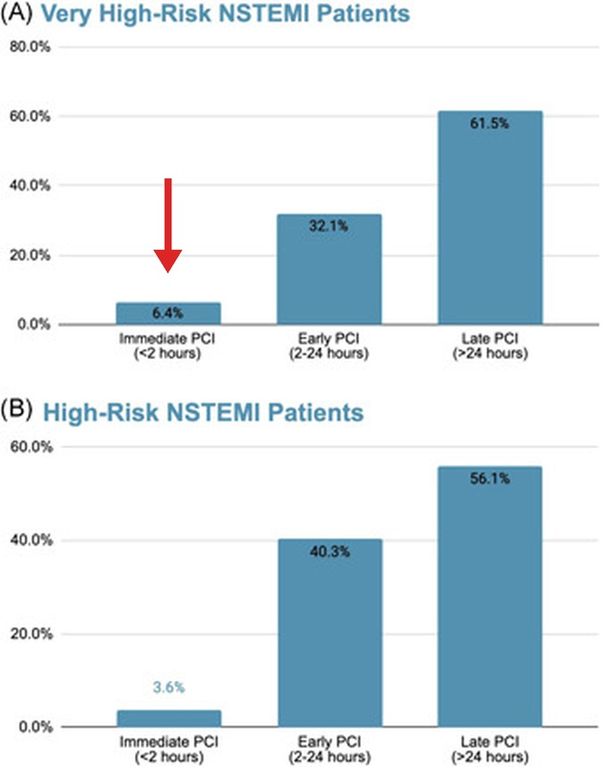
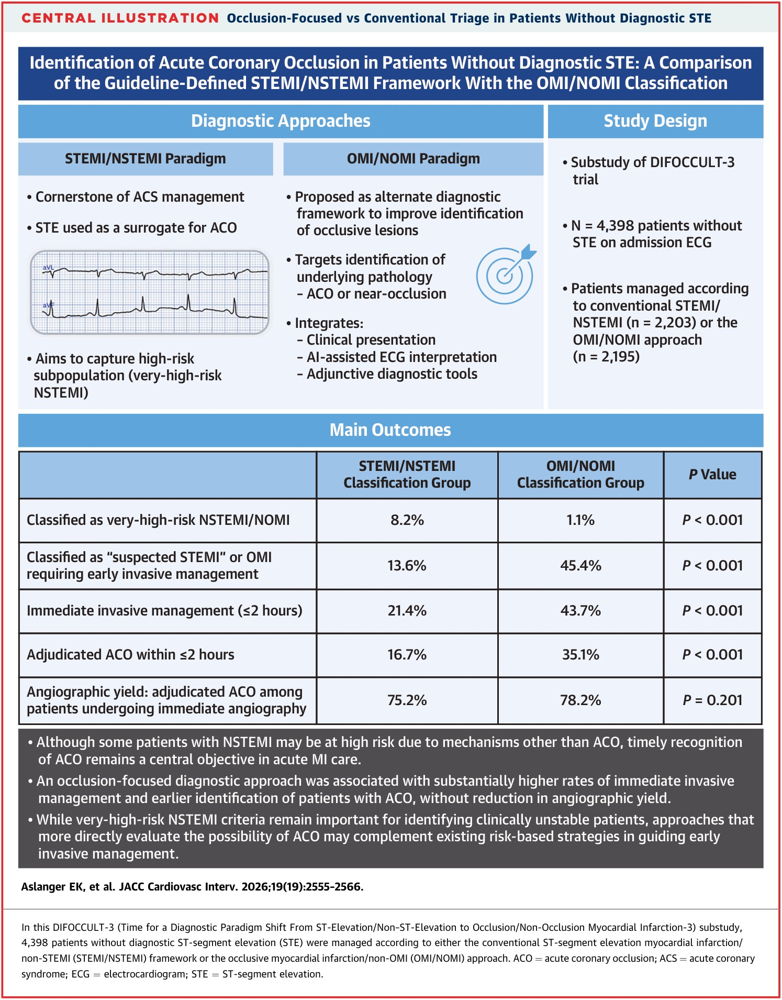
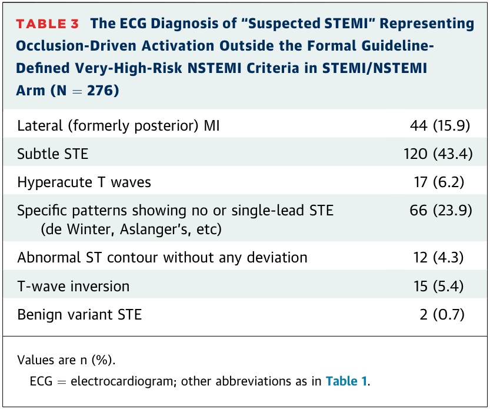



跟心臟科討論沒有STE的OMI，常聽到一句話：「NSTEMI指引本來就有very-high-risk，符合就2小時內做導管，為什麼要換一套OMI/NOMI?」有時還會補一句：「研究也說NSTEMI早做導管沒有比較好。」[^kite2022][^jobs2017]但指引真的有被照做嗎?Dr. Smith常引用一篇以色列全國調查(ACSIS 2016、2018)：做了PCI、有記錄door-to-balloon時間的1,078位NSTEMI病人中，156位符合very-high-risk，真正在2小時內做導管的只有10位(6.4%)[^lupu2022]。

<figure class="d3-fig">

<figcaption><b class="cap-f">Figure 1</b>｜原文Figure 1(Lupu 2022)：NSTEMI病人做PCI的時機。(A)very-high-risk：2小時內6.4%、2–24小時32.1%、超過24小時61.5%(紅色箭頭是2小時內的6.4%)；(B)high-risk：2小時內3.6%、2–24小時40.3%、超過24小時56.1%。分母是有記錄door-to-balloon時間的病人(very-high-risk 156人、high-risk 922人)。 來源：Lupu L, et al. <i>Clin Cardiol</i> 2022;45(4):359–369，CC BY開放取用。</figcaption>
</figure>

這個質疑很合理。如果把very-high-risk NSTEMI準則執行好，就能把該緊急打通的人抓出來，那OMI/NOMI就只是換個名字而已。

2026年10月JACC: Cardiovascular Interventions這篇DIFOCCULT-3次研究，就是針對這個質疑設計的。作者是Aslanger、Meyers、Smith這群心電圖大師們[^asl-intro]。

為什麼要在意血管有沒有塞住?作者在Discussion寫：**<mark style="background-color: pink">過去的meta-analysis顯示，NSTEMI病人culprit血管是不是塞住，比Killip class這些傳統高風險指標，更能預測不良預後</mark>**[^asl-killip]。作者這句引了三篇文獻，其中真正的meta-analysis是Khan 2017[^khan2017]：

<figure class="d3-fig">
<svg viewBox="0 0 800 300" role="img" aria-labelledby="d3e-t">
  <title id="d3e-t">Khan 2017：culprit血管完全阻塞vs沒阻塞，四項結果的RR都在1的右邊</title>
  <text class="d3-b" x="20" y="30">7篇研究、40,777位NSTEMI，10,415位(25.5%)culprit血管完全阻塞</text>
  <text class="d3-s" x="640" y="58">RR(95% CI)</text>
  <line class="d3-ln" x1="280" y1="62" x2="280" y2="240" stroke-dasharray="4 4"/>
  <line class="d3-ln" x1="220" y1="240" x2="700" y2="240"/>
  <text class="d3-s" x="280" y="262" text-anchor="middle">1.0</text>
  <text class="d3-s" x="430" y="262" text-anchor="middle">1.5</text>
  <text class="d3-s" x="580" y="262" text-anchor="middle">2.0</text>
  <text class="d3-b" x="20" y="91">短期全死因死亡</text>
  <line x1="373" y1="86" x2="619" y2="86" stroke="#dc2626" stroke-width="2.5"/>
  <rect x="474" y="79" width="14" height="14" fill="#dc2626"/>
  <text class="d3-s" x="640" y="91">1.67(1.31–2.13)</text>
  <text class="d3-b" x="20" y="131">短期MACE</text>
  <line x1="331" y1="126" x2="490" y2="126" stroke="#dc2626" stroke-width="2.5"/>
  <rect x="396" y="119" width="14" height="14" fill="#dc2626"/>
  <text class="d3-s" x="640" y="131">1.41(1.17–1.70)</text>
  <text class="d3-b" x="20" y="171">中長期全死因死亡</text>
  <line x1="304" y1="166" x2="538" y2="166" stroke="#dc2626" stroke-width="2.5"/>
  <rect x="399" y="159" width="14" height="14" fill="#dc2626"/>
  <text class="d3-s" x="640" y="171">1.42(1.08–1.86)</text>
  <text class="d3-b" x="20" y="211">中長期MACE</text>
  <line x1="313" y1="206" x2="448" y2="206" stroke="#dc2626" stroke-width="2.5"/>
  <rect x="369" y="199" width="14" height="14" fill="#dc2626"/>
  <text class="d3-s" x="640" y="211">1.32(1.11–1.56)</text>
  <text class="d3-s" x="272" y="286" text-anchor="end">← 兩組一樣(RR＝1)</text>
  <text class="d3-s" x="288" y="286">完全阻塞那組比較差 →</text>
</svg>
<figcaption><b class="cap-f">Figure 2</b>｜Khan 2017 meta-analysis：<strong><mark style="background-color: lightgreen">NSTEMI culprit血管完全阻塞vs沒阻塞</mark></strong>。方塊是RR，橫線是95% CI；虛線是RR＝1(兩組一樣)，四條橫線都在虛線右邊，代表完全阻塞那組都比較差。</figcaption>
</figure>

也就是說，**<mark>四個NSTEMI裡大約就有一個血管其實是塞住的，這群人的短期死亡風險是沒阻塞者的1.67倍</mark>**。

其他研究也看到類似結果：台大團隊Hung 2018的meta-analysis(25篇研究、60,898位NSTEMI)阻塞比例34%，死亡的勝算是沒阻塞者的1.72倍(OR 1.72)[^hung2018]，Wang 2009校正後6個月死亡率HR 1.72[^wang2009]，不過也有registry發現長期死亡率主要跟病人原本的共病有關[^fernando2021]。

## 這個研究在問什麼?

**<mark>沒有diagnostic STE的病人，用指引的very-high-risk NSTEMI分流，還是用OMI/NOMI分流，哪一個比較早找到ACO(acute coronary occlusion，急性冠狀動脈阻塞)?</mark>**

前面幾篇觀察性研究都看到，血管塞住的NSTEMI短期預後比較差(Figure 2)。**<mark style="background-color: pink">那提早找到這群人，能不能把預後救回來?這篇回答不了。它只比較兩種分流哪一個比較早找到ACO、比較早進導管室，沒有看死亡、梗塞大小或LVEF</mark>**；作者寫明，早找到能不能變成臨床上的好處，要等DIFOCCULT-3母試驗預定的1年結果[^asl-outcome]。所以<strong><u>這篇回答的是前半段：OMI/NOMI做法比較早找到ACO(Q3)；後半段「早找到能不能改善預後」，目前還是假說(Q5)</u></strong>。

DIFOCCULT-3在土耳其18家中心進行。以介入心臟科團隊為單位，依輪值日分配：這一天照STEMI/NSTEMI指引處理，那一天照OMI/NOMI處理。DIFOCCULT-3收的是ECG或臨床診斷為急性心肌梗塞的成人，不是所有胸痛病人[^difo3-ct]。這篇次研究再排除入院ECG已經達到diagnostic STE的人(由自動判讀軟體依通用標準判定，1,287人)，troponin雖然上升、但最後判定是心肌梗塞以外原因造成的病人也排除。最後4,398人，兩組都是入院ECG沒有diagnostic STE的MI病人：STEMI/NSTEMI日2,203人，OMI/NOMI日2,195人[^asl-design]。

<figure class="d3-fig">
<svg viewBox="0 0 720 470" role="img" aria-labelledby="d3a-t">
  <title id="d3a-t">DIFOCCULT-3次研究流程：4,398位沒有diagnostic STE的MI病人，依輪值日分成兩套做法</title>
  <defs><marker id="d3a-ar" viewBox="0 0 10 10" refX="9" refY="5" markerWidth="7" markerHeight="7" orient="auto"><path d="M0,0 L10,5 L0,10 z" fill="currentColor" fill-opacity=".55"/></marker></defs>
  <rect class="d3-box" x="150" y="10" width="420" height="62" rx="10"/>
  <text class="d3-b" x="360" y="36" text-anchor="middle">土耳其18家中心｜沒有diagnostic STE的成人MI病人</text>
  <text class="d3-s" x="360" y="58" text-anchor="middle">排除troponin上升歸因於非MI的病人，共4,398人</text>
  <line class="d3-ln" x1="360" y1="72" x2="360" y2="96"/>
  <text class="d3-s" x="372" y="90">依介入心臟科團隊的輪值日分配</text>
  <path class="d3-ln" d="M185,96 L535,96" fill="none"/>
  <line class="d3-ln" x1="185" y1="96" x2="185" y2="116" marker-end="url(#d3a-ar)"/>
  <line class="d3-ln" x1="535" y1="96" x2="535" y2="116" marker-end="url(#d3a-ar)"/>
  <rect class="d3-blue" x="35" y="118" width="300" height="58" rx="10"/>
  <text class="d3-b" x="185" y="142" text-anchor="middle" fill="#2563eb">STEMI/NSTEMI日｜2,203人</text>
  <text class="d3-s" x="185" y="164" text-anchor="middle">照指引分流，AI app關閉</text>
  <rect class="d3-red" x="385" y="118" width="300" height="58" rx="10"/>
  <text class="d3-b" x="535" y="142" text-anchor="middle" fill="#dc2626">OMI/NOMI日｜2,195人</text>
  <text class="d3-s" x="535" y="164" text-anchor="middle">ECG判讀＋AI app為主要觸發</text>
  <line class="d3-ln" x1="185" y1="176" x2="185" y2="204" marker-end="url(#d3a-ar)"/>
  <line class="d3-ln" x1="535" y1="176" x2="535" y2="204" marker-end="url(#d3a-ar)"/>
  <rect class="d3-box" x="35" y="206" width="300" height="58" rx="10"/>
  <text class="d3-b" x="185" y="230" text-anchor="middle">Very-high-risk NSTEMI 181人(8.2%)</text>
  <text class="d3-s" x="185" y="252" text-anchor="middle">2小時內進導管98人(54.1%)</text>
  <rect class="d3-box" x="385" y="206" width="300" height="58" rx="10"/>
  <text class="d3-b" x="535" y="230" text-anchor="middle">判為OMI 997人(45.4%)</text>
  <text class="d3-s" x="535" y="252" text-anchor="middle">2小時內進導管820人(82.2%)</text>
  <line class="d3-ln" x1="185" y1="264" x2="185" y2="292" marker-end="url(#d3a-ar)"/>
  <line class="d3-ln" x1="535" y1="264" x2="535" y2="292" marker-end="url(#d3a-ar)"/>
  <rect class="d3-box" x="35" y="294" width="300" height="58" rx="10"/>
  <text class="d3-b" x="185" y="318" text-anchor="middle">其餘2,022人</text>
  <text class="d3-s" x="185" y="340" text-anchor="middle">醫師覺得ECG像阻塞而叫導管：276人(13.6%)</text>
  <rect class="d3-box" x="385" y="294" width="300" height="58" rx="10"/>
  <text class="d3-b" x="535" y="318" text-anchor="middle">其餘判為NOMI</text>
  <text class="d3-s" x="535" y="340" text-anchor="middle">其中仍有very-high-risk特徵：25人</text>
  <line class="d3-ln" x1="185" y1="352" x2="185" y2="392" marker-end="url(#d3a-ar)"/>
  <line class="d3-ln" x1="535" y1="352" x2="535" y2="392" marker-end="url(#d3a-ar)"/>
  <rect class="d3-box" x="35" y="394" width="650" height="62" rx="10"/>
  <text class="d3-b" x="360" y="420" text-anchor="middle">比較兩個主要指標</text>
  <text class="d3-s" x="360" y="442" text-anchor="middle">① 首張ECG到balloon ≤2小時　② 2小時內找到adjudicated ACO</text>
</svg>
<figcaption><b class="cap-f">Figure 3</b>｜研究流程。左邊是照指引的那一天，右邊是照OMI/NOMI的那一天；兩邊的病人都是沒有diagnostic STE的MI。人數依原文Results與Table 2整理。</figcaption>
</figure>

兩個主要指標：

<b>Table 1</b>｜兩個主要指標

| 指標 | 定義 |
| --- | --- |
| Immediate invasive management | 首張ECG到balloon ≤2小時 |
| 2小時內找到adjudicated ACO | 血管攝影TIMI flow 0–1(血流完全不通或幾乎不通)，或TIMI 2(有血流但慢)合併急性culprit病灶特徵，而且troponin明顯上升[^asl-endpoints] |

Adjudicated ACO是研究團隊照同一套定義(上面Table 1)判定的ACO，不是各家醫院各自認定：血管攝影由至少2位有經驗的介入心臟科醫師判讀，意見不同時由第3位裁定。之所以不只算完全塞住(TIMI 0–1)，是因為阻塞會變動，到做血管攝影時可能已經部分或自己通了[^asl-adjud]。

OMI/NOMI日的做法：<strong>主要觸發是ECG，包括醫師判讀與AI app</strong>，<strong>未達STEMI criteria的subtle pattern、dynamic change都算</strong>；臨床表現、very high troponin、床邊心臟超音波當輔助。AI app是Powerful Medical的手機app，拍下ECG後顯示「OMI」或「Not OMI」，顯示OMI就要通知介入心臟科。STEMI/NSTEMI日AI app關閉[^asl-ai-app]。

也就是說，OMI的診斷不是只靠ECG。Smith部落格反覆講這件事：「OMI is a clinical diagnosis」，ECG看起來沒事不能排除OMI，troponin正常也不能[^frick2024b]；ECG不是唯一的線索，還有病史、身體檢查、troponin和床邊心臟超音波[^frick2024a]。DIFOCCULT-3的OMI/NOMI日也是這樣設計：ECG(醫師判讀加AI app)是主要觸發，臨床表現、very high troponin、床邊超音波一起看(下面Table 3)。

## 先問自己幾個問題:

- Q1：very-high-risk NSTEMI是哪些人?實際上抓得到多少?
- Q2：OMI/NOMI值班那一天，團隊怎麼找阻塞?
- Q3：2小時內找到ACO，兩套做法差多少?導管室會不會多做一堆通的血管(沒有阻塞)?
- Q4：照指引值班那一天，醫師其實已經在抓哪些ECG?
- Q5：這篇沒辦法回答什麼?

## Q1：very-high-risk NSTEMI抓得到多少?

這篇依ESC指引定義very-high-risk NSTEMI[^asl-vhr-def]：

<b>Table 2</b>｜Very-high-risk NSTEMI特徵（ESC指引）

| Very-high-risk NSTEMI特徵 |
| --- |
| Hemodynamic instability或cardiogenic shock |
| 藥物治療無效的反覆或持續胸痛(refractory chest pain) |
| 推定由持續缺血造成的acute heart failure |
| 到院後life-threatening ventricular arrhythmia或cardiac arrest |
| Mechanical complications |
| 反覆的dynamic ST-T change，特別是間歇性STE |

STEMI/NSTEMI日2,203人中，符合very-high-risk的只有181人(8.2%)。這181人裡，2小時內進導管的只有98人(54.1%)[^asl-vhr-181]。

181人的決策理由(可重疊)，最多的是refractory chest pain 82人(45.3%)。Hemodynamic instability、ventricular arrhythmia、mechanical complications都很少[^asl-table2]。

也就是說，**<mark style="background-color: lightgreen">靠very-high-risk準則來決定誰要緊急導管，有兩個問題：第一，符合的人很少，2,203人只有181人；第二，就算符合，也只有一半左右真的在2小時內進導管</mark>**。

為什麼篩到的人少?作者的解釋是：hemodynamic instability、malignant arrhythmia這些特徵本來就少見；refractory chest pain和dynamic ECG change，則是在STEMI/NSTEMI架構下常常沒有被認出來(under-recognition)：病人其實有，但醫師沒有把它標成very-high-risk。**這是....視若無睹嗎?XD**

**所以此篇研究STEMI/NSTEMI這一群的病患，應該要有比181位，更多的病患被納入Very high risk，但因為被<u>under-recognition</u>，所以只有181位。**

我自己的體感是以前和CV man報告病患refractory chest pain or hypotension，CV man常會請我們進一步治療，或試著把血壓拉起來。不會第一時間，就想抓進去做PCI。但是近幾年已經好蠻多的，反而我們再次會診CV man說病患仍持續胸痛、或血壓掉。還蠻願意就直接去導管室。

下面Figure 4就是原文Table 2，實際被標成very-high-risk的，**<mark style="background-color: lightblue">最多的是胸痛壓不住，不是休克</mark>**[^asl-underrecog]。

。左欄是STEMI/NSTEMI日的181人，右欄是OMI/NOMI日仍有very-high-risk特徵的NOMI 25人。")

原文Table 2的註腳寫明：refractory chest pain和dynamic ST-T change這兩項，在OMI/NOMI架構下本來就直接歸為OMI，所以OMI/NOMI日仍有very-high-risk特徵的NOMI病人(25人)裡，這兩項都是0[^asl-table2b]。Smith部落格2023年一篇病例(Jesse McLaren撰文)也這樣寫：照OMI架構，診斷性的ECG和refractory chest pain，都是緊急再灌流的適應症[^mclaren2023]。

作者把兩套做法的差別講成一句話：very-high-risk看的是downstream的臨床不穩定，OMI看的是upstream的阻塞本身。作者另外推測：OMI做法更早找到、更早打通ACO，理論上也許能讓一部分病人不要惡化到very-high-risk那些不穩定的狀況；但作者明講這只是假說，還要等預後資料證實[^asl-down-up]。

<figure class="d3-fig">
<svg viewBox="0 0 720 300" role="img" aria-labelledby="d3b-t">
  <title id="d3b-t">Upstream與downstream：OMI找阻塞本身，very-high-risk看阻塞造成的臨床不穩定</title>
  <defs><marker id="d3b-ar" viewBox="0 0 10 10" refX="9" refY="5" markerWidth="8" markerHeight="8" orient="auto"><path d="M0,0 L10,5 L0,10 z" fill="currentColor" fill-opacity=".6"/></marker></defs>
  <text class="d3-b" x="120" y="30" text-anchor="middle" fill="#dc2626">OMI/NOMI：直接找阻塞</text>
  <text class="d3-s" x="120" y="50" text-anchor="middle">看ECG、超音波、臨床</text>
  <line x1="120" y1="58" x2="120" y2="92" stroke="#dc2626" stroke-width="2" marker-end="url(#d3b-ar)"/>
  <text class="d3-b" x="600" y="30" text-anchor="middle" fill="#2563eb">Very-high-risk：看不穩定</text>
  <text class="d3-s" x="600" y="50" text-anchor="middle">等到出現這些特徵才緊急導管</text>
  <line x1="600" y1="58" x2="600" y2="92" stroke="#2563eb" stroke-width="2" marker-end="url(#d3b-ar)"/>
  <rect class="d3-red" x="20" y="96" width="200" height="86" rx="10"/>
  <text class="d3-b" x="120" y="128" text-anchor="middle">冠狀動脈阻塞(ACO)</text>
  <text class="d3-s" x="120" y="150" text-anchor="middle">upstream</text>
  <text class="d3-s" x="120" y="168" text-anchor="middle">阻塞的病灶本身</text>
  <line class="d3-ln" x1="222" y1="139" x2="258" y2="139" marker-end="url(#d3b-ar)"/>
  <rect class="d3-box" x="260" y="96" width="200" height="86" rx="10"/>
  <text class="d3-b" x="360" y="128" text-anchor="middle">缺血持續</text>
  <text class="d3-s" x="360" y="150" text-anchor="middle">沒打通，</text>
  <text class="d3-s" x="360" y="168" text-anchor="middle">心肌繼續受損</text>
  <line class="d3-ln" x1="462" y1="139" x2="498" y2="139" marker-end="url(#d3b-ar)"/>
  <rect class="d3-blue" x="500" y="96" width="200" height="86" rx="10"/>
  <text class="d3-b" x="600" y="122" text-anchor="middle">臨床不穩定</text>
  <text class="d3-s" x="600" y="142" text-anchor="middle">downstream</text>
  <text class="d3-s" x="600" y="160" text-anchor="middle">休克、惡性心律不整、</text>
  <text class="d3-s" x="600" y="176" text-anchor="middle">急性心衰竭、胸痛壓不住</text>
  <path d="M222,108 Q360,22 498,108" fill="none" stroke="currentColor" stroke-opacity=".45" stroke-dasharray="5 4" marker-end="url(#d3b-ar)"/>
  <text class="d3-s" x="360" y="50" text-anchor="middle">假說：更早打通，能不能不走到這裡?</text>
  <line class="d3-ln" x1="20" y1="204" x2="700" y2="204" marker-end="url(#d3b-ar)"/>
  <text class="d3-b" x="360" y="226" text-anchor="middle">隨時間演進</text>
  <text class="d3-s" x="360" y="256" text-anchor="middle">更早找到ACO，能不能讓病人不要走到不穩定?作者說這只是假說，要等預後資料</text>
  <text class="d3-s" x="360" y="284" text-anchor="middle">反過來：休克但血管沒有塞住的病人，OMI不一定抓得到，very-high-risk照樣要處理</text>
</svg>
<figcaption><b class="cap-f">Figure 5</b>｜Upstream與downstream。依原文Discussion「downstream clinical instability vs upstream occlusive pathology」繪製，中間「缺血持續」一格、上方虛線和下方「隨時間演進」箭頭是為了說明而加的。</figcaption>
</figure>

這不代表very-high-risk可以丟掉。病人休克了，但血管沒有塞住，OMI不一定抓得到，very-high-risk還是要處理。作者的說法是：very-high-risk仍然是找出臨床不穩定病人的重要工具，直接找ACO的做法可能可以補足它(may complement)[^asl-complement]。

## Q2：OMI/NOMI日怎麼找阻塞?

OMI/NOMI日2,195人中，997人(45.4%)被判為OMI，其中820人(82.2%)在2小時內進導管[^asl-omi997]。

997人的主要觸發：

<b>Table 3</b>｜OMI/NOMI日997位OMI的主要觸發

| 主要觸發 | 人數(分母997) |
| --- | --- |
| AI輔助ECG判讀 | 817(81.9%) |
| Clinical gestalt(含高度典型的缺血症狀) | 101(10.1%) |
| Serial ECG change | 29(2.9%) |
| 床邊心臟超音波 | 28(2.8%) |
| Very high first troponin | 22(2.2%)[^asl-triggers] |

<figure class="d3-fig">
<svg viewBox="0 0 800 420" role="img" aria-labelledby="d3f-t">
  <title id="d3f-t">OMI/NOMI日997位OMI的五種主要觸發，圍繞著病人</title>
  <circle cx="380" cy="230" r="130" fill="none" stroke="#dc2626" stroke-width="28" stroke-dasharray="666.0 816.8" transform="rotate(-327.2 380 230)"/>
  <circle cx="380" cy="230" r="130" fill="none" stroke="#f59e0b" stroke-width="28" stroke-dasharray="79.5 816.8" transform="rotate(-32.4 380 230)"/>
  <circle cx="380" cy="230" r="130" fill="none" stroke="#0d9488" stroke-width="28" stroke-dasharray="20.7 816.8" transform="rotate(4.0 380 230)"/>
  <circle cx="380" cy="230" r="130" fill="none" stroke="#2563eb" stroke-width="28" stroke-dasharray="19.9 816.8" transform="rotate(14.4 380 230)"/>
  <circle cx="380" cy="230" r="130" fill="none" stroke="#7c3aed" stroke-width="28" stroke-dasharray="15.0 816.8" transform="rotate(24.5 380 230)"/>
  <circle cx="380" cy="180" r="26" fill="#94a3b8"/>
  <path d="M322,302 C322,238 346,216 380,216 C414,216 438,238 438,302 Z" fill="#94a3b8"/>
  <path d="M380,264 C372,256 362,250 366,241 C369,235 377,237 380,243 C383,237 391,235 394,241 C398,250 388,256 380,264 Z" fill="#dc2626"/>
  <text class="d3-b" x="380" y="326" text-anchor="middle">997位OMI</text>
  <polyline points="234,230 214,230 200,230" fill="none" stroke="#dc2626" stroke-width="1.5"/>
  <circle cx="234" cy="230" r="3" fill="#dc2626"/>
  <text class="d3-b" x="196" y="216" text-anchor="end" fill="#dc2626">AI輔助ECG判讀</text>
  <text x="196" y="250" text-anchor="end" fill="#dc2626" font-size="28" font-weight="800">81.9%</text>
  <text class="d3-s" x="196" y="272" text-anchor="end">817人</text>
  <polyline points="522,194 556,113 572,113" fill="none" stroke="#f59e0b" stroke-width="1.5"/>
  <circle cx="522" cy="194" r="3" fill="#f59e0b"/>
  <text class="d3-b" x="580" y="118" fill="#f59e0b">Clinical gestalt</text>
  <text class="d3-s" x="580" y="138">含典型缺血症狀・101人(10.1%)</text>
  <polyline points="524,253 556,203 572,203" fill="none" stroke="#0d9488" stroke-width="1.5"/>
  <circle cx="524" cy="253" r="3" fill="#0d9488"/>
  <text class="d3-b" x="580" y="208" fill="#0d9488">ECG動態變化</text>
  <text class="d3-s" x="580" y="228">Serial ECG change・29人(2.9%)</text>
  <polyline points="518,279 556,277 572,277" fill="none" stroke="#2563eb" stroke-width="1.5"/>
  <circle cx="518" cy="279" r="3" fill="#2563eb"/>
  <text class="d3-b" x="580" y="282" fill="#2563eb">床邊心臟超音波</text>
  <text class="d3-s" x="580" y="302">28人(2.8%)</text>
  <polyline points="508,300 556,351 572,351" fill="none" stroke="#7c3aed" stroke-width="1.5"/>
  <circle cx="508" cy="300" r="3" fill="#7c3aed"/>
  <text class="d3-b" x="580" y="356" fill="#7c3aed">Very high first troponin</text>
  <text class="d3-s" x="580" y="376">抽血才知道・22人(2.2%)</text>
</svg>
<figcaption><b class="cap-f">Figure 6</b>｜依上面Table 3畫的：環的長度就是比例。OMI/NOMI日997位OMI，每位算一個主要觸發，紅色的AI輔助ECG判讀佔八成，其他四種加起來不到兩成。</figcaption>
</figure>

八成的觸發來自AI。所以作者特別提醒：OMI/NOMI日多找到的ACO，是整套找阻塞的流程(ECG判讀、AI app、臨床判斷、床邊超音波)合起來的成果，這篇沒有拿「有AI」和「沒有AI」來比，不能把功勞都算給AI；在ECG判讀強的環境，不用AI也可能做到，AI可能讓結果更容易重複、更容易推廣到其他醫院[^asl-ai-alone]。

## Q3：2小時內找到ACO，差多少?

<b>Table 4</b>｜兩套做法的主要結果(整理自原文Results與Figure 2B，原文沒有這張表)

| 指標 | STEMI/NSTEMI日 | OMI/NOMI日 | 差異 |
| --- | --- | --- | --- |
| 2小時內進導管 | 472/2,203(21.4%) | 960/2,195(43.7%) | 22.3%，aOR 2.37 |
| 2小時內找到adjudicated ACO(有時間資料者) | 355/2,128(16.7%) | 751/2,138(35.1%) | 18.4% |
| 只算TIMI 0–1，2小時內找到(有時間資料者) | 270/2,081(13.0%) | 576/2,071(27.8%) | 14.8% |
| 不限時間的adjudicated ACO(有判定資料者) | 1,204/2,201(54.7%) | 1,274/2,192(58.1%) | P=0.024[^asl-main] |

表中的472是原文直接報告的人數。其中98人是very-high-risk，236人是醫師以suspected STEMI啟動導管(276人中的236人)，加起來334人；其餘138人(472−334)，原文沒有細分[^asl-472]。

作者另外換了一個比較好想像的講法，一步一步算給你看(Figure 8)：

1. 假設兩邊各有1,000位病人。
2. 2小時內進導管：STEMI/NSTEMI日21.4%，就是214人；OMI/NOMI日43.7%，就是437人。OMI/NOMI多送437−214＝223人。
3. 2小時內找到ACO：16.7%是167人，35.1%是351人。OMI/NOMI多找到351−167＝184人。
4. 223÷184約等於1.2：平均每多送1.2個人進導管，就多抓到1個早期ACO。也就是說，多做的223次導管，對應多找到的184個ACO(184÷223約82%)[^asl-per1000]。

要注意，這裡的百分比分母不完全一樣：進導管算的是全部病人(2,203、2,195)，找到ACO只算有時間資料的人(2,128、2,138)。所以這些人數是近似值，跟下面Table 5的命中率(75.2%、78.2%)也不會剛好對上。

<figure class="d3-fig">
<svg viewBox="0 0 720 390" role="img" aria-labelledby="d3c-t">
  <title id="d3c-t">每1,000人的換算：多做223次2小時內導管，多找到184個早期ACO</title>
  <defs><marker id="d3c-ar" viewBox="0 0 10 10" refX="9" refY="5" markerWidth="7" markerHeight="7" orient="auto"><path d="M0,0 L10,5 L0,10 z" fill="currentColor" fill-opacity=".55"/></marker></defs>
  <rect class="d3-blue" x="35" y="10" width="300" height="50" rx="10"/>
  <text class="d3-b" x="185" y="41" text-anchor="middle" fill="#2563eb">STEMI/NSTEMI日｜1,000人</text>
  <rect class="d3-red" x="385" y="10" width="300" height="50" rx="10"/>
  <text class="d3-b" x="535" y="41" text-anchor="middle" fill="#dc2626">OMI/NOMI日｜1,000人</text>
  <line class="d3-ln" x1="185" y1="60" x2="185" y2="86" marker-end="url(#d3c-ar)"/>
  <line class="d3-ln" x1="535" y1="60" x2="535" y2="86" marker-end="url(#d3c-ar)"/>
  <rect class="d3-box" x="35" y="88" width="300" height="58" rx="10"/>
  <text class="d3-b" x="185" y="112" text-anchor="middle">2小時內進導管：214人</text>
  <text class="d3-s" x="185" y="134" text-anchor="middle">21.4%×1,000</text>
  <rect class="d3-box" x="385" y="88" width="300" height="58" rx="10"/>
  <text class="d3-b" x="535" y="112" text-anchor="middle">2小時內進導管：437人</text>
  <text class="d3-s" x="535" y="134" text-anchor="middle">43.7%×1,000</text>
  <line class="d3-ln" x1="185" y1="146" x2="185" y2="172" marker-end="url(#d3c-ar)"/>
  <line class="d3-ln" x1="535" y1="146" x2="535" y2="172" marker-end="url(#d3c-ar)"/>
  <rect class="d3-box" x="35" y="174" width="300" height="58" rx="10"/>
  <text class="d3-b" x="185" y="198" text-anchor="middle">其中找到ACO：167人</text>
  <text class="d3-s" x="185" y="220" text-anchor="middle">16.7%×1,000</text>
  <rect class="d3-box" x="385" y="174" width="300" height="58" rx="10"/>
  <text class="d3-b" x="535" y="198" text-anchor="middle">其中找到ACO：351人</text>
  <text class="d3-s" x="535" y="220" text-anchor="middle">35.1%×1,000</text>
  <line class="d3-ln" x1="185" y1="232" x2="185" y2="262" marker-end="url(#d3c-ar)"/>
  <line class="d3-ln" x1="535" y1="232" x2="535" y2="262" marker-end="url(#d3c-ar)"/>
  <rect class="d3-box" x="35" y="264" width="650" height="114" rx="10"/>
  <text class="d3-b" x="360" y="292" text-anchor="middle">多做導管：437−214＝223次</text>
  <text class="d3-b" x="360" y="320" text-anchor="middle">多找到ACO：351−167＝184個</text>
  <text class="d3-b" x="360" y="350" text-anchor="middle" fill="#dc2626">223÷184≈1.2：每多做1.2次導管，多找到1個早期ACO</text>
</svg>
<figcaption><b class="cap-f">Figure 8</b>｜每1,000人的換算(依上面Table 4的百分比計算)。進導管的百分比分母是全部病人(2,203、2,195)，找到ACO只算有時間資料的人(2,128、2,138)，所以人數是近似值。</figcaption>
</figure>

**2小時內找到ACO的比例約為兩倍(2.1倍)；換成最嚴格的TIMI 0–1定義，也是約兩倍**[^asl-timi01]。

**不限時間的話**，兩組找到的ACO比例**差距小很多(54.7% vs 58.1%，P=0.024)**[^asl-main]。**<mark style="background-color: pink">主要差別在早還是晚；早找到能不能換到更多心肌、改善預後，這篇沒有回答。</mark>**

開頭心臟科說的「NSTEMI早做導管沒有比較好」，確實有RCT證據。Kite 2022的meta-analysis整合17篇RCT、10,209位NSTE-ACS病人，早做和晚做導管相比，全死因死亡(RR 0.90，95% CI 0.78–1.04)和MI(RR 0.86，95% CI 0.63–1.16)都沒有差，只有反覆缺血和住院時間減少[^kite2022]。Jobs 2017的meta-analysis(8篇RCT、5,324人)整體死亡率也沒有差；但在troponin上升、糖尿病、GRACE>140、75歲以上這些高風險病人，早做的死亡率比較低，只是交互作用檢定沒有定論[^jobs2017]。2023年ESC指引也是這樣整理[^esc2023]。不過這些RCT收的是所有NSTE-ACS，沒有把culprit血管塞住的那大約四分之一(Figure 2)拆出來看。

那血管塞住、但沒有STE的人，早一點打通會不會比較好?這個問題，Smith團隊自己目前也沒有答案。2021年Meyers、Smith等人在J Emerg Med回顧467位ACS病人：108位OMI裡只有60%(67/108)符合STEMI criteria；沒有STE的OMI，到院到導管中位數437分鐘，有STE的OMI是41分鐘，90分鐘內做導管的比例是28% vs 76%。但沒有STE的OMI，不良預後比較接近有STE的OMI，跟沒有阻塞的人差得多。他們的結論也只寫到「支持OMI/NOMI架構，沒有STE的OMI做緊急再灌流需要進一步研究」[^meyers2021]。Meyers和Smith在部落格評論丹麥的VERDICT試驗時也說，他們猜這群人早做會比較有好處，但那是猜測[^verdict-blog]。

如果你讀過摘要，會看到一組數字45.4% vs 13.6%，很容易以為是兩組進導管的比例，其實不是。45.4%是OMI/NOMI日被判成OMI的比例(997/2,195)；13.6%是STEMI/NSTEMI日扣掉very-high-risk之後，醫師以suspected STEMI叫導管的比例(276/2,022)。兩個數字算的東西不一樣，分母也不一樣，不能直接比。真正比較兩組2小時內進導管的，是上面Table 4的21.4% vs 43.7%[^asl-abstract]。

<figure class="d3-fig">
<svg viewBox="0 0 720 320" role="img" aria-labelledby="d3d-t">
  <title id="d3d-t">摘要的45.4% vs 13.6%是分類比例，真正比較兩組2小時內進導管的是43.7% vs 21.4%</title>
  <text class="d3-b" x="20" y="26">摘要的45.4% vs 13.6%：被分到「要緊急處理」那一類的比例</text>
  <text class="d3-b" x="20" y="62">OMI/NOMI日</text>
  <text class="d3-s" x="20" y="80">判為OMI 997/2,195</text>
  <rect x="250" y="50" width="182" height="28" rx="4" fill="#dc2626" fill-opacity=".75"/>
  <text class="d3-b" x="440" y="70">45.4%</text>
  <text class="d3-b" x="20" y="108">STEMI/NSTEMI日</text>
  <text class="d3-s" x="20" y="126">suspected STEMI 276/2,022</text>
  <rect x="250" y="96" width="54" height="28" rx="4" fill="#2563eb" fill-opacity=".75"/>
  <text class="d3-b" x="312" y="116">13.6%</text>
  <text class="d3-s" x="20" y="154">算的東西不一樣，分母也不一樣(2,022是2,203扣掉181位very-high-risk)，不能直接比</text>
  <line class="d3-ln" x1="20" y1="172" x2="700" y2="172" stroke-dasharray="4 4"/>
  <text class="d3-b" x="20" y="202">真正比較兩組：2小時內進導管(分母都是全部病人)</text>
  <text class="d3-b" x="20" y="238">OMI/NOMI日</text>
  <text class="d3-s" x="20" y="256">960/2,195</text>
  <rect x="250" y="226" width="175" height="28" rx="4" fill="#dc2626" fill-opacity=".75"/>
  <text class="d3-b" x="433" y="246">43.7%</text>
  <text class="d3-b" x="20" y="284">STEMI/NSTEMI日</text>
  <text class="d3-s" x="20" y="302">472/2,203</text>
  <rect x="250" y="272" width="86" height="28" rx="4" fill="#2563eb" fill-opacity=".75"/>
  <text class="d3-b" x="344" y="292">21.4%</text>
</svg>
<figcaption><b class="cap-f">Figure 9</b>｜摘要那組數字和真正比較的數字。長條長度依百分比等比例畫(滿格400px＝100%)。</figcaption>
</figure>

先猜一下。OMI組2小時內送進導管室的人是兩倍，送進去的人裡面真的有ACO的比例(angiographic yield)，你覺得會變高、變低，還是差不多?

<b>Table 5</b>｜Angiographic yield(2小時內導管的人中，真的有ACO)

| Angiographic yield(2小時內導管的人中，真的有ACO) | STEMI/NSTEMI組 | OMI/NOMI組 | P |
| --- | --- | --- | --- |
| 研究判定的ACO | 355/472(75.2%) | 751/960(78.2%) | 0.201 |
| 只算TIMI 0–1 | 270/444(60.8%) | 576/916(62.9%) | 0.497[^asl-yield] |

差不多。送的人多一倍，命中率沒有下降，但也沒有因為「挑得比較準」而明顯變高。

至於「多做一堆乾淨的血管」：這群人都是MI病人，沒有ACO不等於血管乾淨。直接看冠狀動脈正常的MI(MI with normal coronary arteries)，兩組是89/2,203(4.0%) vs 77/2,195(3.5%)，P=0.355，沒有增加[^asl-minoca]。

## Q4：照指引值班那一天，醫師已經在抓哪些ECG?

STEMI/NSTEMI日扣掉181位very-high-risk，剩下2,022人。其中276人(13.6%)，醫師覺得ECG看起來是阻塞，雖然沒達到毫米STE criteria，還是叫了導管室。作者稱這群人為「suspected STEMI」，認為它不是指引定義的STEMI，觀念上跟OMI重疊[^asl-suspected]。

這276人的ECG診斷[^asl-table3]：

這張表是傳統組醫師在指引外啟動導管時記錄的ECG診斷，原文沒有每個pattern各自的ACO比例。<mark>它告訴我們的是：不用OMI這個名字，第一線醫師也已經在抓這些pattern，其中subtle STE最多</mark>。

## Q5：這篇沒辦法回答什麼?

- **預後**：**<mark style="background-color: pink">這篇只看導管時間和早期找到ACO，沒有死亡、梗塞大小、LVEF。作者寫明，這些要等DIFOCCULT-3母試驗預定的1年結果</mark>**[^asl-outcome]。
- **族群**：兩組都是入院ECG沒有diagnostic STE、最後診斷為MI的病人(troponin上升歸因於非MI的人已排除)；判斷有沒有STE只看入院那一張ECG。所以ACO比例才會高達54.7%–58.1%。不能直接套到急診所有胸痛病人[^asl-exclusion]。
- **醫療體系**：土耳其這些中心NSTEMI的導管本來就做得比較早，作者認為在NSTEMI導管常延遲的體系，差距可能更大；但也提醒要看當地導管室容量，不能延誤其他高優先病人[^asl-turkey]。
- **設計**：以團隊輪值日分配，醫師知道當天用哪一套；作者也承認，同一家醫院的流程互相影響，兩組之間無法完全隔開[^asl-contam]。
- **不是每個OMI都是持續完全阻塞**：作者承認，有些OMI在評估當下是間歇性阻塞或剛自己再通。這類病人可能不需要跟持續完全阻塞的人一樣緊急；但作者認為，culprit病灶已經顯示會塞住，觀察期間如果再塞住，不一定能即時發現、即時處理[^asl-intermittent]。
- **Very high troponin**：ACO的定義用到very high troponin，這可能讓ACO判定更準，但也可能代表梗塞已經比較完整，再灌流能多救的心肌有限[^asl-trop]。

## 所以在急診我們要怎麼做?

已經考慮MI、但ECG沒過STEMI毫米標準的胸痛病人，不要等到休克、致命性心律不整產生、藥物無效的胸痛才找心臟科。ECG上有subtle STE、de Winter、Aslanger pattern、lateral MI(formerly posterior)、hyperacute T waves，就要主動討論緊急導管。這幾個是傳統組醫師在指引外啟動導管時最常記錄的ECG，原文沒有各自的ACO比例[^asl-table3]。

Very-high-risk照樣要處理：休克、惡性心律不整的病人，不管血管有沒有塞住都是急件。

跟心臟科溝通時，可以用這組數字：2小時內找到ACO 16.7%→35.1%，送進去的人裡面真的有ACO的比例沒有下降，冠狀動脈正常的MI也沒有增加[^asl-main][^asl-yield][^asl-minoca]。

<figure class="d3-fig">
<svg viewBox="0 0 760 340" role="img" aria-labelledby="d3g-t">
  <title id="d3g-t">2小時內找到ACO倍增，命中率與冠狀動脈正常的MI幾乎不變</title>
  <line class="d3-ln" x1="230" y1="40" x2="230" y2="326"/>
  <text class="d3-b" x="20" y="30">2小時內找到ACO</text>
  <text class="d3-b" x="740" y="30" text-anchor="end" fill="#dc2626">多一倍</text>
  <text class="d3-s" x="20" y="61">STEMI/NSTEMI日</text>
  <rect x="230" y="44" width="60" height="24" rx="4" fill="#2563eb" fill-opacity=".75"/>
  <text class="d3-b" x="298" y="61">16.7%</text>
  <text class="d3-s" x="352" y="61">(355/2,128)</text>
  <text class="d3-s" x="20" y="93">OMI/NOMI日</text>
  <rect x="230" y="76" width="126" height="24" rx="4" fill="#dc2626" fill-opacity=".75"/>
  <text class="d3-b" x="364" y="93">35.1%</text>
  <text class="d3-s" x="418" y="93">(751/2,138)</text>
  <text class="d3-b" x="20" y="140">送進導管室的人裡，真的有ACO</text>
  <text class="d3-b" x="740" y="140" text-anchor="end" fill="#dc2626">沒有下降</text>
  <text class="d3-s" x="20" y="171">STEMI/NSTEMI日</text>
  <rect x="230" y="154" width="271" height="24" rx="4" fill="#2563eb" fill-opacity=".75"/>
  <text class="d3-b" x="509" y="171">75.2%</text>
  <text class="d3-s" x="563" y="171">(355/472)</text>
  <text class="d3-s" x="20" y="203">OMI/NOMI日</text>
  <rect x="230" y="186" width="282" height="24" rx="4" fill="#dc2626" fill-opacity=".75"/>
  <text class="d3-b" x="520" y="203">78.2%</text>
  <text class="d3-s" x="574" y="203">(751/960)</text>
  <text class="d3-b" x="20" y="250">冠狀動脈正常的MI</text>
  <text class="d3-b" x="740" y="250" text-anchor="end" fill="#dc2626">沒有增加</text>
  <text class="d3-s" x="20" y="281">STEMI/NSTEMI日</text>
  <rect x="230" y="264" width="14" height="24" rx="4" fill="#2563eb" fill-opacity=".75"/>
  <text class="d3-b" x="252" y="281">4.0%</text>
  <text class="d3-s" x="306" y="281">(89/2,203)</text>
  <text class="d3-s" x="20" y="313">OMI/NOMI日</text>
  <rect x="230" y="296" width="13" height="24" rx="4" fill="#dc2626" fill-opacity=".75"/>
  <text class="d3-b" x="251" y="313">3.5%</text>
  <text class="d3-s" x="305" y="313">(77/2,195)</text>
</svg>
<figcaption><b class="cap-f">Figure 11</b>｜跟心臟科溝通的三組數字。藍色是STEMI/NSTEMI日(照指引)，紅色是OMI/NOMI日；長條長度依百分比等比例畫(滿格360px＝100%)。</figcaption>
</figure>

**<mark>目前證明的是「更早找到」，還沒有證明「預後更好」</mark>**。

## 學習重點

1. 沒有diagnostic STE的MI病人中，指引very-high-risk NSTEMI只佔8.2%(181/2,203)，其中只有54.1%在2小時內進導管。
2. OMI/NOMI做法讓2小時內進導管從21.4%升到43.7%，2小時內找到ACO從16.7%升到35.1%。
3. Very-high-risk看downstream的臨床不穩定，OMI看upstream的阻塞；作者認為找ACO的做法可能補足very-high-risk，休克、惡性心律不整照樣是急件。
4. 導管多做一倍，送進去的人裡面真的有ACO的比例沒有下降(75.2% vs 78.2%)，冠狀動脈正常的MI也沒有增加(4.0% vs 3.5%)；每多做約1.2次導管，多找到1例早期ACO。
5. 不限時間的ACO比例差距小很多(54.7% vs 58.1%，P=0.024)，主要差別在早還是晚。
6. 傳統組醫師在指引外啟動導管時記錄的ECG，以subtle STE(43.4%)最多，其次是de Winter、Aslanger等特定pattern(23.9%)、lateral MI(15.9%)；原文沒有各pattern的ACO比例。
7. 這篇證明的是更早找到ACO；預後是否改善，要等DIFOCCULT-3的1年結果。研究族群是已排除非MI的病人，不能直接套到所有胸痛。

## 參考資料

內文每個上標數字，滑過去（手機點一下）就看得到出處和原文。整理起來是這15份：

- **本篇導讀的研究**
  - Aslanger EK, Aggül B, Yıldırımtürk Ö, Karabay CY, Meyers HP, Smith SW, Değertekin M, DIFOCCULT-3 Study Investigators. *JACC Cardiovasc Interv* 2026;19(19):2555–2566（Occlusion-Focused Triage vs Very-High-Risk NSTEMI Criteria: A DIFOCCULT-3 Substudy）
- **其他研究**
  - Lupu L, et al. *Clin Cardiol* 2022;45(4):359–369（以色列ACSIS：very-high-risk NSTEMI的立即導管比例）
  - Khan AR, et al. *Eur Heart J* 2017;38(41):3082–3089（NSTEMI culprit完全阻塞的meta-analysis）
  - Hung CS, et al. *Crit Care* 2018;22(1):34（NSTEMI culprit完全阻塞的meta-analysis，25篇研究）
  - Wang TY, et al. *Am Heart J* 2009;157(4):716–723（PARAGON-B：NSTE-ACS culprit完全阻塞與6個月死亡率）
  - Fernando H, et al. *Am J Cardiol* 2021;156:52–57（澳洲MIG registry：NSTEMI完全阻塞與30天、長期預後）
  - Meyers HP, et al. *J Emerg Med* 2021;60(3):273–284（STEMI/NSTEMI vs OMI/NOMI兩套架構比較）
  - Kite TA, et al. *Eur Heart J* 2022;43(33):3148–3161（NSTE-ACS導管時機的meta-analysis，17篇RCT）
  - Jobs A, et al. *Lancet* 2017;390(10096):737–746（NSTE-ACS導管時機的meta-analysis，8篇RCT）
- **指引與試驗登錄**
  - Byrne RA, et al. 2023 ESC Guidelines for the management of acute coronary syndromes. *Eur Heart J* 2023;44(38):3720–3826
  - ClinicalTrials.gov NCT06570759（DIFOCCULT-3收案條件）
- **部落格**
  - Meyers P, Smith SW. The VERDICT Trial. Dr. Smith's ECG Blog, 2019
  - McLaren J. 50 year old with acute chest pain, with ‘normal’ ECG and falling troponin. Dr. Smith's ECG Blog, 2023
  - Frick W. A man in his 40s with 3 days of stuttering chest pain. Dr. Smith's ECG Blog, 2024
  - Frick W. Crushing Chest Pain and Can't see OMI on the ECG? Just give morphine, right? Dr. Smith's ECG Blog, 2024

[^lupu2022]: Lupu L, Taha L, Banai A, et al. Immediate and early percutaneous coronary intervention in very high-risk and high-risk non-ST segment elevation myocardial infarction patients. *Clin Cardiol* 2022;45(4):359–369. doi:10.1002/clc.23781. PMID 35266561。 原文："Out of 1793 NSTEMI patients, 1643 (92%) patients underwent PCI, and door to balloon time was documented in 1078 of them. One hundred and fifty-six (14.5%) patients and 922 (85.5%) patients were defined as very high-risk and high-risk NSTEMI patients, respectively. Of the very high-risk NSTEMI patients, only 10 (6.4%) underwent immediate coronary angiography, and 50 (32.1%) underwent early coronary angiography."
[^asl-intro]: Aslanger EK, et al. Occlusion-Focused Triage vs Very-High-Risk NSTEMI Criteria: A DIFOCCULT-3 Substudy. *JACC Cardiovasc Interv* 2026;19(19):2555–2566. doi:10.1016/j.jcin.2026.06.040. PMID 42863867（p.2，Introduction）。 原文："...has been met with skepticism, based in part on the view that improved implementation of very-high-risk NSTEMI criteria could address the same clinical needs without requiring a change in the diagnostic framework (Central Illustration)."
[^asl-killip]: Aslanger 2026（p.9，Discussion；原文ref 31–33）。 原文："prior meta-analyses have demonstrated that ACO of the culprit artery in NSTEMI is a stronger determinant of adverse outcomes than traditional high-risk markers, such as Killip class."
[^khan2017]: Khan AR, Golwala H, Tripathi A, et al. Impact of total occlusion of culprit artery in acute non-ST elevation myocardial infarction: a systematic review and meta-analysis. *Eur Heart J* 2017;38(41):3082–3089. PMID 29020244（即Aslanger 2026的ref 31）。 原文："Our literature search yielded seven studies with 40 777 patients." "A total of 10 415 (25.5%) patients had an occluded culprit artery" "There was an increased risk of both MACE (short-term RR: 1.41; CI: 1.17, 1.70; P = 0.0003; I2 = 26%; medium- to long-term RR: 1.32; CI: 1.11, 1.56; P = 0.001; I2 = 25%) and all-cause mortality (short-term RR: 1.67; CI: 1.31, 2.13; P < 0.0001; I2 = 41%; medium to long-term RR: 1.42; CI: 1.08, 1.86; P = 0.01; I2 = 32%) with TO of the culprit artery."
[^hung2018]: Hung CS, Chen YH, Huang CC, et al. Prevalence and outcome of patients with non-ST segment elevation myocardial infarction with occluded "culprit" artery – a systemic review and meta-analysis. *Crit Care* 2018;22(1):34. doi:10.1186/s13054-018-1944-x. PMID 29422071。 原文："Among the 60,898 patients with NSTEMI enrolled in 25 studies, 17,212 were found to have OCA. The average proportion of OCA in NSTEMI was 34% (95% CI 30-37%)." "Death rate (OR 1.72, 95% CI 1.49-1.98, p < 0.001) and recurrent myocardial infarction (OR 1.7, 95% CI 1.06-2.75, p = 0.029) were also higher in patients with OCA"
[^wang2009]: Wang TY, Zhang M, Fu Y, et al. Incidence, distribution, and prognostic impact of occluded culprit arteries among patients with non-ST-elevation acute coronary syndromes undergoing diagnostic angiography. *Am Heart J* 2009;157(4):716–723. doi:10.1016/j.ahj.2009.01.004. PMID 19332201。 原文："The culprit artery was occluded in 528 (27%) patients." "patients with an occluded culprit artery had larger infarcts (median peak creatine kinase-MB 4.3 vs 2.1 x upper limit of normal, P < .0001) and higher risk-adjusted 6-month mortality (hazard ratio 1.72, 95% CI 1.07-2.79)."
[^fernando2021]: Fernando H, Duffy SJ, Low A, et al. Totally Occluded Culprit Coronary Artery in Patients with Non-ST-Elevation Myocardial Infarction Undergoing Percutaneous Coronary Intervention. *Am J Cardiol* 2021;156:52–57. doi:10.1016/j.amjcard.2021.06.043. PMID 34362552。 原文："A total of 6,829 patients with NSTEMI had single-vessel PCI of which 954 (14%) had TOCCA." "Multivariable Cox-proportional hazards regression identified TOCCA as an independent predictor of 30-day MACE (HR = 1.93; 95%CI: 1.4-2.6), but not long-term mortality, which was predicted by baseline comorbidities."
[^asl-design]: Aslanger 2026（p.2、p.5）。 原文："we included consecutive adult patients enrolled in DIFOCCULT-3 who did not meet diagnostic STE criteria on the admission ECG." "patients with diagnostic STE on the admission ECG were excluded using an automated ECG analysis software applying established universal thresholds." Figure 1："1287 STEMI on admission ECG" "a prospective, multicenter, modified cluster-randomized study conducted across 18 centers in Türkiye" "interventional cardiology teams to follow either the conventional STEMI/NSTEMI or the OMI/NOMI diagnostic framework on a rotating duty-day basis" "the final study population comprised 4,398 patients, with 2,203 patients managed under the STEMI/NSTEMI paradigm and 2,195 under the OMI/NOMI paradigm."
[^asl-endpoints]: Aslanger 2026（p.4）。 原文："An immediate invasive management was defined as a first ECG-to-balloon time of ≤2 hours" "Adjudicated ACO was defined as angiographic TIMI flow grade 0 to 1, or TIMI flow grade 2 with angiographic features..."
[^asl-ai-app]: Aslanger 2026（p.2）。 原文："All first responders had access to a dedicated AI-powered smartphone application on OMI/NOMI days (Powerful Medical). The application digitized ECGs and displayed “OMI” or “Not OMI.” First responders were instructed to notify the interventional cardiologist if “OMI” was indicated. On STEMI/NSTEMI days, the application was deactivated, and users were instructed to follow standard STEMI/NSTEMI practice." "Clinical features, very high troponin values, and bedside imaging were considered supportive triggers when consistent with the overall presentation."
[^asl-vhr-def]: Aslanger 2026（p.2，Definition；六項特徵依同段列舉）。 原文："Very-high-risk NSTEMI was defined according to the European Society of Cardiology guidelines."
[^asl-vhr-181]: Aslanger 2026（p.5）。 原文："181 of 2,203 patients (8.2%) fulfilled very-high-risk NSTEMI criteria. Of these, 98 of 181 (54.1%) underwent immediate invasive management, whereas 70 of 181 (38.7%) received standard-timing invasive management and 13 of 181 (7.2%) did not undergo intervention"
[^asl-table2]: Aslanger 2026，Table 2（p.9）。 原文："Refractory chest pain 82 (45.3)" "Hemodynamic instability or cardiogenic shock 13 (7.1)" "Ventricular arrhythmias 10 (5.5)" "Mechanical complications 0 (0)"
[^asl-underrecog]: Aslanger 2026（p.9，Discussion）。 原文："Several very-high-risk features, such as hemodynamic instability or malignant arrhythmias, are intrinsically rare, whereas others, most notably refractory or recurrent ischemic chest pain and dynamic ECG changes, seem particularly vulnerable to under-recognition within the STEMI/NSTEMI framework."
[^asl-table2b]: Aslanger 2026，Table 2與註b（p.9）。 原文："STEMI/NSTEMI (n = 181) OMI/NOMI (n = 25)" "Refractory chest pain 82 (45.3) 0 (0)b" "Dynamic ST-T changes 33 (18.2) 0 (0)b" "bThese criteria were already classified as OMI under the OMI/NOMI paradigm, so excluded from the NOMI subset."
[^asl-down-up]: Aslanger 2026（p.9，Discussion）。 原文："high-risk NSTEMI stratification and the OMI/NOMI paradigm address related but distinct clinical questions: downstream clinical instability vs upstream occlusive pathology." "Earlier recognition and intervention for ACO under the OMI/NOMI approach could theoretically reduce progression to downstream instability features that define very-high-risk NSTEMI, although this hypothesis requires confirmation in clinical outcome analyses."
[^asl-complement]: Aslanger 2026，Central Illustration（p.3）。 原文："While very-high-risk NSTEMI criteria remain important for identifying clinically unstable patients, approaches that more directly evaluate the possibility of ACO may complement existing risk-based strategies in guiding early invasive management."
[^asl-omi997]: Aslanger 2026（p.5）。 原文："under the OMI/NOMI paradigm, 997 of 2,195 patients (45.4%) were classified as having OMI" "820 of 997 (82.2%) underwent immediate invasive management"
[^asl-triggers]: Aslanger 2026（p.5）。 原文："OMI diagnosis was based on AI-assisted ECG interpretation in 817 patients (81.9%), serial ECG changes in 29 patients (2.9%), clinical gestalt including highly typical ischemic symptoms in 101 patients (10.1%), very high first troponin in 22 patients (2.2%), and adjunctive modalities in 28 patients (2.8%), all of which were bedside echocardiography."
[^asl-ai-alone]: Aslanger 2026（p.9–10，Discussion）。 原文："the observed increase in early ACO detection should be interpreted as the effect of a combined occlusion-focused strategy rather than AI alone." "Similar results may be achievable without AI in expert ECG environments, but AI support likely improved reproducibility and scalability in broader clinical practice."
[^asl-main]: Aslanger 2026（p.5–7）。 原文："Immediate invasive management (≤2 hours) occurred in 472 of 2,203 patients (21.4%) in the STEMI/NSTEMI arm and in 960 of 2,195 patients (43.7%) in the OMI/NOMI arm. The absolute increase in immediate invasive management was 22.3% (95% CI: 19.6%-25.0%; P < 0.001)" "(adjusted OR: 2.37; 95% CI: 1.93-2.90; P < 0.001)" "adjudicated ACO identified within 2 hours occurred in 355 of 2,128 patients (16.7%) in the STEMI/NSTEMI arm and in 751 of 2,138 patients (35.1%) in the OMI/NOMI arm, corresponding to an absolute increase of 18.4% (95% CI: 15.9%-21.0%; P < 0.001)" "1,204 of 2,201 patients ... and in 1,274 of 2,192 patients ... (54.7% vs 58.1%, respectively; P = 0.024)"
[^asl-per1000]: Aslanger 2026（p.7）。 原文："Expressed per 1,000 patients, the OMI/NOMI strategy was associated with approximately 223 additional immediate invasive procedures and 184 additional adjudicated ACOs detected within 2 hours, corresponding to approximately 1.2 additional immediate invasive procedures per additional early ACO detected."
[^asl-timi01]: Aslanger 2026（p.7）。 原文："preintervention TIMI flow grade 0 to 1 identified within 2 hours occurred in 270 of 2,081 patients (13.0%) in the STEMI/NSTEMI arm and in 576 of 2,071 patients (27.8%) in the OMI/NOMI arm, corresponding to an absolute increase of 14.8% (95% CI: 12.3%-17.4%; P < 0.001)"
[^asl-abstract]: Aslanger 2026（p.1摘要、p.6）。 原文："The OMI/NOMI approach selected more patients for early invasive management compared with the STEMI/NSTEMI framework (45.4% vs 13.6%; P < 0.001)." "(997 of 2,195 [45.4%] vs 276 of 2,022 [13.6%]; absolute difference 31.8% [95% CI: 29.2%-34.4%]; P < 0.001)"
[^asl-yield]: Aslanger 2026（p.7、p.9）。 原文："(355 of 472 [75.2%] vs 751 of 960 [78.2%]; P = 0.201)" "yield among patients undergoing immediate angiography was also similar between paradigms (270 of 444 [60.8%] vs 576 of 916 [62.9%], respectively; P = 0.497)."
[^asl-minoca]: Aslanger 2026（p.7）。 原文："In an exploratory analysis, MI with normal coronary arteries was uncommon and similar between arms (89 of 2,203 [4.0%] vs 77 of 2,195 [3.5%]; P = 0.355)"
[^asl-suspected]: Aslanger 2026（p.5）。 原文："276 of 2,022 patients (13.6%) underwent immediate catheterization for a diagnosis of “suspected STEMI,” referring to patients whose treating clinicians activated the immediate invasive pathway because the ECG was considered suggestive of ACO despite not meeting formal millimeter-based STE criteria. Thus, this category does not represent guideline-defined STEMI, but rather a conceptual overlap with ECG-based OMI classification."
[^asl-table3]: Aslanger 2026，Table 3（p.9）。 原文："Lateral (formerly posterior) MI 44 (15.9)" "Subtle STE 120 (43.4)" "Hyperacute T waves 17 (6.2)" "Specific patterns showing no or single-lead STE (de Winter, Aslanger’s, etc) 66 (23.9)" "Abnormal ST contour without any deviation 12 (4.3)" "T-wave inversion 15 (5.4)" "Benign variant STE 2 (0.7)"
[^asl-outcome]: Aslanger 2026（p.10，Conclusions）。 原文："Whether this diagnostic and process-of-care gain translates into improved clinical outcomes awaits the planned 1-year outcome analysis of the parent DIFOCCULT-3 trial."
[^asl-exclusion]: Aslanger 2026（p.2）。 原文："Patients whose cardiac troponin elevation was ultimately attributed to a non-MI diagnosis before angiography were also excluded, even if coronary angiography was performed later in the clinical course."
[^asl-turkey]: Aslanger 2026（p.9–10）。 原文："this trial was conducted exclusively in Türkiye, where participating centers generally have faster access to invasive management for NSTEMI" "implementation should consider local catheter laboratory capacity and safeguards against delaying other high-priority cases."
[^asl-contam]: Aslanger 2026（p.10，Study Limitations）。 原文："some degree of cross-contamination across study arms was unavoidable because of shared institutional workflows."
[^asl-intermittent]: Aslanger 2026（p.9，Discussion）。 原文："Not all OMI presentations represent persistent complete occlusion at assessment; some may reflect intermittent or recently reperfused occlusive disease. Although such patients may not require the same immediacy as those with persistent ACO, the culprit lesion has demonstrated occlusive potential, and recurrent occlusion during observation may not be recognized or treated instantaneously."
[^asl-trop]: Aslanger 2026（p.10，Study Limitations）。 原文："Some components of the adjudicated ACO definition, particularly very high troponin, may improve diagnostic specificity for ACO but may also reflect more completed infarction, potentially limiting the incremental benefit of reperfusion."
[^meyers2021]: Meyers HP, Bracey A, Lee D, et al. Comparison of the ST-Elevation Myocardial Infarction (STEMI) vs. NSTEMI and Occlusion MI (OMI) vs. NOMI Paradigms of Acute MI. *J Emerg Med* 2021;60(3):273–284. doi:10.1016/j.jemermed.2020.10.026. PMID 33308915。 原文："Among 467 patients, there were 108 OMIs, with only 60% (67 of 108) meeting STEMI criteria." "Median time from arrival to catheterization was 41 min (IQR 23-86 min) for STEMI(+) OMI compared with 437 min (IQR 85-1590 min) for STEMI(-) OMI (p < 0.001). STEMI(+) OMI was more likely than STEMI(-) OMI to undergo catheterization within 90 min (76% vs. 28%; p < 0.001)." "STEMI(-) OMI patients had significant delays to catheterization but adverse outcomes more similar to STEMI(+) OMI than those with no occlusion. These data support the OMI/NOMI paradigm and the importance of further research into emergent reperfusion for STEMI(-) OMI."
[^verdict-blog]: Meyers P, Smith SW. The VERDICT Trial. Dr. Smith's ECG Blog, 2019-01-04. https://drsmithsecgblog.com/the-verdict-trial/ 。 原文："this study yet again confirms the fact that 25% of these “NSTEMIs” did in fact have complete occlusion of a coronary artery upon catheterization. Unfortunately, the authors do not provide us with data on outcomes differences: did the STEMI(-) OMI(+) group have more outcome benefit from “early” reperfusion than the STEMI(-) OMI (-) group? My guess, even though “early” was not truly “early,” would be that these patients would have proven to have more benefit."
[^frick2024a]: Frick W. A man in his 40s with 3 days of stuttering chest pain. Dr. Smith's ECG Blog, 2024-03-13. https://drsmithsecgblog.com/a-man-in-his-40s-with-3-days-of/ 原文："Fortunately, ECG is not the only diagnostic information to clue you into the possibility OMI! There is history, physical, troponin, and bedside echo."
[^frick2024b]: Frick W. Crushing Chest Pain and Can't see OMI on the ECG? Just give morphine, right? Dr. Smith's ECG Blog, 2024-05-15. https://drsmithsecgblog.com/crushing-chest-pain-and-cant-see-omi-on/ 原文："Learning Points: OMI is a clinical diagnosis. A “negative” ECG does not rule out OMI. A normal troponin does not rule out OMI."
[^mclaren2023]: McLaren J, comments by Smith SW. 50 year old with acute chest pain, with ‘normal’ ECG and falling troponin. Dr. Smith's ECG Blog, 2023-04-21. https://drsmithsecgblog.com/50-year-old-with-acute-chest-pain-with/ 原文："But according to the OMI paradigm the patient had diagnostic ECGs and refractory chest pain, two indications for emergent reperfusion despite early and unreliable troponin."
[^difo3-ct]: ClinicalTrials.gov NCT06570759（DIFOCCULT-3：Time for a Diagnostic Paradigm Shift From ST-elevation/Non-ST-elevation to Occlusion/Non-occlusion Myocardial Infarction），收案條件。 原文："Inclusion criteria: Age >18 years; ECG and/or clinical diagnosis of acute myocardial infarction" "Exclusion criteria: ... Non-ischemic myocardial injury"
[^asl-adjud]: Aslanger 2026（p.4，Methods）。 原文："Because coronary occlusion is a dynamic process and may partially or spontaneously recanalize before angiography, an adjudicated ACO endpoint was used for this analysis." "Angiographic assessments were reviewed by at least 2 experienced interventional cardiologists, with adjudication by a third reviewer in cases of disagreement."
[^asl-472]: Aslanger 2026（p.5–6，Results）。 原文："Immediate invasive management (≤2 hours) occurred in 472 of 2,203 patients (21.4%) in the STEMI/NSTEMI arm" "Of these, 98 of 181 (54.1%) underwent immediate invasive management" "Of these patients, 236 of 276 (85.5%) received immediate invasive management"
[^kite2022]: Kite TA, Kurmani SA, Bountziouka V, et al. Timing of invasive strategy in non-ST-elevation acute coronary syndrome: a meta-analysis of randomized controlled trials. *Eur Heart J* 2022;43(33):3148–3161. doi:10.1093/eurheartj/ehac213. PMID 35514079。 原文："Seventeen RCTs with outcome data from 10 209 patients were included. No significant differences in risk for all-cause mortality [RR: 0.90, 95% confidence interval (CI): 0.78-1.04], MI (RR: 0.86, 95% CI: 0.63-1.16)" "Recurrent ischaemia (RR: 0.57, 95% CI: 0.40-0.81) and length of stay (median difference: -22 h, 95% CI: -36.7 to -7.5 h) were reduced with an early IS."
[^jobs2017]: Jobs A, Mehta SR, Montalescot G, et al. Optimal timing of an invasive strategy in patients with non-ST-elevation acute coronary syndrome: a meta-analysis of randomised trials. *Lancet* 2017;390(10096):737–746. doi:10.1016/S0140-6736(17)31490-3. PMID 28778541。 原文："We included eight trials (n=5324 patients)" "Overall, there was no significant mortality reduction in the early invasive group compared with the delayed invasive group HR 0·81, 95% CI 0·64-1·03" "we found lower mortality with an early invasive strategy in patients with elevated cardiac biomarkers at baseline (HR 0·761, 95% CI 0·581-0·996), diabetes (0·67, 0·45-0·99), a GRACE risk score more than 140 (0·70, 0·52-0·95), and aged 75 years older (0·65, 0·46-0·93), although tests for interaction were inconclusive."
[^esc2023]: Byrne RA, Rossello X, Coughlan JJ, et al. 2023 ESC Guidelines for the management of acute coronary syndromes. *Eur Heart J* 2023;44(38):3720–3826. PMID 37622654。 原文："None of these studies observed superiority of early invasive strategies compared with routine invasive strategies for death or non-fatal MI, although early invasive strategies were associated with a lower risk of recurrent/refractory ischaemia and a shorter duration of hospital stay." "The largest meta-analysis to date (17 RCTs >10 000 patients) reported that, in all-comers with NSTE-ACS, early ICA only significantly reduced the risk of recurrent ischaemia and duration of stay"
