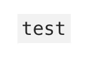
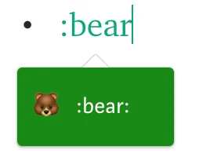
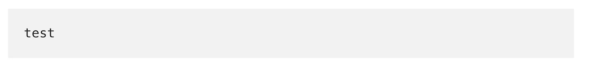
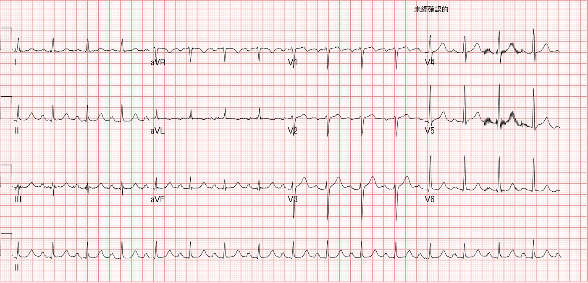
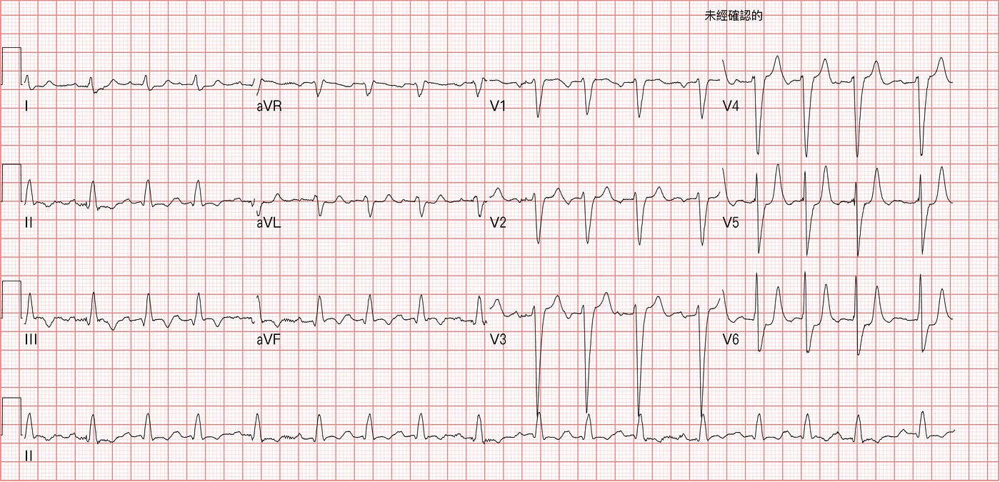
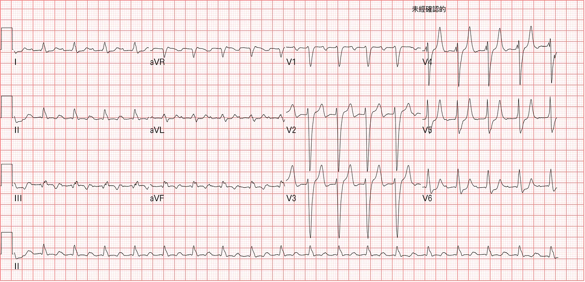

- Type \` and the text after it gets a gray background

- Type : and then some English, and [emoji symbols](https://www.webfx.com/tools/emoji-cheat-sheet/) pop up

- Type \`\`\` and a gray-background block appears (you have to type it at the very start)

- Press CMD+K on an image to add a Hyperlink to it
- **Press \*+space or 1. → to get indented formatting**
- Type **TK in the body → marks a body paragraph that isn't finished yet (a handy marker)**
- All kinds of [keyboard shortcuts](https://medium.com/@luyo/medium-%E5%BF%AB%E9%80%9F%E9%8D%B5%E6%95%88%E6%9E%9C%E5%B1%95%E7%A4%BA%E5%8F%8A%E4%BD%BF%E7%94%A8%E5%BF%83%E5%BE%97-b6e4c0203816)

[Medium Keyboard Shortcuts: Demo and Usage Notes](https://medium.com/@luyo/medium-%E5%BF%AB%E9%80%9F%E9%8D%B5%E6%95%88%E6%9E%9C%E5%B1%95%E7%A4%BA%E5%8F%8A%E4%BD%BF%E7%94%A8%E5%BF%83%E5%BE%97-b6e4c0203816) (in Chinese)

- Image Grids (hold CMD when selecting images to pick several at once)

*Previous ECG*

*Left side: K →6.1; Right side: K →7.4*
