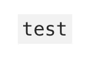
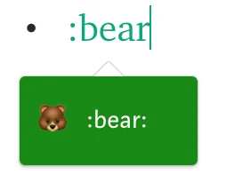
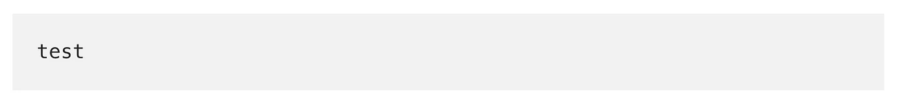
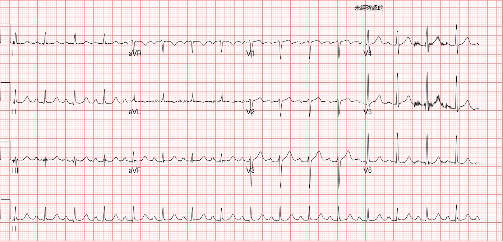
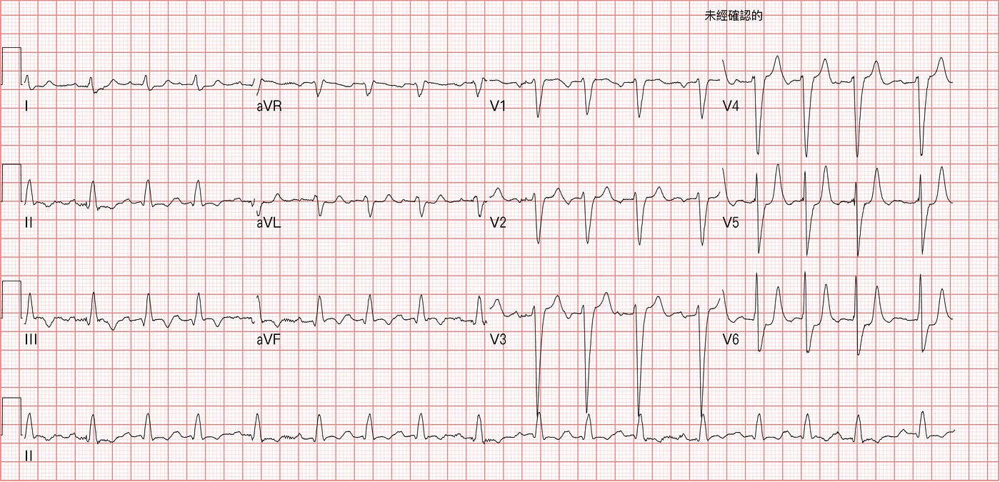
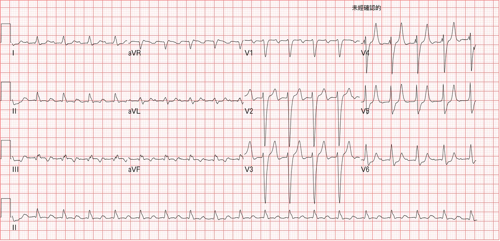



- 打入 \` 之後的文字就會灰底

- 打入 : 之後輸入英文會出現[emoji符號](https://www.webfx.com/tools/emoji-cheat-sheet/)

- 打入\`\`\`之後會有區塊灰底出現(要在一開始打入)

- 圖片按下CMD+K，可以幫圖片添加Hyperlink
- **按下\*空格、1. →可以進行內縮排版**
- 內文處輸入**TK →代表尚未完成的內文段落(幫忙標記)**
- 各式[鍵盤快速鍵](https://medium.com/@luyo/medium-%E5%BF%AB%E9%80%9F%E9%8D%B5%E6%95%88%E6%9E%9C%E5%B1%95%E7%A4%BA%E5%8F%8A%E4%BD%BF%E7%94%A8%E5%BF%83%E5%BE%97-b6e4c0203816)

[Medium 快速鍵效果展示及使用心得](https://medium.com/@luyo/medium-%E5%BF%AB%E9%80%9F%E9%8D%B5%E6%95%88%E6%9E%9C%E5%B1%95%E7%A4%BA%E5%8F%8A%E4%BD%BF%E7%94%A8%E5%BF%83%E5%BE%97-b6e4c0203816)

- Image Grids(選擇圖片時按下CMD，可選多張圖片)

