

## ❤️Case：最近同事遇到的一個個案

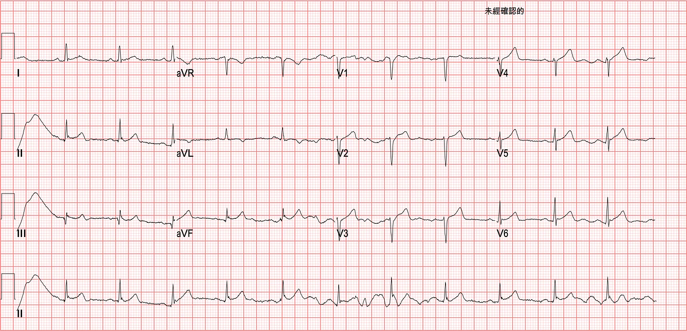

讓我來說說最近同事遇到的一個個案。我覺得從個案裡面可以學到非常多的東西。讓我們一起來淘金這篇文章吧~~~

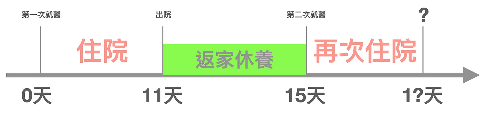

個案是一位39歲男性，過去有高血壓、高血脂，與自發性腦出血病史。

第一次就醫時於急診主述胸口悶悶的、會痛且會有心悸的感覺。

Fig.1是第一次就醫時的ECG。

### ❤️簡單判讀一下

II/III的Baseline不穩，這是因為LL導極有抖動才會如此。

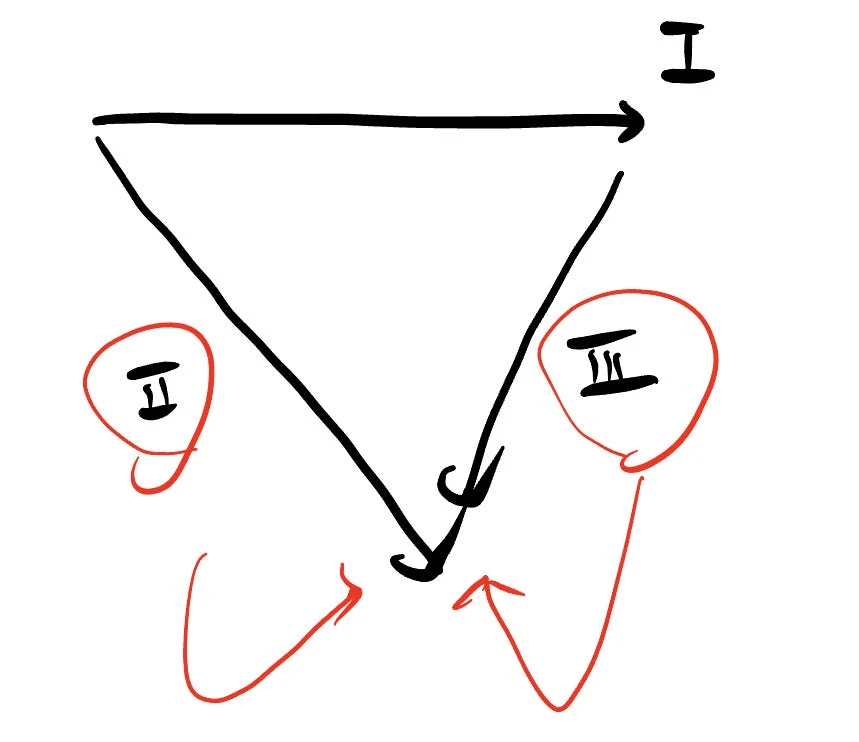

要如何在5秒之內看ECG就知道，左腳抖動引起的baseline artifact?

請在心裡把Lead I/II/III畫出來，同時會造成II/III有抖動的為LL導極。

<strong>初學者對於ECG判讀</strong>，我建議可以利用Rate-Rhythm-Axis-Interval-Ischemia順序來判讀，比較不會有缺漏，沒看到的東西。

Rate: 70 bpm

Rhythm: SR(I/II/aVF的P wave upright、且aVR的P wave inverted)

Axis: normal axis

<strong>Axis判讀我推薦可以玩看看這個網站，把指針轉轉，看看I/aVF/II的變化來了解axis目前方向為何~~~</strong>

[Cardiac axis trainer](https://david-shrk.github.io/ecgaxistrainer/)

Interval: No QT prolong

Ischemia:首要目標是找看看<strong>有無OMI ECG findings(目前是18個…以後只會越來越多XD)</strong>

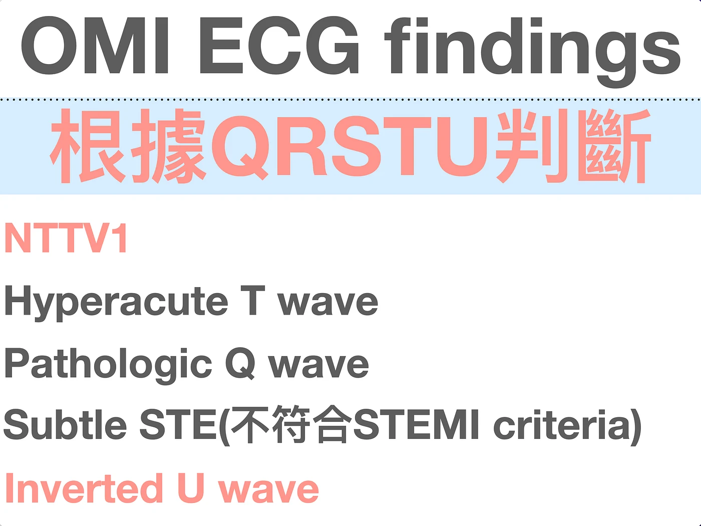

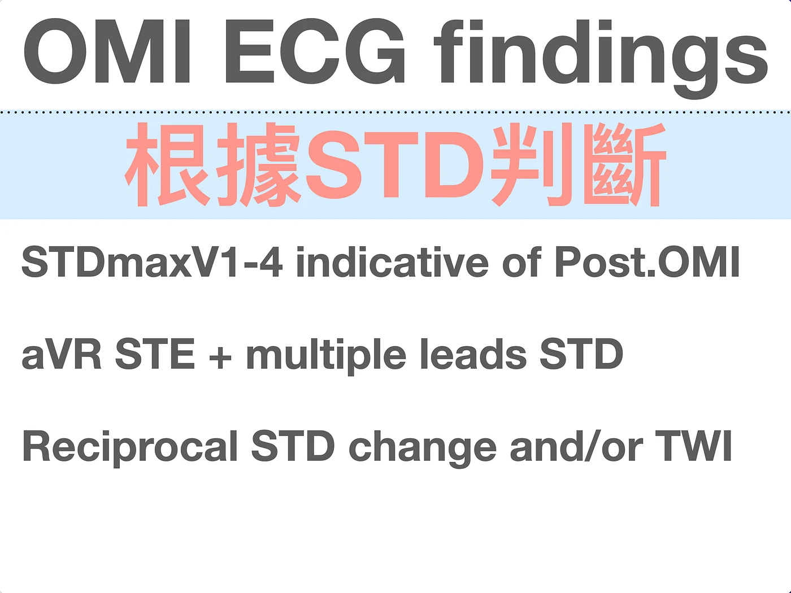

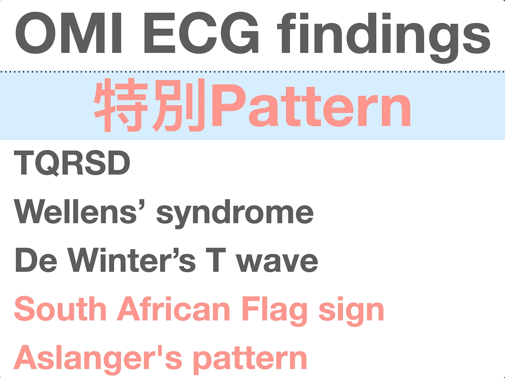

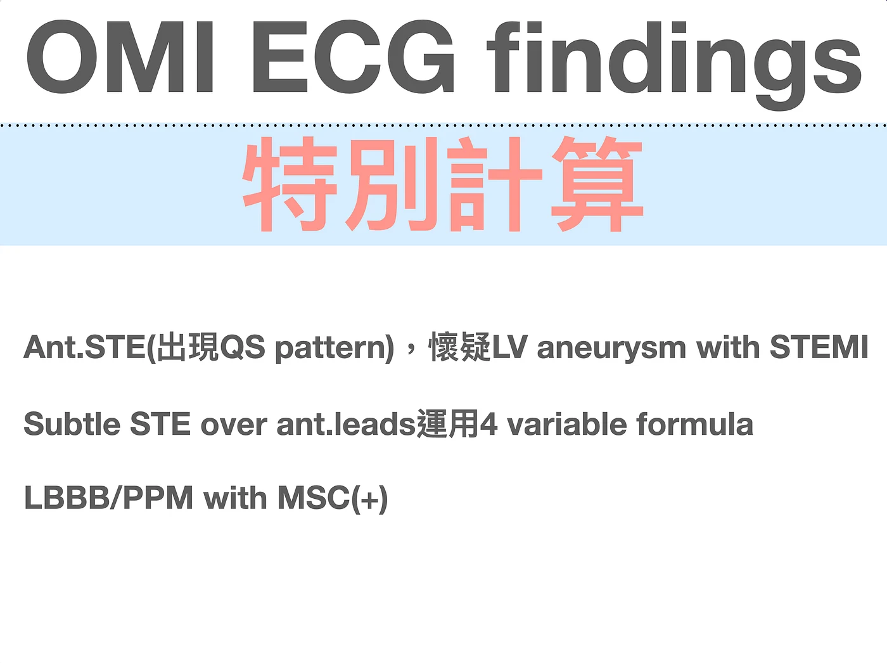

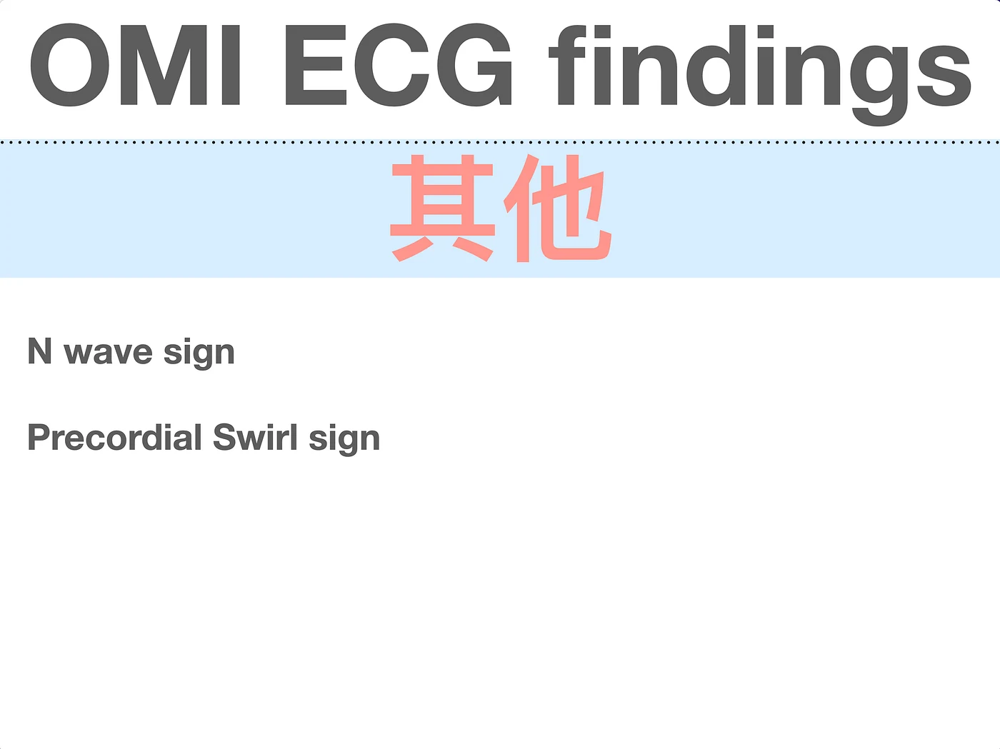

### ❤️OMI(Occlusion MI)

我想有看Dr.Smith’s ECG Blog與Ken Grauer的ECG interpretation網站應該都知道我在說什麼。

在第一線面對病患的我們，必須要盡一切努力擋下任何OMI被我們放回家。

每天來急診的那麼多病患中，總是有一定比例是以ACS症狀來的。<mark><strong>我們一定要有信心擋下任何OMI。</strong></mark>

### ❤️如果沒擋下…..常常就會有以下劇情。

<strong>同事院內來電…….</strong>

喂~~熊醫師嗎?，你…..前幾天看的這個病人…..

話還沒說完，聽到這裡，我想身為急診人，聽了這幾個字，此時應該都有周邊hypoperfusion，四肢冰冷。此為shock sign…….無解XD

<strong>精進自己閱讀ECG的能力，我想是唯一答案~~~~</strong>

<strong>我們先來看看什麼叫做擋下OMI病患，我覺得蠻重要的。</strong>

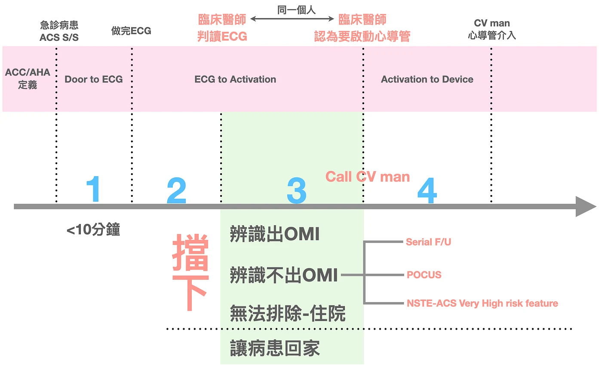

我們到底要擋下怎樣的OMI病患?

<strong>STEMI(+)/OMI(+)</strong>與<strong>STEMI(-)/OMI(+)</strong>

STEMI(+)/OMI(+)就不多說了。本來就應該要擋下，但是要小心STEMI mimics病患就是了。(有機會來寫Blog)

我們應該要擋下的就是STEMI(-)/OMI(+)，翻成白話文的意思就是，<strong>這類病患沒有符合STEMI criteria但是病患確確實實血管阻塞了</strong>。

擋下的意思，有分幾個層次(<strong>請見Fig.10</strong>)

Fig.10的『1』評鑑都在評了(<strong>Guideline也是寫<10分鐘啦</strong>)，有人會不敢10分鐘內做到ECG嗎?(<strong>Door to ECG time</strong>)

『2』做完後到臨床醫師判讀，這通常取決於臨床醫師，因為做完後，應該很快就會放到醫師桌面上。除非醫師沒看到或不曉得有胸痛病患的Chart在桌面上。(<strong>2的時間幾乎可以忽略，若有增加，可以檢討為何做完ECG那麼久還沒被臨床醫師判讀</strong>)

『3』我覺得非常非常的重要。這段時間代表臨床醫師開始判讀ECG，到臨床醫師認為要啟動心導管。這段時間叫做<strong>ECG to Activation time(ETA)</strong>。(<strong>Ps:注意是同一個人，並不是CV man認為要啟動心導管，而是判讀的醫師認為要啟動心導管</strong>)

『4』是指從Call了CV man到導管介入這段時間(<strong>Activation to Device</strong>)。這段時間，說老實的，ED man很難有什麼作為，因為這段時間取決於CV man認為這病患有沒有需要去做PCI。如果我們認為這病患需要Cath lab activation，Call了CV man，但是CV man可能覺得不需要。

ACC/AHA的D2B time包含了上述的時間，希望D2B time <90分鐘[^1]。

### ❤️再來解析Fig.10的『擋下』意義是什麼?

- 辨識出OMI →包含STEMI(+)/OMI(+)與STEMI(-)/OMI(+) →<strong>Call CV man</strong>
- 辨識不出OMI →但是懂得<strong>運用以下輔助工具與病患feature</strong> →若(+)，<strong>Call CV man</strong>

1. Serial F/U ECG+Enzyme(在initial ECG後，覺得ECG有問題，但是又不符合STEMI criteria，然後OMI ECG findings的18個sign，又不是很熟，但就是認為ECG有問題，請千萬記得<strong>10–15分鐘就要F/U ECG</strong>)
2. 可以利用POCUS看看有無RWMA
3. 如果病患不符合STEMI criteria，但是出現NSTE-ACS的Very high risk feature的狀況 →<strong>Call CV man(之前Blog多次提到，不再重複了啦)</strong>

- 臨床無法排除有ACS可能性，最後我們讓病患住院了

能夠『<strong>Call CV man</strong>』 or 『<strong>認為病患應該要住院</strong>』 →<strong>這就是擋下</strong>。

最不好的狀況就是辨識不出OMI，也沒F/U ECG+Enzyme，就讓病患回家了。

### ❤️為何我說Fig.10的『ETA time』非常非常重要~~~~

Fig.10的ETA time要強調的就是臨床醫師對於ECG要有足夠的判讀能力，如此才能縮短看完ECG到Call CV man的時間。

ETA time可以透過訓練來縮短時間，這是自我提昇幫助病患的唯一途徑。<strong>(改變自己遠比改變其他人有效且有用)</strong>

這邊推薦閱讀一篇McLaren在2021年發表在AJEM的文章[^2]。

文章中各以一年為期分成pre-intervention和post-intervention來做比較:

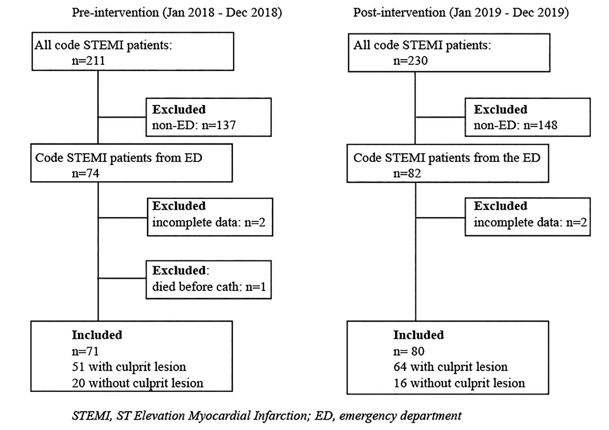

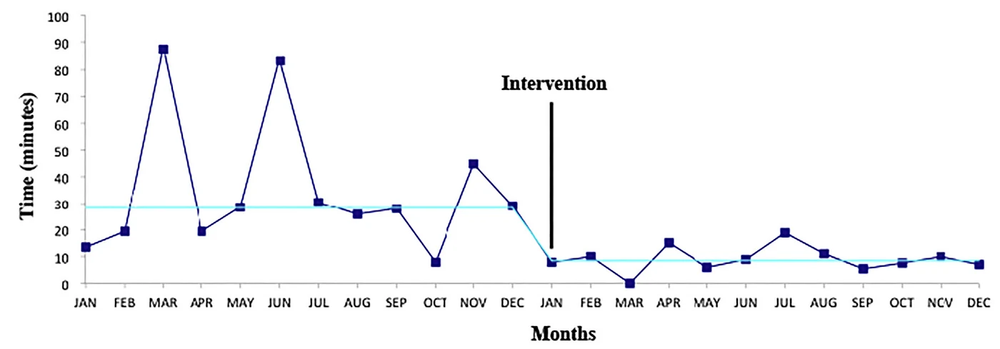

從Fig.11、Fig.12可得知，藉由intervention的介入，縮短了ETA的時間。

那麼文章中的intervention包括了什麼呢?

<strong>作者表示包含了grand round presentation與內部網路每週都會提出具有挑戰的個案ECG伴隨STEMI equivalents與subtle occlsuion的文獻討論。此外會監測進入內部網路看個案ECG的瀏覽次數/拜訪次數。</strong>

最後文章的結論顯示了，開始介入後，縮短了ETA時間，但是沒有明顯增加Code STEMI w/o culprit lesion的數量。

<mark><strong>意思就是經由介入讓醫師學習了OMI ECG findings，縮短ED man判讀ECG到ED man認為需要啟動心導管(Call CV man)的時間。這縮短的時間，並不是亂Call一通，而是這些的Code STEMI(Call CV man)都是有意義的Call，因為統計上並沒有增加Code STEMI w/o culprit lesion的比例。</strong></mark>

文章的附錄舉了10個Case來說明看起來好像是normal的ECG，但卻是ACO病患。各位有興趣，請自行下載文章閱讀囉~~~~

## ❤️Back to Case

先不破題Fig.1的ECG看到什麼，後續病患入住心臟科病房，也陸續驗了Troponin。

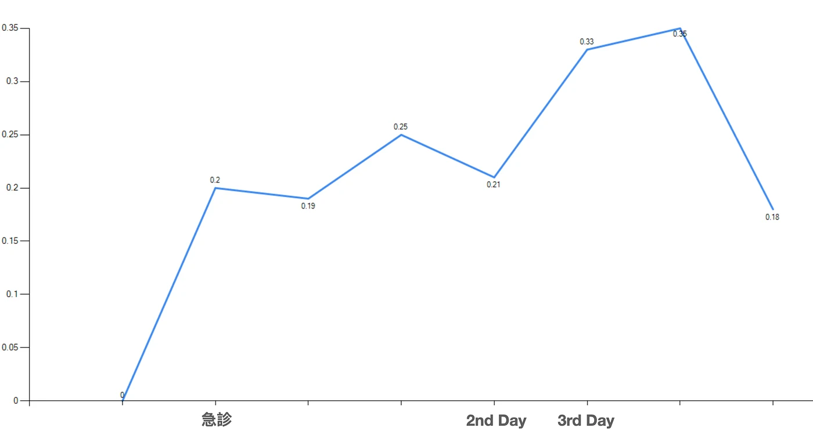

病患住院過程中做了Exercise stress test與Echo。

Exercise stress test根據病歷記載顯示是正常的，echo的部份我沒看到任何相關報告。

### ❤️最後病患的出院診斷是

<strong>Chest pain, favor pericarditis related</strong>

首先，很弔詭的是，Troponin在initial急診測時，就已經超過99th percentile of URL，後續在病房第2-3天更是往上。這絕對不是Chronic myocardial injury。

另外如果真的是pericarditis，我們要問自己一個問題，那就是pericarditis是否可能伴隨biomarker的上升。

在Uptodate的這篇文章中[^3]說明在一項研究中118位被診斷acute idiopathic pericarditis，發現有38位病患(32%)，有biomarker上升。但是這些病患也應該要考慮是否有myopericarditis。(<strong>Pericarditis不到一半會biomarker上升)</strong>

Dr.Smith有一篇文章關於診斷pericarditis，非常非常的經典[^4]。

在這篇文章中描述到，<strong>如果Troponin上升，我們會將AMI vs. pericarditis演變成AMI vs. myocarditis</strong>。

然而在ED裡，<strong>AMI和myocarditis是無法區別的，需要Cath lab activation才能區別</strong>。

在另一篇文章中的Ken大師評論中更強調一件事[^5]:

『<strong>即使是國際上的ECG論壇，pericarditis在臨床上仍是非常少見的 →在Smith’s ECG Blog裡面常常被多次強調，pericarditis遠少見於OMI或repolarization variant。Stephen Smith常說 You diagnose acute pericarditis at your peril!(診斷心包膜炎要後果自負)</strong>』

<strong>You diagnose acute pericarditis at your peril!到底是什麼意思?我請ChatGPT翻譯，我覺得非常貼切。</strong>

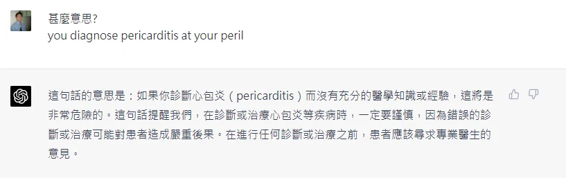

### ❤️錯誤的診斷可能會對患者造成嚴重後果。

對~~~~<strong>一堆大師都說了，診斷pericarditis，後果要自行負責!!!!!!</strong>

會產生後果，是因為沒有去排除其他問題(OMI or myocarditis)，就認為這就是pericarditis。

接著我們來再看看，這病患做了exercise stress test得到正常結果，這樣到底算不算排除了OMI。

### ❤️不算(字體放大，強調再三。exercise stress test正常，不能排除病患血管有問題)

### ❤️Why?

我們必須問一個問題。<strong>Exercise stress test可靠嗎?</strong>

在這篇文章裡面[^6]，我們學到了關於Exercise stress test的幾個重點:

⭐️<mark><strong>Negative exercise stress test對我們ED man沒有任何用處</strong></mark>

- 許多ED man應該有許多經驗，那就是治療不少真正ACS病患或cardiac arrest病患，而這些病患有些是近期為negative exercise stress test。
- 過度依賴negative exercise stress test是常見延遲或誤診病患的理由。

因為我們可能<strong>想像Negative exercise stress test = 血管沒有問題(但事實並非如此)</strong>

- 重要的是要記住，冠狀動脈疾病(CAD)可能由動脈粥樣硬化病變引起，這些病變只有輕度狹窄，不穩定斑塊破裂，標準exercise stress test無法檢測到。

另外Amal mattu在2021/3/8的ECG weekly[^7]特別強調一個觀念。

這篇教學中，Amal開頭就問:

<strong>為什麼有許多AMI的病患，近期內做過exercise stress test or CAG，也顯示沒有嚴重阻塞，但過沒幾天卻真正AMI，CAG做進去發現阻塞很厲害?</strong>

### ❤️讓我來慢慢解釋清楚～～～

是不是會導致ACS →<strong>Stress test and Cath不是幫助那麼大</strong> →這可以從<strong>ACS病生理機轉</strong>來解釋清楚

<strong>plaque vulnerability(容易受傷)和穩定度</strong>對於造成ACS的重要影響程度 >> plaque size與管徑狹窄程度

Plaque是不是容易受傷，取決於三個重要因素:

- Fibrous cap的size
- Lipid core有多少
- Inflammatory cells

1️⃣ <strong>Exercise stress test存在的問題</strong>

- Smaller plaques更容易不穩定而導致rupture
- 這些小的plaque仍可以rupture後導致完全阻塞 →有研究顯示IRA(infarct related arteries)在rupture導致AMI之前，通常沒有阻塞的plaque出現(因為很小所以沒有阻塞)

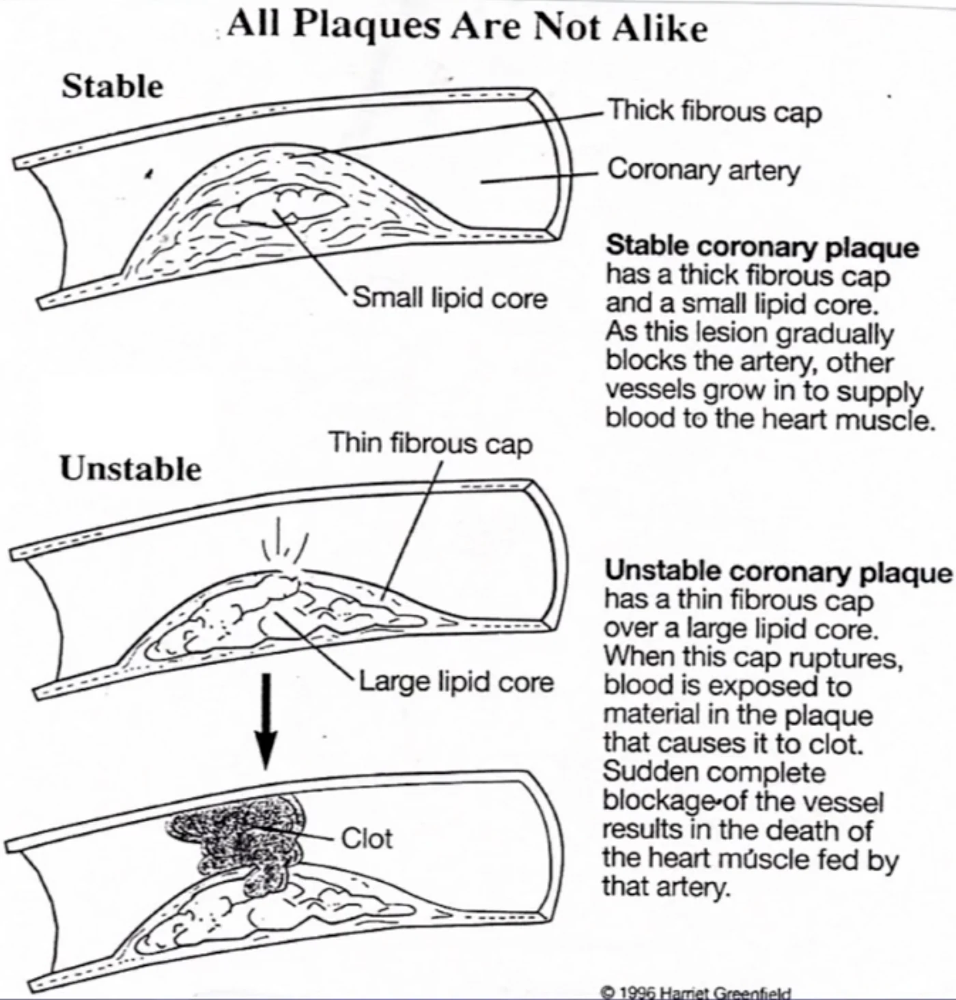

Fig.15 說明了並<strong>不是所有的plaques都是一樣的</strong>

- <strong>Stable coronary plaque</strong> →<strong>有較厚的fibrous cap、較少的lipid core</strong>(此圖形的fibrous cap夠厚讓血管管徑變小，所以做stress test，就會陽性
- <strong>Unstable coronary plaque</strong> →<strong>較薄的fibrous cap、較多的lipid core</strong>(此圖形lipid core+fibrous cap可能阻塞不到管徑的一半，所以stress test可能做出來是陰性的，但其組成成分是不穩定的，所以是一個unstable plaque) →當fibrous cap破裂，血液和lipid core就會形成clot，進而阻塞血管

2️⃣ <strong>Cath存在的問題</strong>

- 無法區分stable vs. unstable plaque成分 →因為Cath無法知道fibrous cap與lipid core有多少
- 無法辨別『coronary artery remodeling』

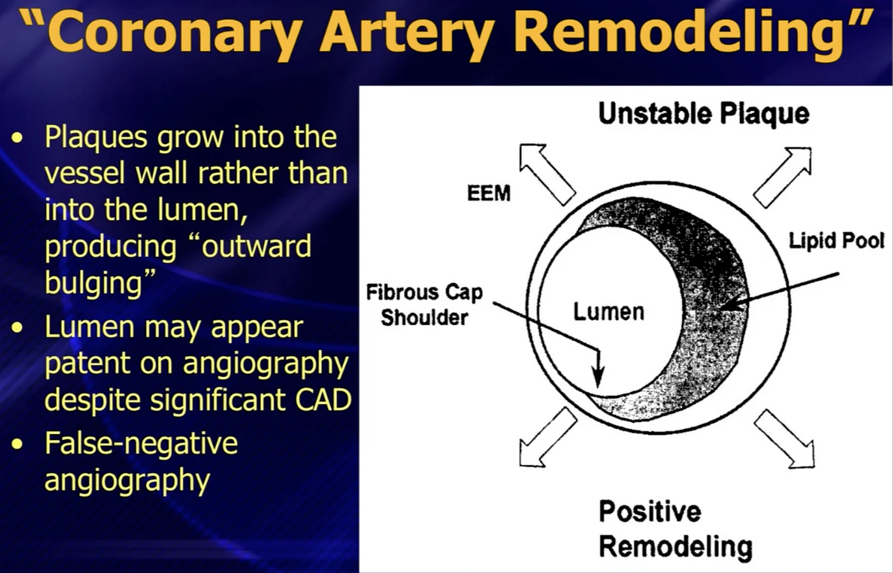

- Fig.16表示Plaque往vessel wall增長(outward bulging) > 往血管管徑內增長 →所以做CAG時，可能顯示通暢，但事實上已經有significant CAD出現 →所以會有false-negative angiography出現

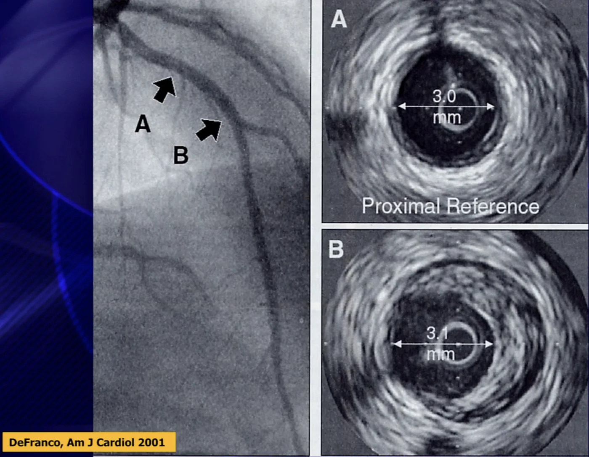

- Fig.17顯示圖A與B在CAG下幾乎都顯示是通的(血管管徑差不多)，但事實上使用intravascular US(IVUS)來看，發現B的位置其實有很大的plaque，但因為remodeling，所以管徑看起來還夠大，但其實rupture風險高。
- B的狹窄程度>A( B如果沒有使用IVUS來看，只會覺得似乎是通的，但事實上已經是處於狹窄狀態 )

綜合上述可以知道即使<strong>近期stress test or CAG是Negative，也不能完全排除ACS(沒有任何一種處置可以讓ACS的風險降到零) →解決方法:病史很重要、ECG、TnI、validated ADP(HEART score等)</strong>

- 當然如果CAG報告是clean coronary artery，因為plaque rupture導致ACS機會很低，但是如果報告打insignificant or unremarkable CAD(因為CAG無法知道plaque的vulnerability and stability)，就要小心

## ❤️再度Back to Case

病患被診斷pericarditis出院後的第4天早上。突然感覺左側胸口一陣一陣悶脹痛、左後上背也痛。病患表示出院後都還好, 今天才會痛, 痛的感覺和上次住院一樣。

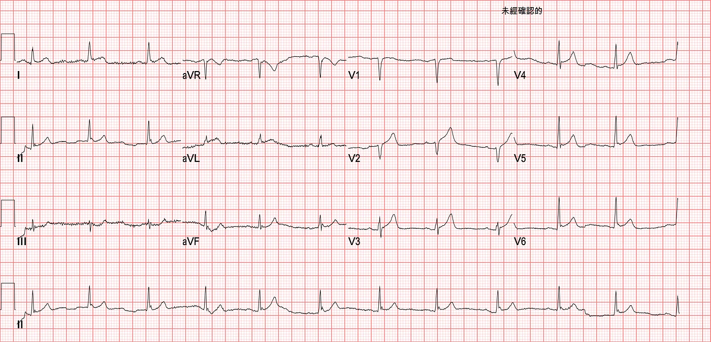

Fig.19的ECG看到了哪些ischemic ECG morphology?

1. 首先V1-V4有LV aneurysm的morphology，所以可以應用Dr.Smith的T/QRS >0.36的應用 →在V2/V3肯定超過0.36
2. Straight ST segment over I/aVL、Maybe STD in III
3. V4-V6的STE是否有意義?我覺得有看到J wave出現，所以我覺得比較像early repolarization造成的STE

綜合上述可以推測應該是proximal LAD出問題。似乎也符合South African Flag sign →懷疑D1 occlusion

我們可以拉回看Fig.1(第一次急診就醫時的initial ECG)，可以看到V1-V4也是符合LV aneurysm pattern，可以應用T/QRS > 0.36，若有任一lead符合就可診斷STEMI →<strong>Fig.1的V4是絕對>0.36</strong>

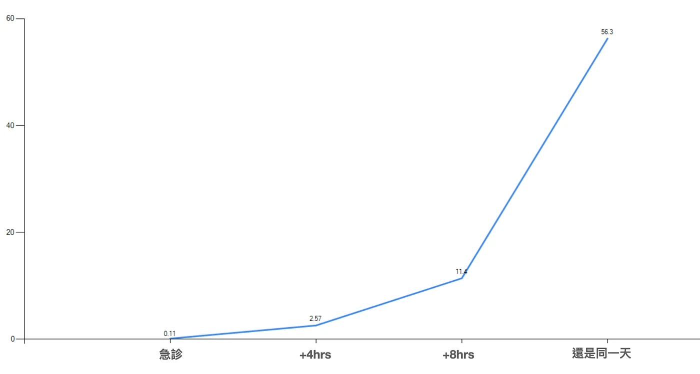

後續病患同一天的Troponin爆炸高…….

但是，CV man還是沒有當天安排CAG(<strong>即使當天是白天工作日</strong>)

嗯……..這就是我在Fig.10對於『4』的時間，我們ED man沒有辦法改變什麼。因為這取決於CV man對於這個Case的態度是如何。

### ❤️CAG final result: Acute D1 total occlusion

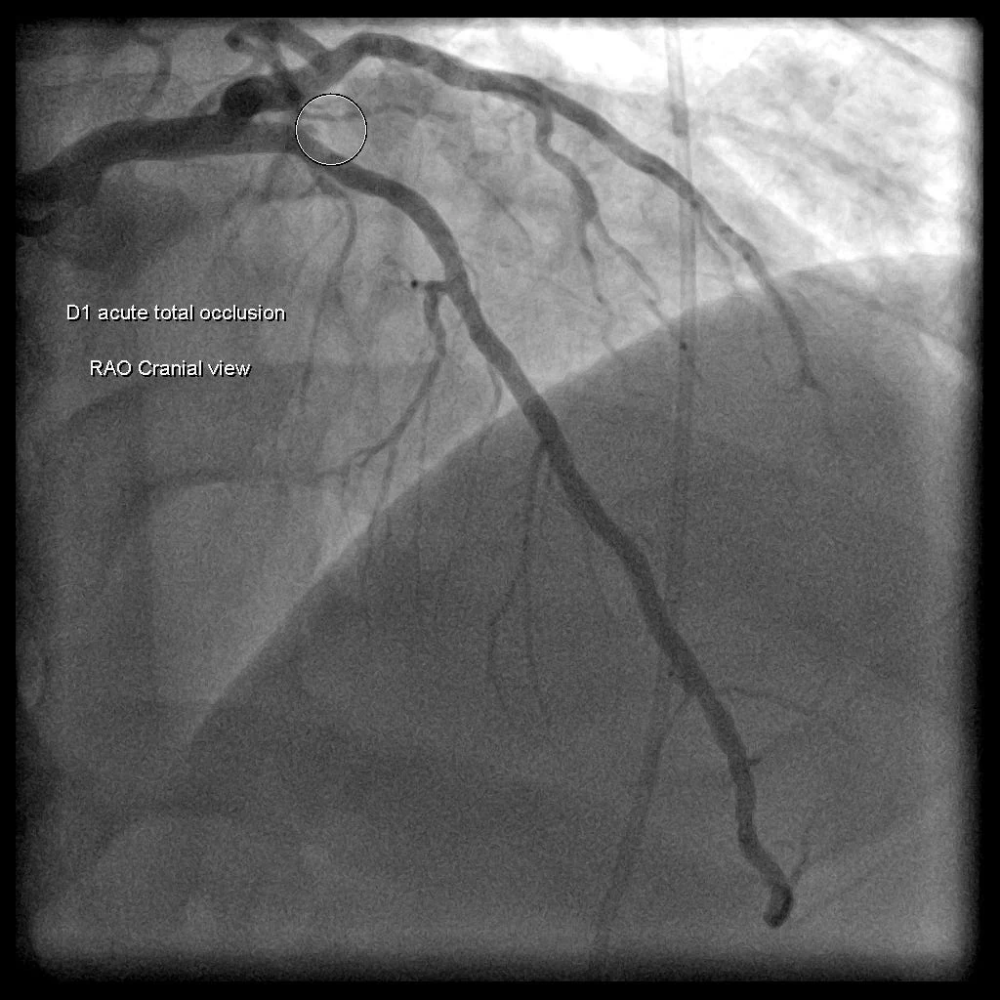

## ❤️稍微整理一下這個個案

首先第一次就診，應該就是OMI(<strong>V4的T/QRS>0.36、且biomarker有上升</strong>)

但是誠如Dr.Smith所說的:

<mark><strong>You diagnose acute pericarditis at your peril!</strong></mark>

當我們要下pericarditis這個診斷時，一定要盡全力排除OMI。

另外如果我們搞不清楚Negative exercise stress test的意義與原理為何，我們會因為雙眼被蒙蔽而讓病患處在危險的邊緣而不自知!!!!真的!!!!

## 學習重點

1. 18個OMI ECG findings有哪些?
2. 如何擋下OMI病患
3. 降低ETA的方法
4. 我們真的要診斷pericarditis嗎?
5. 近期Exercise stress test or CAG為Negative，可以排除ACS嗎?
6. 當ECG morphology符合LV aneurysm，可以應用T/QRS >0.36(我Blog前面幾篇有提到，可以參閱看看)

## 參考資料

內文每個上標數字，滑過去（手機點一下）就看得到出處。整理起來是這7份：

- **研究**
  - McLaren JTT, et al. *Am J Emerg Med* 2021（分享與教學ECG，縮短急診辨識急性冠狀動脈阻塞的時間）
- **指引**
  - 2013 ACCF/AHA Guideline for the Management of ST-Elevation Myocardial Infarction（O’Gara PT, et al. *JACC* 2013）
- **部落格**
  - Dr. Smith’s ECG Blog（2018-06，You Diagnose Pericarditis at your Peril）
  - Dr. Smith’s ECG Blog（2022-06，ST elevation after gunshot to the chest）
  - REBEL EM（Chest Pain, “Negative” Stress Tests, POCUS, & ECG Equations）
- **網站**
  - UpToDate（Acute pericarditis: Clinical presentation and diagnosis）
  - ECG Weekly（Amal Mattu’s ECG Case of the Week，2021-03-08）

[^1]: O’Gara, P. T., Kushner, F. G., Ascheim, D. D., Casey, D. E., Chung, M. K., de Lemos, J. A., Ettinger, S. M., Fang, J. C., Fesmire, F. M., Franklin, B. A., Granger, C. B., Krumholz, H. M., Linderbaum, J. A., Morrow, D. A., Newby, L. K., Ornato, J. P., Ou, N., Radford, M. J., Tamis-Holland, J. E., … Zhao, D. X. (2013). 2013 ACCF/AHA Guideline for the Management of ST-Elevation Myocardial Infarction. Journal of the American College of Cardiology, 61(4), e78–e140. [https://doi.org/10.1016/j.jacc.2012.11.019](https://doi.org/10.1016/j.jacc.2012.11.019)
[^2]: McLaren, J. T. T., Taher, A. K., Kapoor, M., Yi, S. L., & Chartier, L. B. (2021). Sharing and Teaching Electrocardiograms to Minimize Infarction (STEMI): reducing diagnostic time for acute coronary occlusion in the emergency department. The American Journal of Emergency Medicine, 48, 18–32. [https://doi.org/10.1016/j.ajem.2021.03.067](https://doi.org/10.1016/j.ajem.2021.03.067)
[^3]: Acute pericarditis: Clinical presentation and diagnosis — UpToDate — [link](https://www.uptodate.com/contents/acute-pericarditis-clinical-presentation-and-diagnosis?search=pericarditis&selectedTitle=1~150&usage_type=default&display_rank=1#H2298771)
[^4]: Dr. Smith’s ECG Blog: You Diagnose Pericarditis at your Peril (at the Patient’s Peril!) — [link](http://hqmeded-ecg.blogspot.com/2018/06/you-diagnose-pericarditis-at-your-peril.html)
[^5]: Dr. Smith’s ECG Blog: ST elevation after gunshot to the chest — [link](http://hqmeded-ecg.blogspot.com/2022/06/st-elevation-after-gunshot-to-chest.html)
[^6]: Chest Pain, “Negative” Stress Tests, POCUS, & ECG Equations — REBEL EM — Emergency Medicine Blog — [link](https://rebelem.com/chest-pain-negative-stress-tests-pocus-ecg-equations/)
[^7]: Amal Mattu’s ECG Case of the Week — March 8, 2021 — ECG Weekly — [link](https://ecgweekly.com/2021/03/amal-mattus-ecg-case-of-the-week-march-8-2021/)
