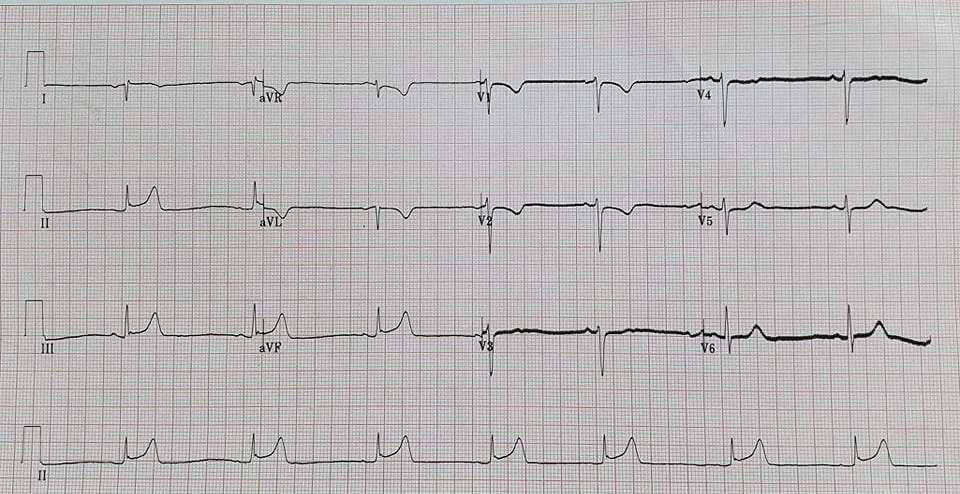
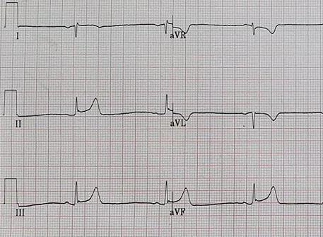
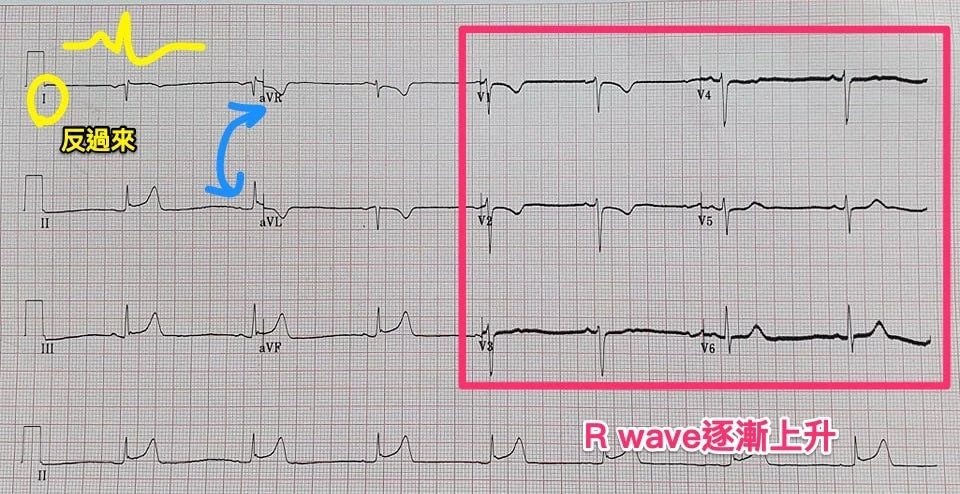
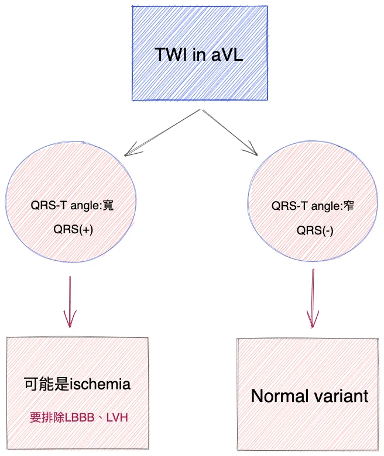
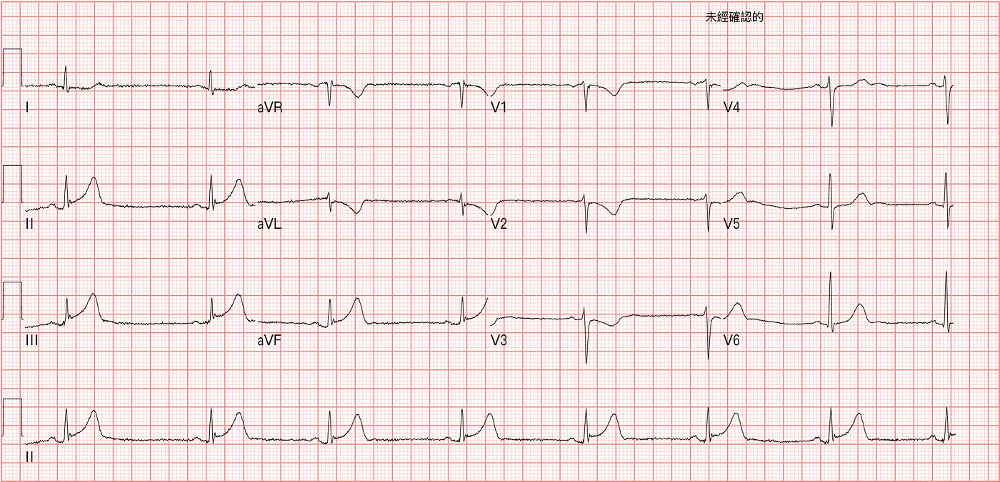
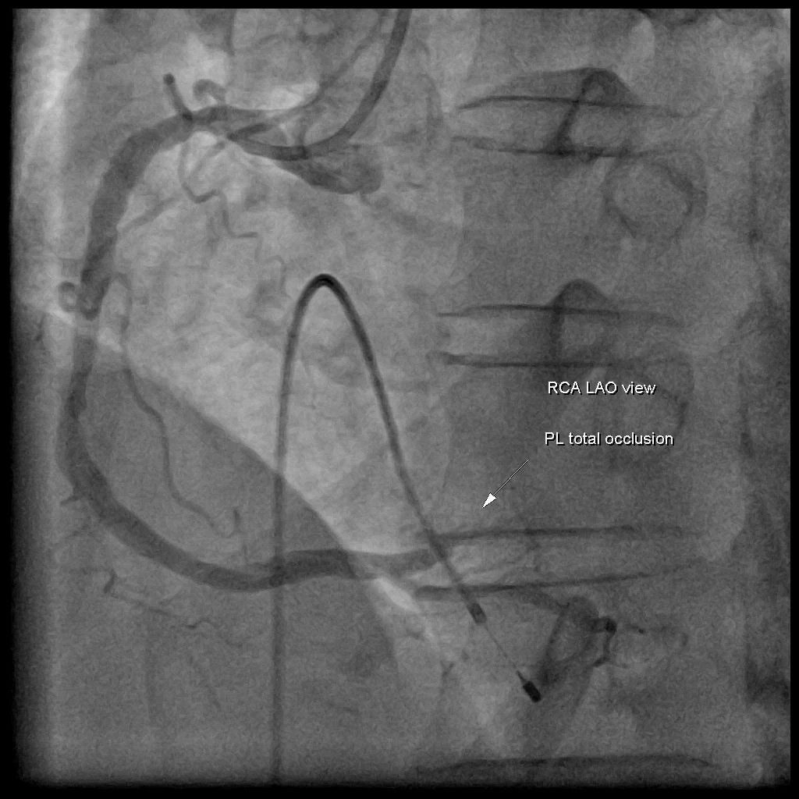



## ❤️Case：凌晨胸悶，悶到兩側手臂

56歲男性，過去沒有特別病史。半夜凌晨胸口悶不舒服，悶到兩側的手臂。

同事交班給我前，詢問我這張有問題嗎?

我當下很快看了一下，我記得當時我說，SB、minimal STE over inf. leads，有TWI over aVL但沒有看到STD、STE over I、STD over V1~V2 with TWI

aVL有TWI的確要考慮是否inf.wall STEMI的early sign出現，但是此處的QRS-T angle是窄的，QRS(-)、T wave(-)， 如果這邊QRS-T angle是寬的，我會覺得比較像。但如果不是AMI，似乎沒辦法解釋STD over V1~V2(必須排除Post.MI)

- **像AMI的地方**
  - 症狀像
  - minimal STE over inf.leads(必須考慮inf.wall STEMI)
  - STD over V1~V2(必須考慮inf.wall STEMI with post.involved)
- **不是很像AMI的地方**
  - QRS-T angle窄，QRS的方向和T wave方向一樣，這樣TWI或許就不一定有意義

<strong>以上是當下快速評估的內容。</strong>

先問幾個問題?


- **Q1**：這張ECG是什麼rhythm?
- **Q2**：現在是凌晨3:30看到這張ECG，你會選擇Call CV嗎?
- **Q3**：如果看到第一張ECG，沒有選擇Call CV，那麼接下來該怎麼做?


### ❤️Q1：先來回答這張是什麼rhythm~~

一般如果是SA node放電往下傳，在<strong>Lead I、II、aVF的P wave為upright、aVR的P wave為inverted</strong>

那麼這張ECG看到什麼?

Lead I的P wave是負的、QRS是負的、T wave是負的。aVR的P wave是正。所以不是SA node往下傳?還是其他問題?

> <strong>Tips:</strong>如果看到<strong>RAD+ Lead I的P wave是inverted</strong>，要想<strong>兩個DDx</strong> →Dextrocardia與lead misplacement

### ❤️那麼要怎麼區分這兩者呢?

比較常見的lead misplacement是<strong>RA和LA互換 →會看到aVR與aVL互換、Lead I的P/QRS/T會negative</strong>

此外如果是lead misplacement在precordial leads仍會有R wave progression

那麼<strong>再看一次病患的入院ECG:</strong>

Precordial leads的<strong>R wave有逐漸增加(至少不是逐漸減少)</strong>

把aVL和aVR交換過來，此外lead I都反過來，是不是比較正常一點呢?

<mark>因此這張入院ECG仍是sinus rhythm(bradycardia)、真正aVL其實是aVR(有STD+TWI)</mark>

### ❤️這邊RA/LA reversal為何容易誤導我們?

因為<strong>Inf.lead STEMI有接近99%會見到aVL的reciprocal STD change</strong>(太早期MI時，還是有可能沒看到，可能只會看到TWI)[^1]，所以我們見到aVL有STD，我們可以更有信心說這是AMI。

> <strong>Tips:</strong>那麼ant.wall STEMI大約有幾成看不到reciprocal STD change?大約30~50%

當aVR/aVL交換過來，原本aVL有STD+TWI (就是ECG圖上的aVR)→變成只有TWI，沒有STD。這可能會讓我們放鬆警戒。

### ❤️再來看TWI in aVL可能是什麼問題?

但是如果看到aVL有TWI，還是要非常小心，因為aVL出現TWI，有可能是inf.wall STEMI，非常early ischemia sign。不可不慎。

一樣在這篇文章[^1]裡面提到，當出現isolated TWI in aVL有100% sensitive、86% specific for inf.wall STEMI →翻成白話文就是，<strong>inf.wall STEMI幾乎100%會出現TWI in aVL，所以出現了要小心，但不一定是inf.wall STEMI，也有可能是LAD-m有問題[^2]</strong>。

### ❤️TWI in aVL是否是正常變異或異常?

所以當我們看到TWI in aVL，這時我們就要擔心接下來，會不會開始inf.leads會出現STE(<strong>按照AHA NSTE-ACS guideline在前一小時每15~30分鐘就要做一張ECG</strong>[^3])。

此時我們要先想一個重要問題，這邊的TWI in aVL是否是正常的(也就是normal variant)還是真正異常的?

可以運用QRS-T angle來進一步評估。QRS-T Angle可以協助區分primary repolarization and secondary repolarization abnormality(注意是再極化的異常)。在這一篇的Smith ECG blog，有很清楚地闡釋，與Ken Grauer在裡面針對QRS-T angle說明了一個簡單approach的方法[^4]。

<strong><em>把重點寫在這裡:</em></strong>

<mark>當TWI合併任何<strong>QRS-T Angle的 絕對值>45度(要算QRS axis和T wave axis然後相減)</strong>→<strong>一定要想異常</strong></mark>➡如果是異常，看看lead III的T wave是否有hyperacute狀況，此外也可以看看是否有T wave flattening in V2(代表可能有posterior OMI出現)

<strong>Ken Grauer</strong>的針對QRS-T Angle簡單的approach方法:

- 我們會擔心的是TWI over aVL →有可能正常或是inferior OMI引起的reciprocal change STD
- 也就是我們不擔心T wave in aVL的T wave axis是如何(因為我們只擔心inverted T wave over aVL)<strong>(也就是別特別去算T wave axis啦)</strong>
- 如果TWI in aVL是normal variant➡那麼應該看到rS-type QRS complex(明顯negative) in aVL。如果沒有看到明顯negative QRS in aVL(or QRS positive)，那麼TWI in aVL就不太可能是normal variant(可能是ischemia or infarction引起)

我把上述的意思稍微簡化成下面流程圖(<strong>Fig.4</strong>)。

## ❤️Case繼續吧!!!!

這個case的真正aVL的QRS其實是(-)，這的的確確會降低我的警戒心!!!!!

但病患臨床症狀持續。20分鐘後，我再做了一次ECG(Fig.5)~~

這張心電圖，導極放正確位置了。可以看到STD in aVL更明顯。而且原本STD in V1~V2更extend到V3。這肯定是有Post.wall involved。Lead III的Hyperacute T wave變明顯。當下可以直接診斷inf.STEMI with post.wall involved。

於是到院20分鐘後，我call了CV，CV也認同我的診斷。病患直入心導管室。<mark><strong>CAG report: RCA-PL total occlusion</strong></mark>

## 後記

其實病患一開始QRS-T angle(-)合併TWI，真的降低我對AMI的診斷，但臨床症狀，仍無法排除，所以病患到院後，我就直接做了Heart echo去看Inf.wall動得怎麼樣。但第一次Heart echo，eyeballing下真的動得還不錯。病患要上去導管室前，我不死心，又再做了一次(<strong>約到院50分鐘後</strong>)，才看到basal septum動得比較差。

<mark><strong>這也讓我學到，ECG的ischemia sign遠比Heart echo上LV的RWMA還早!!!!!!!</strong></mark>

## 學習重點

1. RA/LA reversal要如何辨識
2. TWI in aVL的意義
3. QRS-T angle wide + TWI in aVL →要排除LBBB、LVH
4. ECG的ischemia sign遠比Heart echo上LV的RWMA還早

## 參考資料

內文每個上標數字，滑過去（手機點一下）就看得到出處。整理起來是這4份：

- **研究**
  - Bischof JE, et al. *Am J Emerg Med* 2016（aVL ST depression分辨inferior STEMI與pericarditis）
  - Hassen GW, et al. *J Emerg Med* 2014（aVL T wave inversion與LAD病灶）
- **指引**
  - 2014 AHA/ACC Guideline for the Management of Patients With Non–ST-Elevation Acute Coronary Syndromes（Amsterdam EA, et al. *JACC* 2014）
- **部落格**
  - Dr. Smith's ECG Blog（2018-02）

[^1]: Bischof, J. E., Worrall, C., Thompson, P., Marti, D., & Smith, S. W. (2016). ST depression in lead aVL differentiates inferior ST-elevation myocardial infarction from pericarditis. *The American Journal of Emergency Medicine*, *34*(2), 149–154. [https://doi.org/10.1016/j.ajem.2015.09.035](https://doi.org/10.1016/j.ajem.2015.09.035)
[^2]: Hassen, G. W., Costea, A., Smith, T., Carrazco, C., Hussein, H., Soroori-Rad, B., Vaidian, S., Seashore, J., Alderwish, E., Sun, W., Chen, A., Simmons, B., Usmani, S., Kalantari, H., & Fernaine, G. (2014). The Neglected Lead on Electrocardiogram: T Wave Inversion in Lead aVL, Nonspecific Finding or a Sign for Left Anterior Descending Artery Lesion? *The Journal of Emergency Medicine*, *46*(2), 165–170. [https://doi.org/10.1016/j.jemermed.2013.08.079](https://doi.org/10.1016/j.jemermed.2013.08.079)
[^3]: Amsterdam, E. A., Wenger, N. K., Brindis, R. G., Casey, D. E., Ganiats, T. G., Holmes, D. R., Jaffe, A. S., Jneid, H., Kelly, R. F., Kontos, M. C., Levine, G. N., Liebson, P. R., Mukherjee, D., Peterson, E. D., Sabatine, M. S., Smalling, R. W., & Zieman, S. J. (2014). 2014 AHA/ACC Guideline for the Management of Patients With Non–ST-Elevation Acute Coronary Syndromes. *Journal of the American College of Cardiology*, *64*(24), e139–e228. [https://doi.org/10.1016/j.jacc.2014.09.017](https://doi.org/10.1016/j.jacc.2014.09.017)
[^4]: Dr. Smith’s ECG Blog: A female in her 60s who was lucky to get expert ECG interpretation — [link](https://hqmeded-ecg.blogspot.com/2018/02/a-female-in-her-60s-who-was-lucky-to.html)
