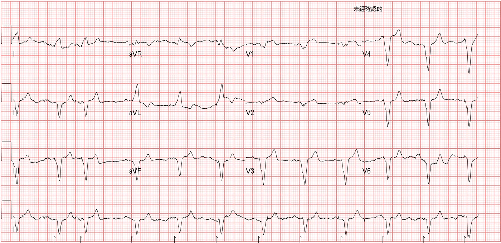
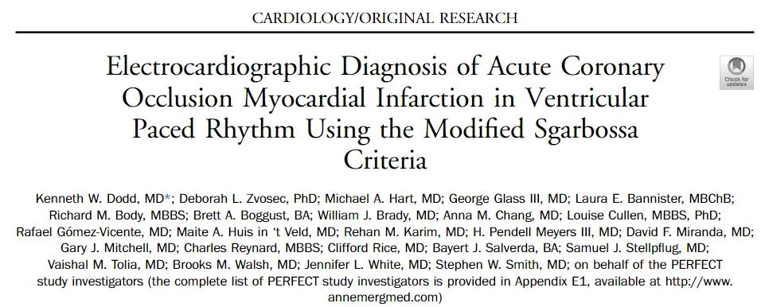
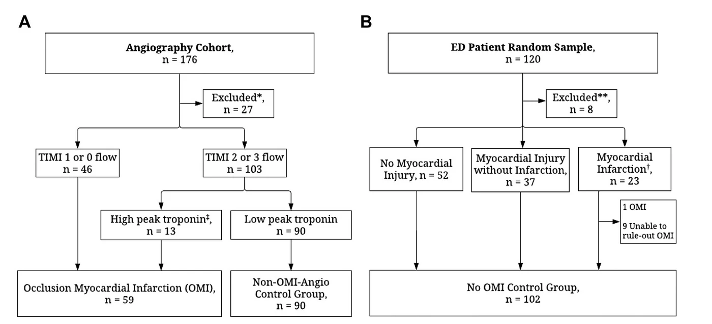
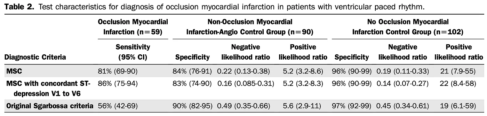
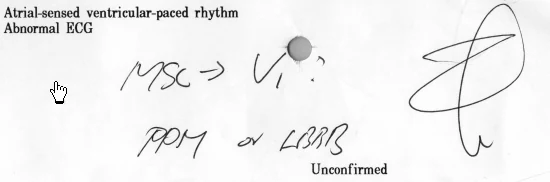
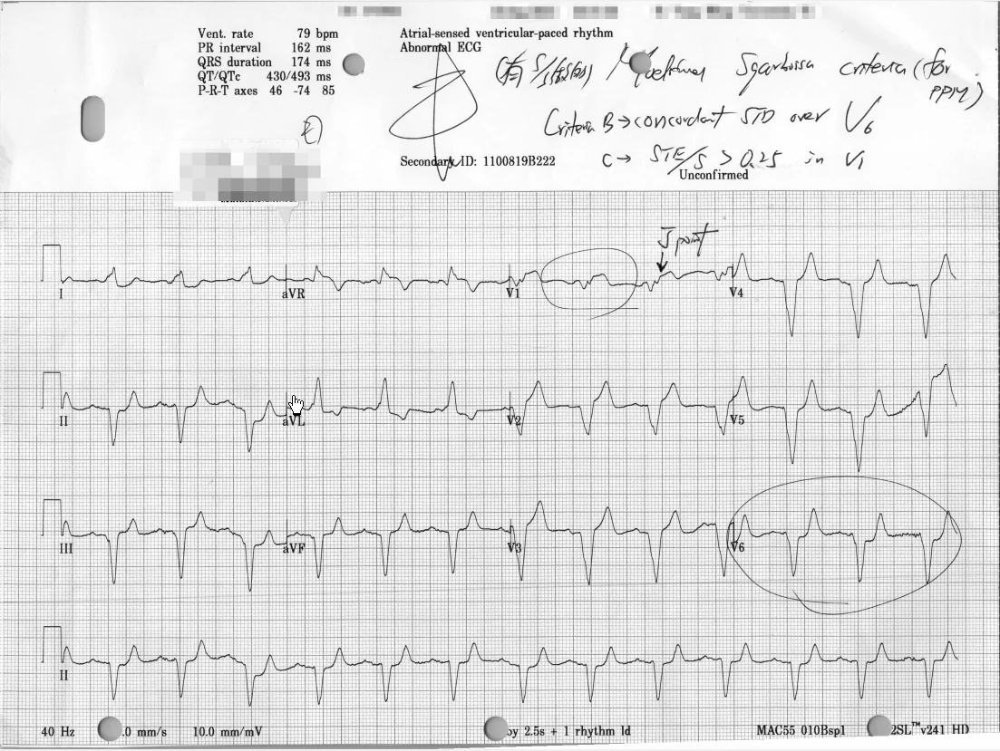
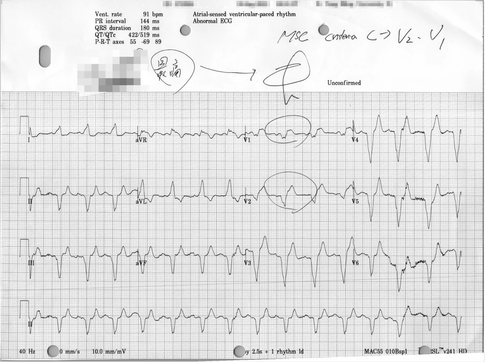
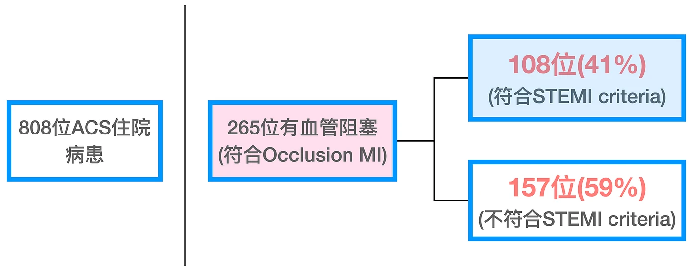
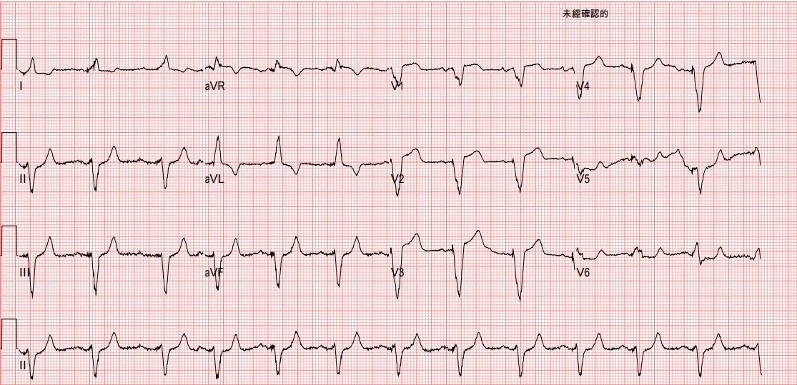



## ❤️Case：74歲男性胸痛快昏倒

74歲男性胸痛、痛到快昏倒了。到院時表示，這幾天常常如此但是一下就緩解了，今天特別難受。

通常ECG的interpretation不太可信，但是ECG machine對於偵測有pacemaker rhythm非常敏感[^1]。**Fig.1**是病患入院10分鐘內做的ECG，可以看到最下排long lead II，有偵測到pacemaker rhythm的微小spike。

## ❤️所以問題回到了，裝有PPM的病患是否可以透過ECG來診斷AMI

那我們來看看一篇今年6月份就已經在Annals of Emergency Medicine以Article in press形式看到文章，直到10月份正式刊出的一篇文章。

這一篇文章利用Modified Sgarbossa criteria來協助診斷裝有pacemaker發生ACO(Acute coronary occlusion)的狀況[^2]。

Fig.3看到了這個研究分成三組(**數值請見Fig.4**)

❶**第一組**是OMI(**59位病患**)

❷**第二組**是NOMI **control group**(**90位病患**)

❸**第三組**是No OMI **control group**(**102位病患**)-收集ED沒有OMI的pacemaker患者(**於ED有ACS主述**)

### ❤️OMI組別:符合TIMI flow 0~1 or TIMI flow 2~3 + High peak Troponin

- 31位病患是藉由Concordant STE or STD來診斷出來
- 2位病患是藉由Original Sgarbossa criteria的> 5 mm診斷出來
- 17位病患是藉由MSC C rule診斷出來

所以透過**MSC A+B+modified C**➡可以抓出:31 + 17=48➡48/59=**81%**(**還有11位無法抓出**) →此為**MSC對於OMI的sensitivity**

如果是透過**Original SC A+B+C**➡可以抓出:31 + 2=33➡33/59=**56%**(還有26位無法抓出) →**Original SC對於OMI的sensitivity**

### ❤️NOMI組別(Control group)➡TIMI flow 2~3 + Low peak Troponin

我們一樣用MSC與Original SC來看看，其false positive如何?

MSC的**false positive rate**為在NOMI組別中90位病患有14位看到MSC(+) →14/90=16%(所以**Specificity為84%**)

Original SC的false positive rate為90位病患有9位看到Original SC(+) →9/90=10%(所以**Specificity為90%**)

LR- →0.22 vs. 0.49(MSC vs. OSC)

LR+ →5.2 vs. 5.6(MSC vs. OSC)

### ❤️No OMI組別(Control group)➡隨機收集ED沒有OMI的PPM病患

MSC的**false positive rate在No OMI組別**為102位病患有4位看到MSC(+) →4/102=4%(所以**Specificity為96%**)

Original SC的false positive rate為102位病患有3位看到Original SC(+) →3/102=3%(所以**Specificity為97%**)

LR- →0.19 vs. 0.45(MSC vs. OSC)

LR+ →21 vs. 19(MSC vs. OSC)

<mark><strong>綜合了以上OMI group發現了，MSC對於診斷OMI的sensitivity比較好，可以高到81%。但是原本的Original SC對OMI的sensitivity只有56%。</strong></mark>

<strong>此外另外兩個control組別(NOMI與No OMI)，可以知道不管是MSC還是Original SC對於如果不是OMI的病患，其假陽性(false positive rate)很低(也就是specificity很高(84%~97%) →Specificity=1-假陽性)。也就是如果MSC or Original SC是陽性，則病患可以rule in OMI。</strong>

另外在No OMI組別中MSC(+)，有4位(4 of 102位)。去分析這4位，發現原本這4位病患的baseline ECG就已經是MSC(+)。這也讓我們了解到，如果裝有pacemaker的ACS患者，如果在急診看到MSC(+)的話，請也把之前的ECG拿出來一起看，是不是有可能是舊的變化。

## ❤️繼續一開始的個案

在急診看到Fig.1的這張到院時ECG，我在ECG上寫下:V1可能有MSC(指Criteria C →excessive discordant > 0.25)

所以我把病患擺在我的看診椅前面，身上裝著ECG monitor。因為我覺得病患有問題，**因為MSC(+)**。

<strong>MSC criteria A和C rule只要任何一個lead符合就算有問題。criteria B如果是用在LBBB，只看V1~V3、但是如果是用在pacemaker患者，那麼看V1~V6。</strong>

40分鐘後，病患因為症狀持續再做一張ECG(**Fig.6**)。

**Fig.6**看到了V1仍是excessive discordant >0.25、V6看到了concordant STD。看到了V6如此的變化

又過了20分鐘，ECG再做一張(還是有症狀)(Fig.7)

Fig.7看到了V1、V2都符合MSC criteria C。V5~V6因為baseline不穩，所以看不出來是否concordant STD。

到了此時，CV man終於願意幫忙病患進行PCI。

近數十年來將MI病患分成STEMI/Non-STEMI。大家把看到STEMI趕緊送導管室為最高指導原則。但是卻往往卻忽略了**ST elevation對於MI的敏感度真的高嗎?**

我們來看看這篇文章收集的個案[^3]。

文章收集了808位ACS住院病患，其中265位有血管阻塞(符合Occlusion MI)，其中108位(41%)符合STEMI criteria，157位(59%)並不符合STEMI criteria。

所以ST elevation對於診斷OMI，其實敏感度非常不好。也就是如果要用ST elevation來抓OMI的患者，會有很多OMI沒抓到。

LBBB/PPM病患因為傳導異常導致心室去極化與再極化產生變化，進而產生secondary STTC，這些STTC有時會掩蓋或模仿缺血變化。因此LBBB/PPM的患者從以前就被認為並不容易診斷OMI。

但是目前對於LBBB與pacemaker患者，經由validation study，發現透過MSC，可以有非常好的sensitivity與specificity來證明病患有OMI。

## ❤️個案後續PCI

CAG:LAD-M total occlusion(CTO) s/p stent，but failed、RCA-M ulcerative plaques with 80% stenosis s/p stent

在這邊我們來看幾個問題。

❶第一個是MSC是否可以 localize缺血的區域？

通常在正常傳導的狀況下，我們可以依據心電圖來推測缺血的區域與culprit lesion。但是在 LBBB/PPM的傳導異常下，我們還是能夠透過符合MSC criteria A、B、C的leads來推測可能缺血的位置。

比如Criteria A是指concordant STE，如果在有發生concordant STE的leads，可能得考慮是否有ischemia。像此case在V1~V2有符合excessive discordant >0.25(Criteria C)，就必須考慮到septal wall問題。如果有符合Criteria B的Concordant STD over V1~V3就必須考慮Post.wall OMI。

<mark><strong>也就是MSC可以localized梗塞缺血區域。</strong></mark>

❷第二個是因為患者V1~V2都出現缺血變化，猜測可能是LAD出現問題。為何此病患LAD放stent失敗了，但是LAD缺血區域的leads卻改善了(RCA放stent成功，怎麼LAD缺血leads變正常了呢? →見**Fig.9** )

Fig.9是Post PCI在RCA放了stent後的ECG(LAD-CTO有嘗試去放，但打不通)。可以看到原本的V1~V2有excessive discordant STE(>0.25)已經不見了。代表缺血有改善。

但是LAD明明因為CTO打不通，反而是RCA有放stent，為何LAD支配的V1~V2會改善?

這問題，我實在也想不透!所以我去twitter問了一些ECG master~~~





看完大師的回應，有點恍然大悟。怎麼說?

ECG其實是<mark><strong>沒辦法真正localize culprit lesion，它只能呈現缺血的區域</strong></mark>。因為缺血區域被冠狀動脈血管解剖位置、之前是否有無MI過，與是否有無collateral flow等等互相干擾影響著。

也就是說，像這個例子。ECG看起來septal wall可能出問題了。其根本原因並不是真正LAD出問題。而是支配著LAD-CTO區塊的側枝循環出問題了(從RCA來的)。這在做PCI之前，我們根本不會知道。我們只會知道septal wall可能缺血了，但真正的Culprit lesion是誰，我們並不會知道。特別是病患血管有多處問題的情況下。

做完PCI才知道LAD有CTO，且有RCA過來的collateral flow協助支配著。當RCA也有問題時，支配CTO處的RCA側枝循環當然也會受到影響。所以反而RCA處理完後，側枝循環也變好了，當然在V1~V2呈現的OMI ECG finding就改善了。

## 學習重點

1. 對於LBBB/PPM病患是否有OMI，可以使用MSC來協助診斷。Sensitivity與specificity都很高
2. ST elevation對於診斷OMI的敏感度不到一半(所以我們更應該要學習其他OMI ECG finding)
3. MSC可以localize梗塞缺血的區域，但無法localize culprit lesion
4. ECG無法確切猜出正確culprit lesion是哪條(大部分時候可以)。但是知道哪條是culprit lesion並不重要，重要的是要知道病患有沒有OMI。因為有OMI，就需要去做PCI等打通血管的處置。

## 參考資料

內文每個上標數字，滑過去（手機點一下）就看得到出處。整理起來是這3份：

- **研究**
  - Dodd KW, et al. *Ann Emerg Med* 2021（用Modified Sgarbossa criteria診斷心室節律器下的急性冠狀動脈阻塞型心肌梗塞）
  - Meyers HP, et al. *J Am Heart Assoc* 2021（V1–V4最大的缺血性ST depression對OMI的特異性）
- **部落格**
  - Dr. Smith's ECG Blog（ST elevation MI in the setting of a paced rhythm，2008-11）

[^1]: [ST elevation MI in the setting of a paced rhythm](http://hqmeded-ecg.blogspot.com/2008/11/st-elevation-mi-in-setting-of-paced.html)
[^2]: Dodd, K. W., Zvosec, D. L., Hart, M. A., Glass, G., Bannister, L. E., Body, R. M., Boggust, B. A., Brady, W. J., Chang, A. M., Cullen, L., Gómez-Vicente, R., Huis in ‘t Veld, M. A., Karim, R. M., Meyers, H. P., Miranda, D. F., Mitchell, G. J., Reynard, C., Rice, C., Salverda, B. J., … Taylor, A. M. (2021). Electrocardiographic Diagnosis of Acute Coronary Occlusion Myocardial Infarction in Ventricular Paced Rhythm Using the Modified Sgarbossa Criteria. *Annals of Emergency Medicine*, S0196064421002493. [https://doi.org/10.1016/j.annemergmed.2021.03.036](https://doi.org/10.1016/j.annemergmed.2021.03.036)
[^3]: Meyers, H. P., Bracey, A., Lee, D., Lichtenheld, A., Li, W. J., Singer, D. D., Rollins, Z., Kane, J. A., Dodd, K. W., Meyers, K. E., Shroff, G. R., Singer, A. J., & Smith, S. W. (2021). Ischemic ST‐Segment Depression Maximal in V1–V4 (Versus V5–V6) of Any Amplitude Is Specific for Occlusion Myocardial Infarction (Versus Nonocclusive Ischemia). *Journal of the American Heart Association*, e022866. [https://doi.org/10/gngnv7](https://doi.org/10/gngnv7)
