

## ❤️我們來看看為何VPC也可以小兵立大功

VPC是由心室產生的。VPC就像LBBB一樣具有discordant ST segments，所以當excessive discordant STE或concordant STE時，就要小心。雖然沒有證據顯示MSC可以適用VPC就像LBBB一樣。但是根據Stephen Smith的經驗，這rule用在VPC和用在LBBB非常類似，雖然specific少一點[^3]。

[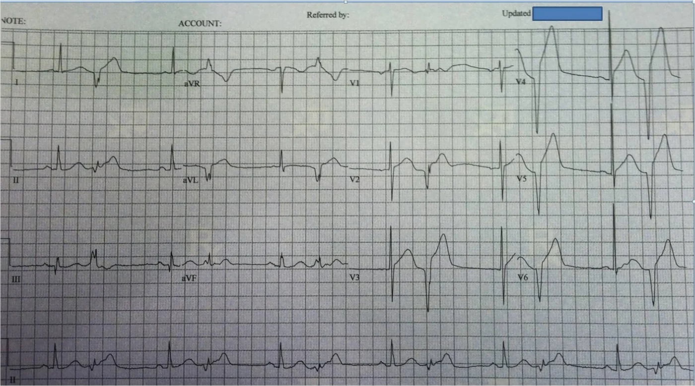](http://hqmeded-ecg.blogspot.com/2014/01/look-at-pvcs.html)
*From Smith ECG Blog*

讓我們來複習一下。Modified Sgarbossa criteria(MSC)可以應用在LBBB/PPM的病患。**Criteria如下:**

1. Concordant STE(> 1 mm) in any lead(任何一個lead)
2. Concordant STD(> 1 mm) in V1~V3(只要一個lead) →如果是PPM，則extend V1~V6都適用
3. Excessive discordant in any lead(STE/S >0.25 or STD/R >0.3)

<mark><strong>這邊要注意一點就是，不要再用Sgarbossa criteria的Criteria C(指Discordant STE >5 mm) →此false-positive的機會高，且不specificity，所以Smith才在2012在AEM出了MSC取代Criteria C，希望修正此問題。</strong></mark>

MSC如果抓0.25這個數值，可以讓sensitivity到80%，specificity到99%。如果抓0.3，則可能會讓sensitivity降到64%，反而錯過許多AMI。

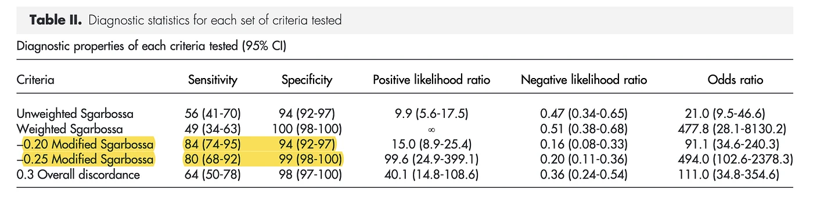

來看圖(**Fig.3 & 4**)比較清楚一點。

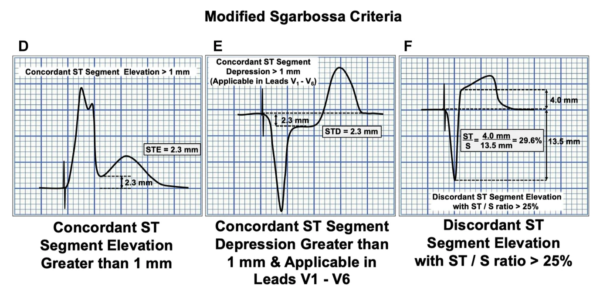

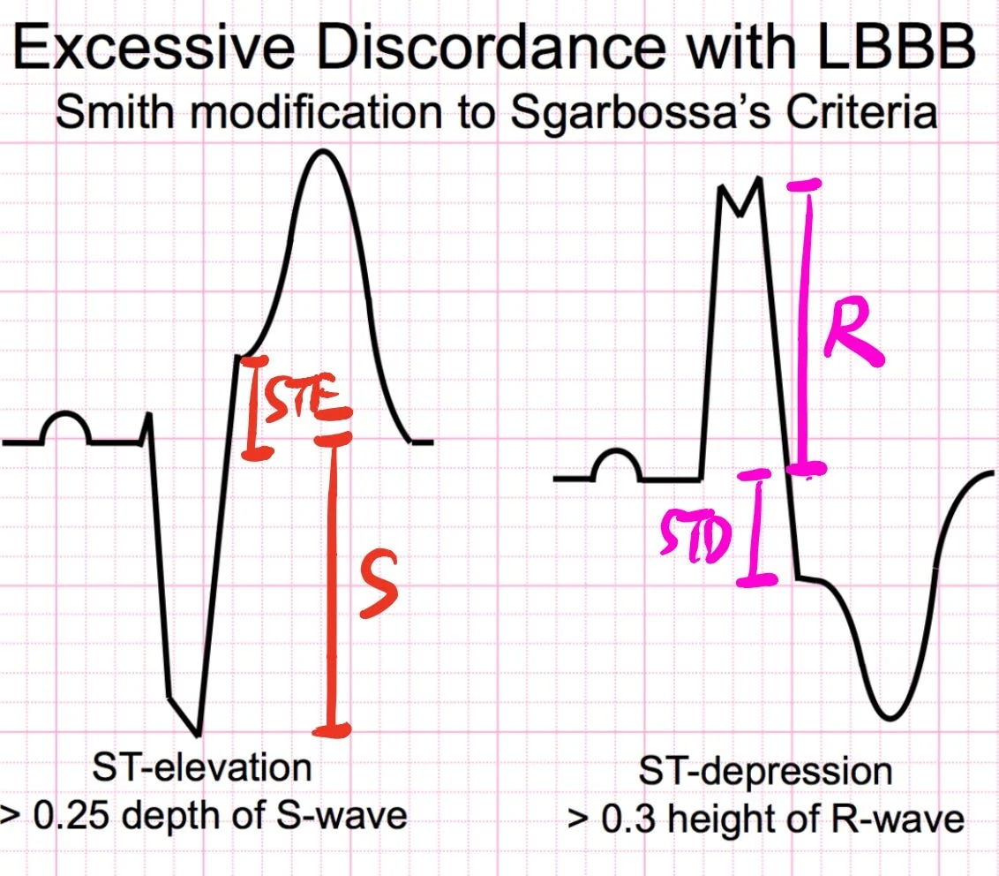

### ❤️有點離題了

<mark>以上要講的重點就是，MSC Criteria C很重要，可以協助我們評估是否有OMI。</mark>

**再來看幾個例子。**

[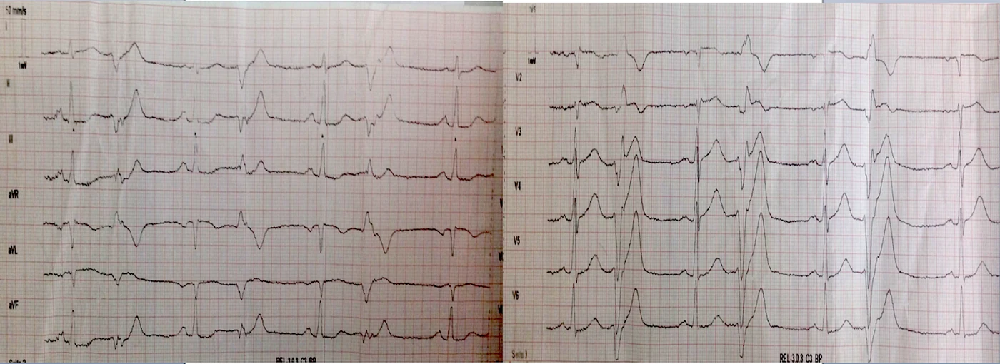](http://hqmeded-ecg.blogspot.com/2018/10/hyperacute-t-waves-and-concordant-st.html)
*From Smith ECG Blog*

圖中可以看到，VPC有明顯hyperacute T wave出現。V2也在VPC有看到Concordant STE。這也是藉由VPC來看出有ischemic change。

根據Stephen Smith的經驗，以往OMI都是透過sinus-conducted beats傳導下來，造成的ST-T wave morphology來診斷。但是近10年來，Smith發現，有不少的個案可以透過VPC的morphology change來做OMI的診斷。

**再來看一張**

[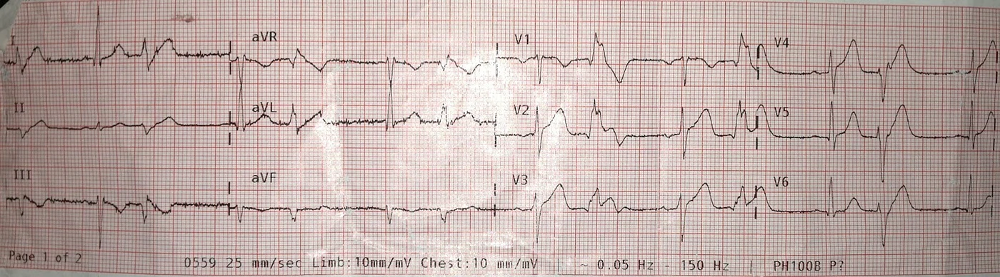](http://hqmeded-ecg.blogspot.com/2013/06/stemi-seen-best-in-pvc-diagnosed-by.html)
*From Smith ECG Blog*

這邊也是透過在V1~V3的**VPC有看到Concordant STE**，但是sinus node往下傳導的beat沒有明顯STE(或許有Large T wave →可以和之前的ECG比較，較為準確)。

## ❤️接著再來一個自己的Case

52歲男性，下午開始胸痛合併冒冷汗(**Fig.7**)

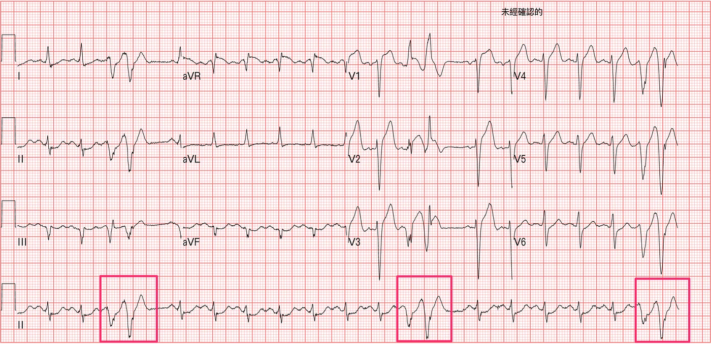

進一步解析此ECG，可以知道sinus tachycardia，約120 bpm。long lead II可見紅色框框的group beats。撇除這個group beats不看，可以看到STE over V2~V4，偏向concave STE，在lead II、aVF有minimal STD。

52歲男性，在V2~V3有2 mm的STE就是STE。此Case在V2約3 mm、V3約2.5 mm。已經算是符合STEMI criteria，可以Call CV man了。更何況在inf.leads有reciprocal STD change(Ant.wall STEMI有30~50%的病患不會有)。

如果這樣程度的高，還不讓你心動去Call CV man。那我們來算看看Subtle LAD occlusion的**Smith 4 variable formula**。

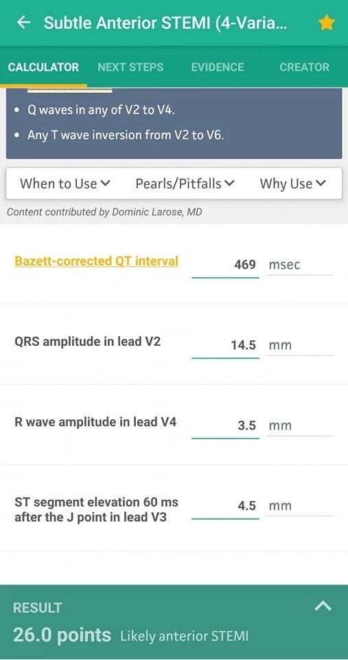

**QTc:469**

**QRSV2:14.5**

**STEV360:4.5**

**RAV4:3.5**

<mark><strong>算出來:26 >18.2 →高度可能是Ant.STEMI</strong></mark>

(當然，這個方程式算出來就是和你說，這非常像Ant.wall STEMI →需要高度警覺，但你千萬別就光拿這數字去和CV說，你看算出來是STEMI，要趕快做導管。沒有人會理你的啊!!!!)

Ps:使用此Smith 4 variable formula，有排除條款。其中之一就是不能有reciprocal STD change。其實這方程式在這不能用。Why?因為有reciprocal change代表是明顯MI了。所以不用使用，就可以說是MI了啊!

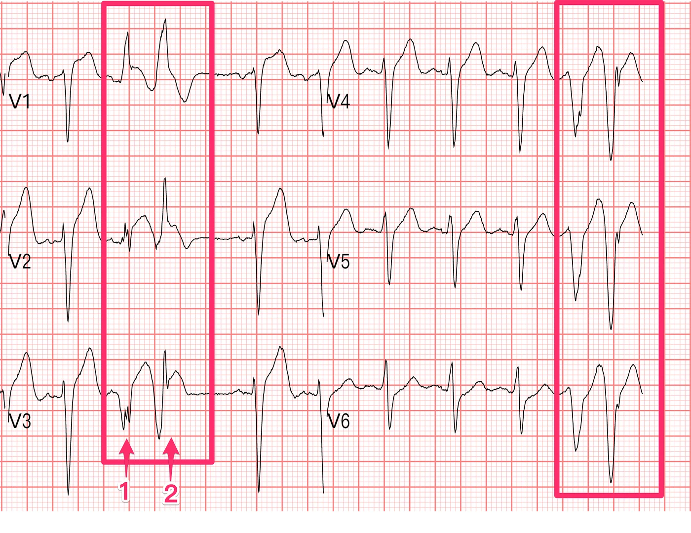

假設STEMI criteria無法讓你去Call CV man，而且Smith 4 variable formula你也不會使用。那麼我們來看看這個group beats發生什麼事了。

Group beats的第一跳看起來是有P wave(往V1~V2對過去)，偏向RBBB pattern，第二跳看起來有寬，沒有明顯P wave，可能是VPC beat，且V2~V3有明顯concordant STE，代表因為有ischemia，才會產生的concordant STE。這也是OMI的證據。

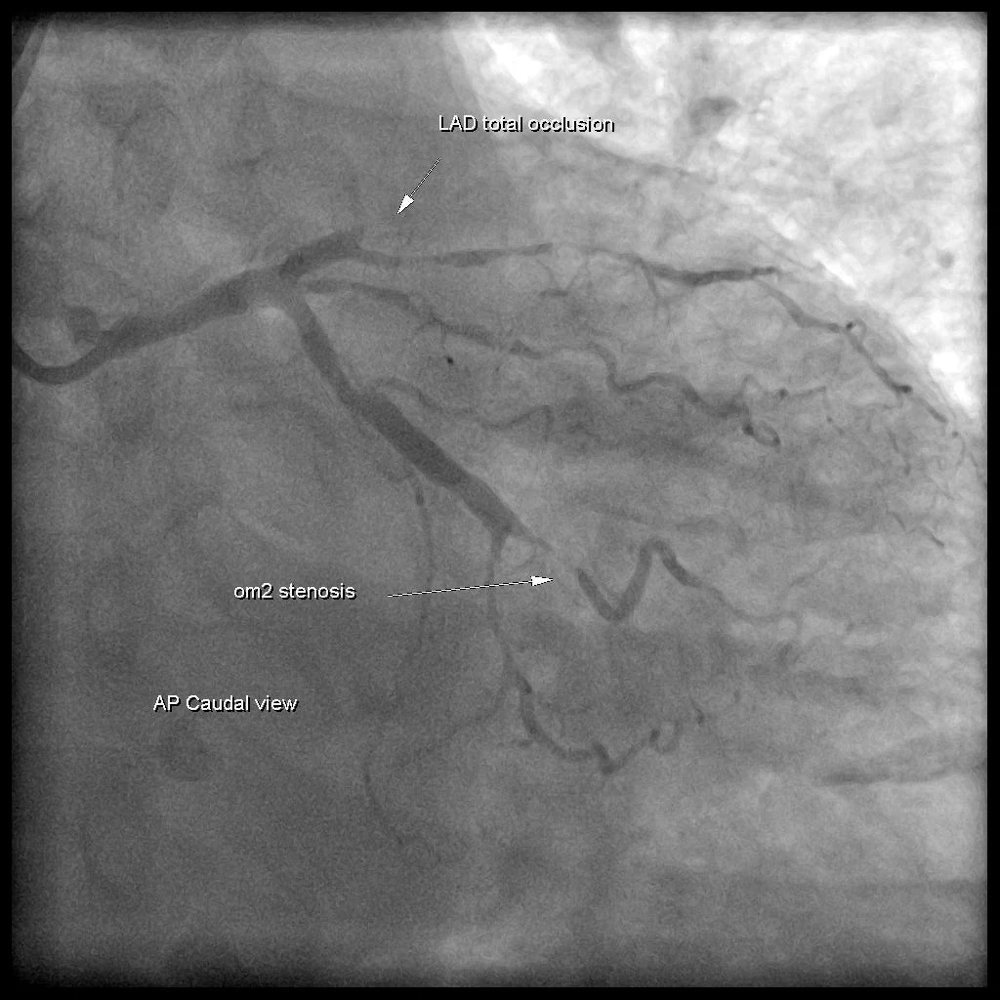

<mark><strong>病患作了PCI顯示LAD total occlusion。</strong></mark>

**在這篇Smith ECG文章中表示[^1]：**

- 在LBBB、PPM，或是LBBB like QRS complexes(如VPC)(目前尚未studies)都應該使用MSC去看是否有ACS(**目前只有LBBB/PPM有Validation study**)
- Appropriate discordance的原則能夠用在所有wide QRS complexes →當有wide QRS complexes出現，有懷疑有ACS，看看是否有excessive discordant現象出現(**也就是符合MSC criteria C**)

## ❤️接著我們再來看一個，可以透過VPC來預知可能會有fatal arrhythmia的產生

[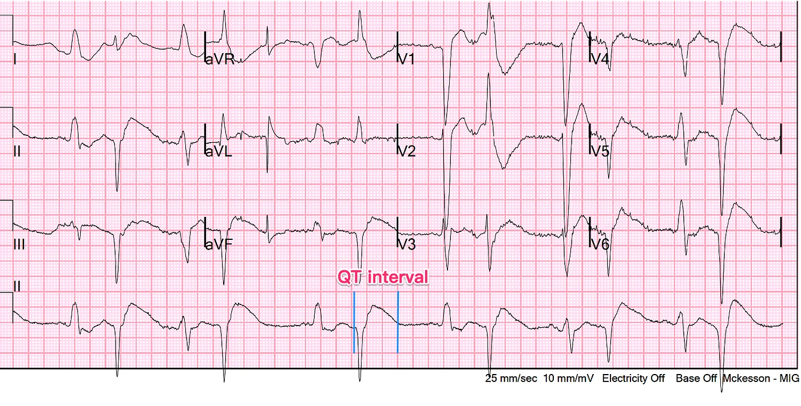](https://hqmeded-ecg.blogspot.com/2021/11/what-are-these-bizarre-bigeminal-pvcs.html)
*From Smith ECG Blog*

樓上的ECG可以見到bigeminy pattern ECG pattern。但是要注意到，可以看看VPC beat的QT interval大約560 ms

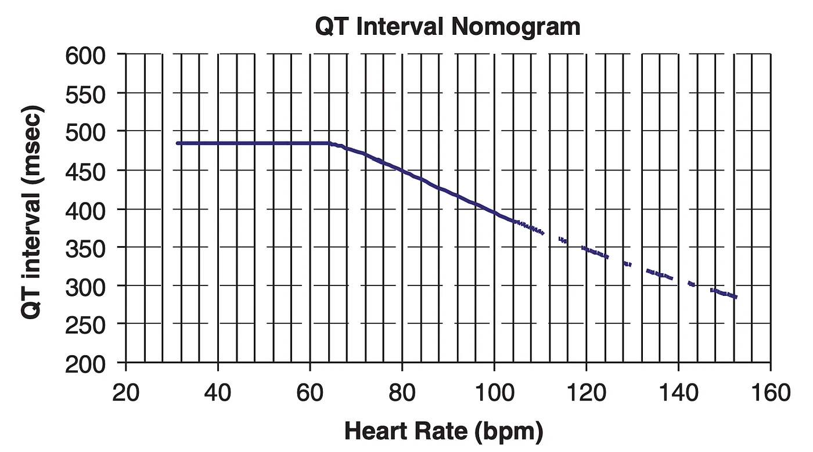

Fig.12為QT interval nomogram[^2]，在H.R<60以下，只要QT interval > 485 ms，就有TdP的風險，H.R>60，隨著H.R上升，發生TdP risk的QT interval也隨之下降。**換句話說就是，在線以上，就要小心發生TdP**。

所以QT interval為560 ms著實，**很可能接下來會發生TdP**。所以趕緊看看是否有Hypo-K、Hypo-Mg。是否有使用增加QT的藥物。病患趕緊On個monitor，擺在自己的眼前，不要等到護理師衝過來和你說，留觀區第幾床看起來怪怪的(已經產生fatal arrhythmia了)。

## 學習重點

1. VPC如果有concordant STE or excessive discordant STE(STE/S>0.25) or Hyperacute T wave可以協助OMI的診斷
2. VPC如果合併QT prolong，趕緊矯正原因，避免後續致命性心律不整的產生

## 參考資料

內文每個上標數字，滑過去（手機點一下）就看得到出處。整理起來是這3份：

- **研究**
  - Chan A, et al. *QJM* 2007（藥物引起的QT延長與torsades de pointes，QT nomogram的評估）
- **部落格**
  - Dr. Smith's ECG Blog（An elderly man who dies 12 hours later，2021-10）
  - Dr. Smith's ECG Blog（Hyperacute T-waves and Concordant ST Elevation seen in PVCs only，2018-10）

[^1]: Dr. Smith’s ECG Blog: An elderly man who dies 12 hours later — could he have been saved? — [link](http://hqmeded-ecg.blogspot.com/2021/10/an-elderly-man-who-dies-12-hours-later.html)
[^2]: Chan, A., Isbister, G. K., Kirkpatrick, C. M. J., & Dufful, S. B. (2007). Drug-induced QT prolongation and torsades de pointes: evaluation of a QT nomogram. *QJM: Monthly Journal of the Association of Physicians*, *100*(10), 609–615. [https://doi.org/10.1093/qjmed/hcm072](https://doi.org/10.1093/qjmed/hcm072)
[^3]: Dr. Smith’s ECG Blog: Hyperacute T-waves and Concordant ST Elevation seen in PVCs only — [link](http://hqmeded-ecg.blogspot.com/2018/10/hyperacute-t-waves-and-concordant-st.html)
