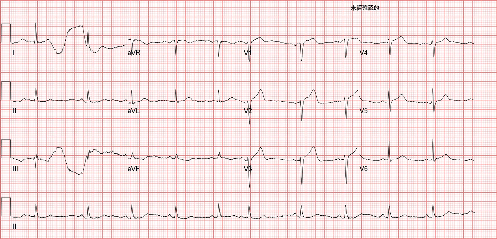
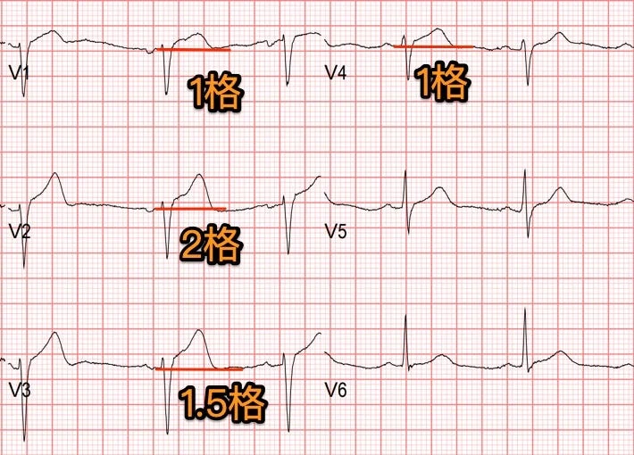
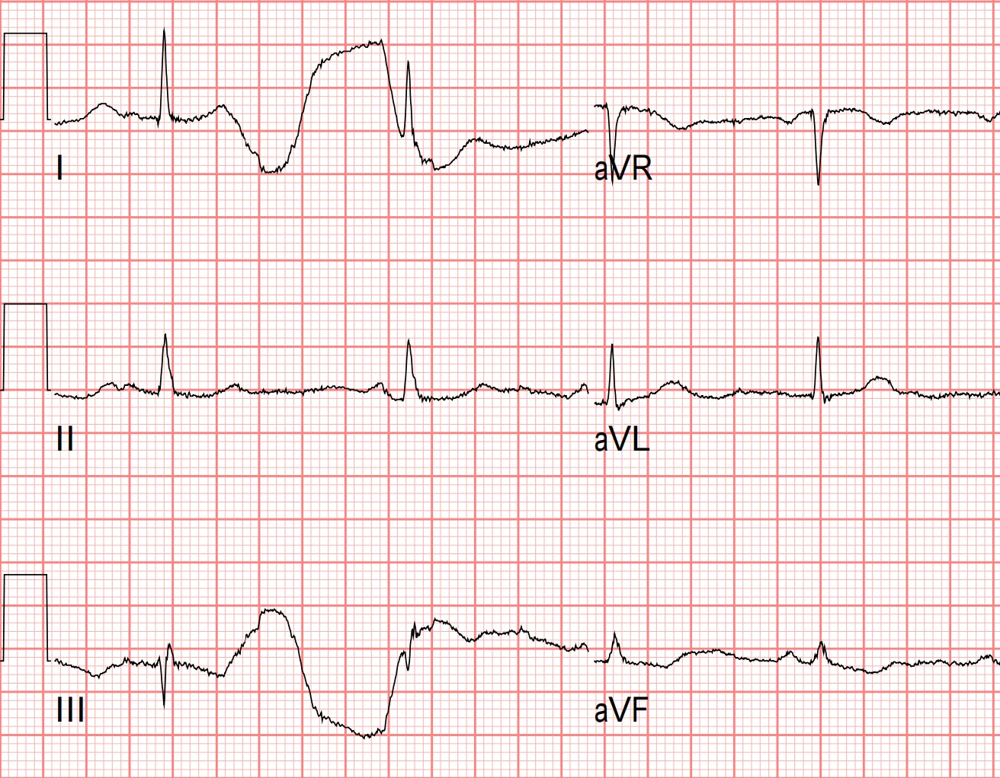
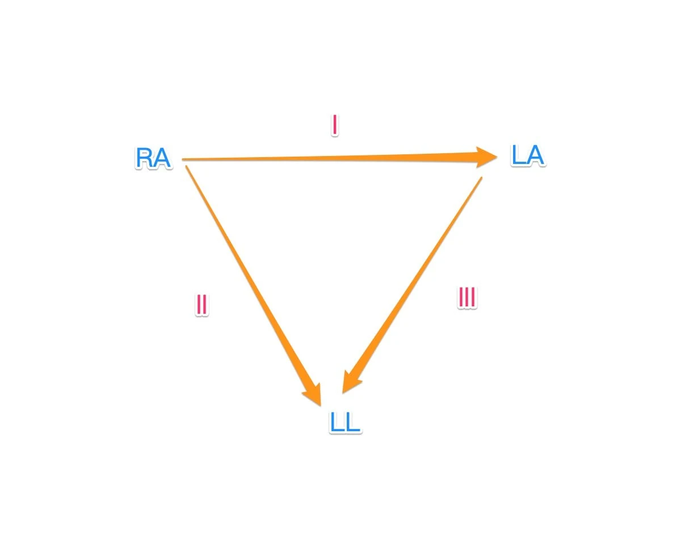
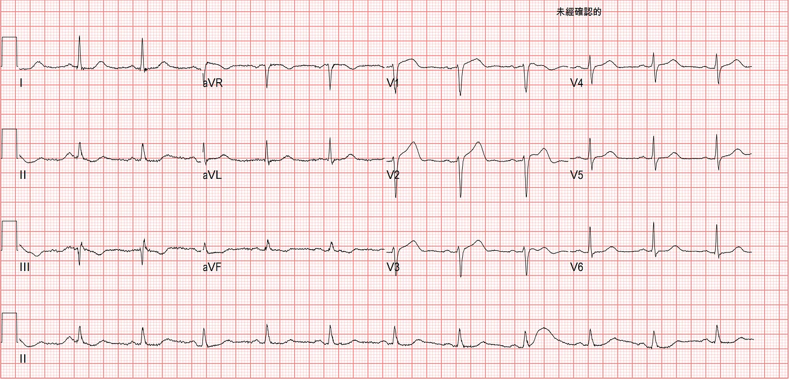
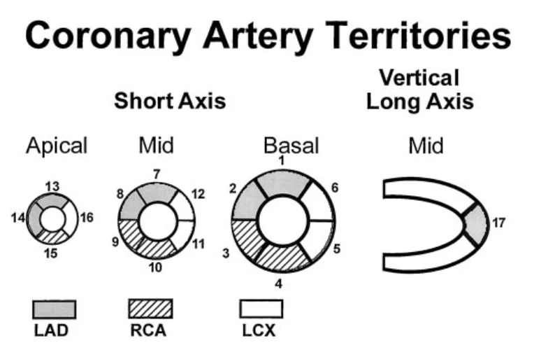
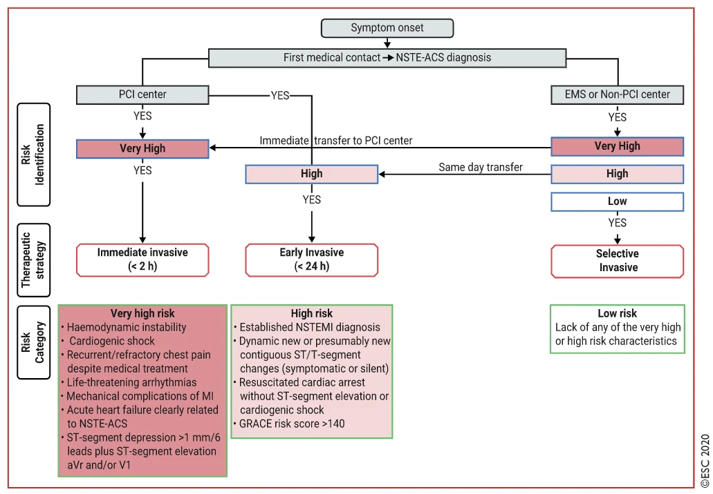
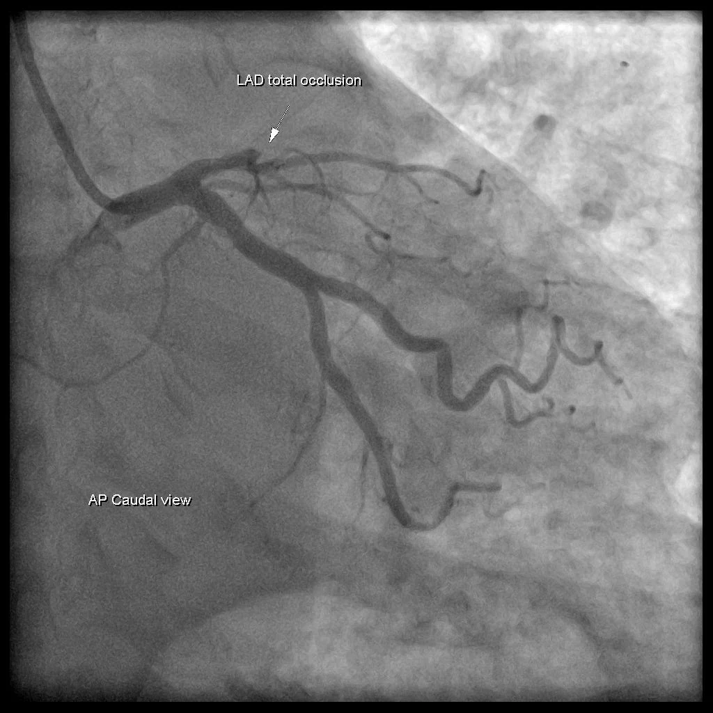
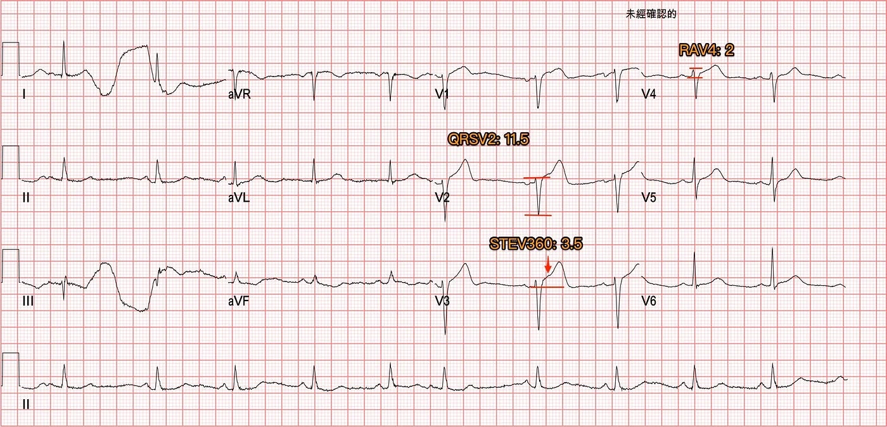
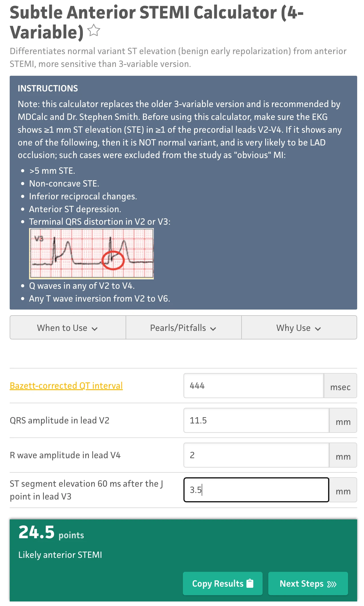



## ❤️Case：下班前最後半小時的胸痛病患

這個Case，是上個月某個夜班，上到早上準備下班的最後半小時。我突然被告知，等等會有一位胸痛病患到院<strong>(敢情是VIP，病患還沒到，幫忙電話到是先到了)</strong>。

護理師說，就靠我了~~~

心想，剩最後半小時，到底靠我要怎樣啦XD

不廢言，來看看我們可以從這個Case學到什麼吧!!!

病患到院時，看起來真的是非常的痛，痛到整個臉都糾結在一起了。她說這1~2天一陣一陣的胸痛。早上開始大痛，痛到後背，痛到冒冷汗。

## ❤️先來判讀一下ECG

<strong>Rate: </strong>63 bpm

<strong>Rhythm: </strong>SR with APC

<strong>Axis: </strong>Normal axis

<strong>Interval: </strong>No QT prolong

<strong>Ischemia: </strong>運用QRSTU來判讀

- 沒有看到明顯的pathologic Q wave
- PRWP(+)
- STE in V1~V4
- Hyperacute T wave over V2~V4

在Ischemia的部分，我們放大V1~V4

V1的STE有1 mm

V2的STE有2 mm

V3的STE有1.5 mm

V4的STE有1 mm

<strong>根據STEMI criteria的定義</strong>，在所有的leads裡面，V2~V3如果是女性不管年紀，要≥1.5 mm才是有意義的高，其他的10個leads只要有1 mm高就算是高。連續兩個leads有高，就是有意義。

所以<mark><strong>這個Case的的確確是符合STEMI criteria</strong></mark>。

如果再配合V2~V4有Hyperacute T wave的出現。此外出現PRWP，其實已經可以診斷，LAD occlusion了。

<strong>但是，這張ECG能夠讓CV man認可，啟動心導管嗎?等會兒說…….</strong>

Fig.1這張心電圖，除了ischemic ECG change外，還有一個有趣的artifact。

我們先看左側limb leads，出現ECG artifact為Lead I與Lead III，Lead II沒有出現artifact。

那麼我們來看看Fig.4的圖就可以知道，問題出在哪一個lead了。問題出在做ECG時，左手(LA)動了，導致<strong>有連到左手的Lead I/III都有問題</strong>。

把Fig.4的圖畫出來，可以很快得知是肢體哪個部分讓limb leads出現了ECG artifact。只要5秒鐘，就能判斷出來。

## ❤️Case continue

剛剛說到，這樣的subtle precordial leads STE、PRWP、Hyperacute T wave，能夠讓CV man覺得這胸痛是AMI嗎?

每個CV man心中都有一把要Cath lab activation的尺，這把尺多長多短，我們急診科沒辦法改變。

病患在我們急診科手上(至少在急診，我們是duty VS)，我們的目標是什麼?

這幾年對心電圖的可重複性、便利性的多個特性。深深覺得是一個非常好協助診斷AMI的工具。既然有工具，那麼我們的目標是什麼?

目標就是提早找出OMI(Occlusion MI)病患，並且說服CV man，讓OMI的病患去接受再灌流治療。打通血管，挽救殘存的心肌細胞。

如果CV man看到此ECG，也認為血管有阻塞，也立刻啟動心導管。I respect~~~

如果CV man看到此ECG，不認為血管有阻塞，I also respect~~~

就醫療立場，不管急診科還是CV man都是為了病患好。

無法立刻啟動心導管，這代表了我們還沒辦法有足夠MI證據說服對方。這是我自己的想法。

所以我自己這幾年希望自己的心電圖判讀能夠更精準，就是希望我在判讀時有足夠的證據，來說明這位病患是需要立刻做導管，而不是擺著追蹤心臟酵素。

又講了一堆心中廢話。

總之<strong>CV man覺得到院時ECG(Fig.1)看起來不像有MI。</strong>

Fig.5是10分鐘後的ECG，仍持續胸痛，但症狀緩解一點。把Fig.5和Fig.1拿來lead by lead比較，V3~V4的Hyperacute T wave有改善，V2~V4的STE有降低。這種ECG變化，我們叫做dynamic STTC，這暗示了血管有問題才會如此。

當下有幫病患做echo，讓我們來看看echo有哪些findings?









藉由echo，我們可以看到，LAD支配的Ant.wall幾乎不太動。<strong>(請搭配Fig.6安心服用)</strong>

ECG在LAD支配位置的Precordial leads出現Subtle STE/PRWP/HATW/此外10分鐘後的dynamic STTC，另外加上echo看到ant.wall有RWMA。這些證據不管怎麼樣都實實在在說明，LAD出現問題了。

總該要去導管了吧????

### ❤️沒有~~~~~~Orz

後來我要下班了。我和病患身旁的長官說，這看起來很有可能是心肌梗塞。

當晚上再次上班時，我詢問陪在這位病患身旁的長官，倒底為何CV man最後還是去做了心導管。

她說我離開急診後，病患後來胸痛痛到漏尿，她問CV man該怎麼辦?!CV man表示，既然那麼痛，就做進去吧!!!!

之前常常講到在2020 ESC NSTEMI guideline中提到，若被歸類在NSTE-ACS中(NSTEMI+UA)，有<strong>very high risk feature</strong>需要立刻在<2 hr內做到心導管。

我們再來複習一下，<strong>請看Fig.7的左下角Very High risk。</strong>

其中有一項是Recurrent/refractory chest pain

Dr.Smith多次在其ECG blog提到，不只美國，全世界真正按照這個Guideline在Very high risk病患，去立刻執行心導管(< 2hr)的並不多，意思就是常常違背這Guideline。

就我們自己在急診的經驗也是如此，明明病患持續胸痛，但是因為ECG沒有出現STE，就繼續追蹤心臟酵素(<mark><strong>持續胸痛，不需要有任何ECG變化，這就符合心導管適應症</strong></mark>)。也有遇過病患胸痛合併心因性休克，但是ICU給了升壓劑，繼續觀察，沒有去做心導管(<mark><strong>冠心症合併心因性休克就是心導管適應症</strong></mark>)。

再次說明，每個CV man對於心中符合心導管的適應症，不盡相同。當我認為應該要做，CV也覺得要做，我是衷心替病患開心。

<mark><strong>心導管報告: LAD total occlusion s/p emergent PCI，Dx with NSTEMI</strong></mark>

此外這個病患因為有subtle STE over precordial leads，所以我們可以應用<strong>Smith 4 variable formula</strong>來看看是否有可能LAD occlusion。

<strong>Smith 4 variable formula:</strong>[<strong>公式連結在這裡</strong>](https://www.mdcalc.com/subtle-anterior-stemi-calculator-4-variable)

### ❤️QRSV2: 11.5

- <strong><em>抓V2的QRS amplitude</em></strong>

### ❤️STEV360: 3.5

- <strong><em>這個數值指的是V3 J point往後60 ms →也就是1.5小格後和baseline的高度</em></strong>

### ❤️RAV4: 2

- <strong><em>這個數值指的是V4的R wave amplitude</em></strong>

### ❤️QTc:444 ms

- 直接把12 lead ECG電腦算的QTc帶入公式就可

把數字帶入網頁公式去算，<strong>算出來數字為24.5</strong>

這個公式算出來的數字只要>18.2就會顯示likely anterior STEMI

- <strong>83.3% sensitivity、87.7% specificity、and 85.9% diagnostic accuracy</strong>

<strong>算這個會不會很難 →其實不會，只要知道每個數值是在算哪裡，大概1分鐘內，就可以把V2、V3、V4要的值算出來。</strong>

## 學習重點

1. 判讀Ischemia，可以根據QRSTU來判讀
2. 運用Fig.4的圖，可以迅速知道肢體artifact的問題在哪兒
3. Subtle LAD occlusion有時符合STEMI criteria，但卻不被認為有問題(<strong>這是真實現實狀況，不是特例</strong>)
4. 當到院時ECG沒辦法說服CV man去執行心導管，該怎麼辦?我們還有echo、還可以做serial ECG，此外病患是否符合2020 ESC NSTEMI guideline的Very high risk狀況(需<2 hr做導管)→這些都可以輔助給我們更多MI的證據與做導管的後盾支持
5. 要如何在Subtle precordial leads STE來看是否有可能LAD occlusion →可以應用Smith 4 variable formula

