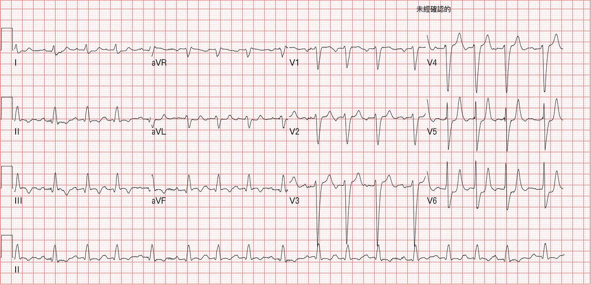
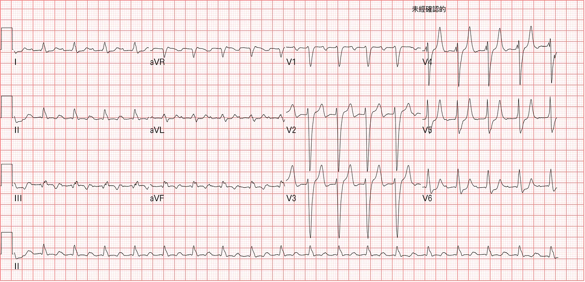
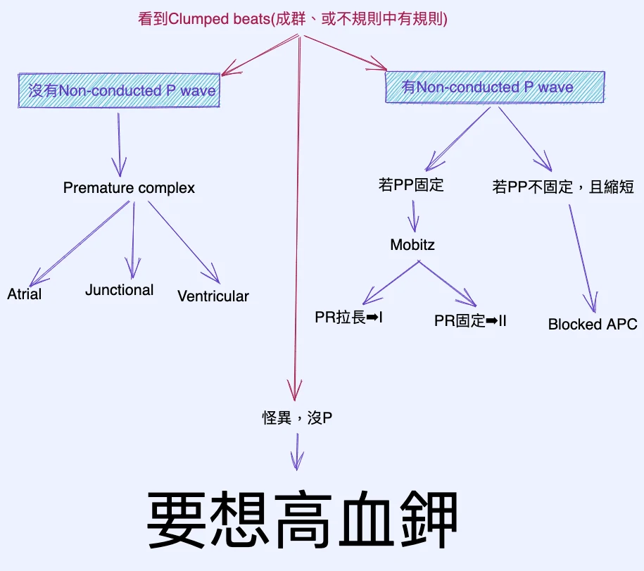



## ❤️Case：洗腎病患，呼吸喘到急診

洗腎病患，因為呼吸喘，而到急診來就診。X光看起來有肺積水，可能水過多了。Fig 1 為入院的ECG。鉀離子:6.1

交班給我時，剛好要追蹤第二次心臟酵素與鉀離子。

Fig 2是第二次追蹤心臟酵素時做的ECG。

我看了之後，立刻開了，Calcium、D50W+RI、Kalimate、NaHCO3。

護理師問我:請問熊醫師，**確定要『再給』一次降鉀藥物嗎?**

### ❤️熊醫師:要!!!

### ❤️之後追蹤的鉀離子:**7.4**

後來看了一下病歷，前一班給了降鉀藥物:**NaHCO3、Kalimate**

高血鉀導致的ECG變化，可謂是千變萬化。任何情況都可能出現。

可以像心肌梗塞的ST elevation，也可以是像subendocardial ischemia的ST depression。可以慢、可以快。

## ❤️可以抓幾個重點

1. 如果ST elevation出現在Rightward lead(aVR、V1、V2、III)，要考慮Hyper-K，特別是有合併RAD狀況下(**另外需要和PE、Na channel blocker一起DDx**)
2. 如果有看到Narrow based Peaked T wave，也需要考慮Hyper-K(**像Fig 2. V3~5尖到不行的T wave) →注意Peaked T wave的sensitive不高(意思是沒有看到Peaked T wave不代表沒有Hyper-K**)
3. 慢的心跳，合併conduction block也要考慮(**P wave變平**)
4. 如果看到Clumped beats，如果怪異沒P，也要考慮(見流程圖Fig 3)

